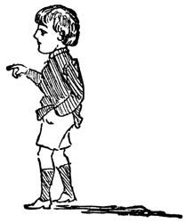

## Introducción

*Al preguntarle un lector si los versos contenidos en este libro eran verdad.*

{width=43%}

¿Que si es cierto? No es verdad.
Y si lo fuera, ¡qué calamidad
para nosotros, en realidad,
que casi todo el día, en efecto,
hacemos algo no muy correcto!
Porque, si así fuera, de cierto
hace tiempo estarías muerto,
ni habría yo llegado a escribir
los nobles versos que ves lucir,
ni B. T. B. llegado a dibujar
lo más lindo que pudiste mirar.

H. B.
