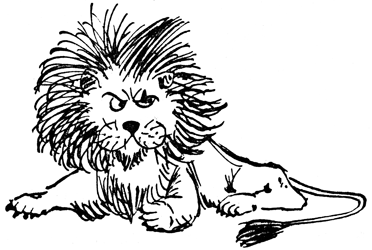
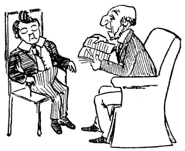
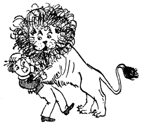
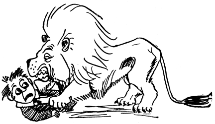
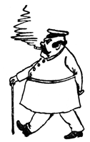
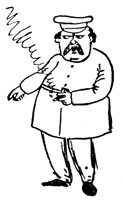
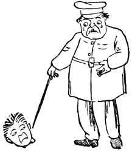
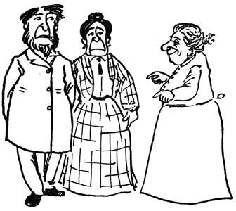

## Jim

*Que se escapó de su niñera y fue devorado por un león.*

{width=74%}

Había un niño llamado Jim;
los suyos lo mimaban sin fin.
Té le daban, tortas, mermelada
y jamón delicioso en tajada,
bombones con relleno rosado,
triciclitos en que andar montado,
y

{width=61%}

cuentos enteros le contaban,
y aun al zoo lo llevaban;
mas allí lo alcanzó el sino atroz
que ahora te cuento a viva voz.

Lo sabes (o lo debes saber,
pues muchas veces te lo hice ver):
que a un niño nunca se le consiente
dejar a su niñera entre la gente.

Pues esa era de Jim la flaqueza:
si podía, se iba con presteza;
y en aquel día de mal agüero
¡soltó la mano y salió ligero!
Ni una vara anduvo cuando...

{width=57%}

¡Zas!
Boca abierta, un león saltó,
y hambriento a devorar empezó
al niño, y por los pies comenzó.

Figúrate qué sensación
si los dedos, y luego el talón,
y, poco a poco, las espinillas,
tobillos, pantorrillas, rodillas,
son comidos, bocado a bocado.

{width=86%}

¡Con razón Jim lo ha detestado!
¡Con razón gritó «¡Eh!» el chiquito!
Oyó el honrado guardián su grito
y, aunque muy gordo,

{width=25%}

casi corrió
y al caballerito socorrió.
«¡Ponto!», ordenó al acercarse
(que así solía el león llamarse),
«¡Ponto!», gritó,

{width=24%}

con fruncido ceño:
«¡Abajo, señor! ¡Suelte al pequeño!».

El león, de golpe, se detuvo,
y el fino bocado no retuvo,
y a su jaula volvió, de mal grado,
gruñendo de rabia, defraudado.
Mas el honrado guardián, sobre Jim
inclinado,

{width=43%}

vio borroso al fin.
Ya a la cabeza el león llegó:
¡y el desdichado niño murió!

{width=67%}

La niñera a los padres fue a contar,
y su inquietud no sé expresar.
Su madre, secándose el llanto,
dijo: «Bueno... no me causa espanto.
¡Nunca hizo lo que se le ordenó!».
Su padre, que nunca se alteró,
pidió a los niños, con voz estable,
mirar de James el fin miserable
y a la niñera nunca soltar,
por miedo a algo peor encontrar.
