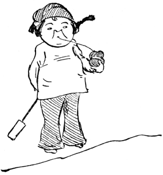
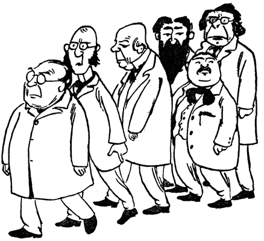
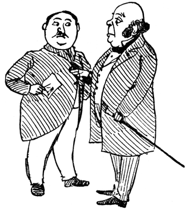
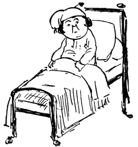

## Henry King

*Que masticaba trozos de cuerda y fue segado antes de tiempo entre terribles agonías.*

De Henry King, el defecto cruel
era

{width=56%}

mascar trozos de cordel.
Al fin tragó un poco, que, al bajar,
por dentro en feos nudos se fue a atar.

{width=88%}

Médicos de lo más afamados
fueron de inmediato llamados;
y, al llegar,

{width=63%}

cobrando la factura,
dijeron: «El mal no tiene cura.
Henry muy pronto morirá».
Sus padres, junto a la cama, ya
lloraban su muerte anticipada,
y Henry, en su última bocanada,
gritó:
«¡Oh, amigos, aprendan de mi pena,

{width=47%}

que desayuno, almuerzo, té y cena
es cuanto el cuerpo humano requiere...».
Y en eso el mísero niño muere.
