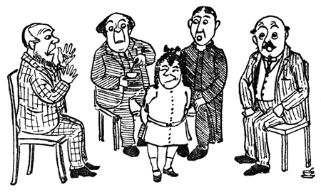
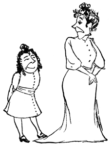
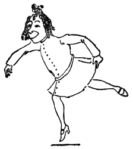
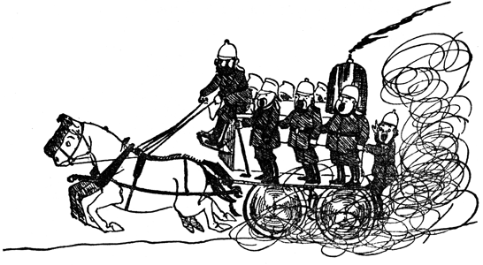
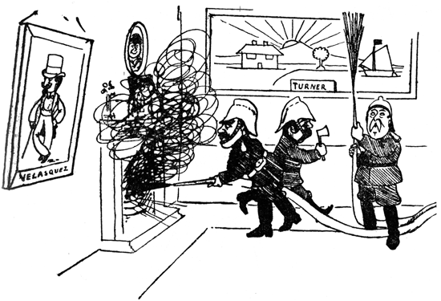
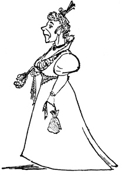
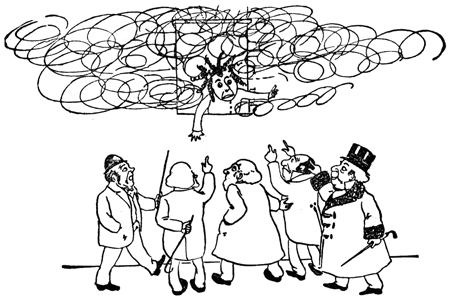
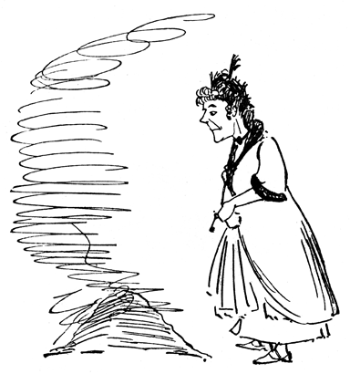

## Matilda

*Que decía mentiras y murió quemada.*

Matilda mentía tan atroz

{width=90%}

que uno abría los ojos, sin voz.
Su tía, desde su tierna edad
estricta siempre con la verdad,

{width=46%}

intentó creerle a Matilda:
el esfuerzo casi la liquida,
y la mataba, de no ser
porque este achaque supo ver.
Pues una vez, al caer el día,
Matilda, a quien el juego aburría,
y, al verse sola, a hurtadillas
fue

{width=45%}

al teléfono en puntillas
y llamó a los nobles bomberos
de Londres, que acudieran ligeros.
En una hora, la gallarda gente
por doquier se volcaba en torrente,
de Putney, Hackney Downs y Bow;
valiente y ardiente, galopó,
rugiendo por la ciudad entera:

{width=100%}

«¡La casa de Matilda: una hoguera!».
Al viva británico y sonoro
de la turba frenética, en coro,
metieron por veinte vidrieras
del salón de baile escaleras,
y, con celo peculiar, empaparon
los cuadros que por la casa hallaron,

{width=100%}

hasta que de Matilda la tía
les mostró que nadie los pedía,
y aun así tuvo que pagar
¡para hacer a los hombres marchar!

***

Sucedió que, a las pocas semanas,
su tía fue al teatro con ganas
a ver la obra interesante, ¡ay!,
*La segunda señora Tanqueray*.

{width=42%}

Negó a su sobrina la función
tan amena: justa privación,
sabia, en castigo a su mentir.
Esa noche, ¡fuego!: ¡había que oír
a Matilda gritar y chillar,
y aullar, y la ventana alzar,
llamando a la gente que pasaba
(el calor, que veloz aumentaba,
la instaba a ganarse su confianza):
¡todo en vano, sin esperanza!
Pues cada vez que «¡Fuego!» gritaba,

{width=91%}

solo «¡Mentirosilla!» escuchaba.
Y así, cuando la tía volvió,
Matilda, y la casa: ¡todo ardió!

{width=77%}
