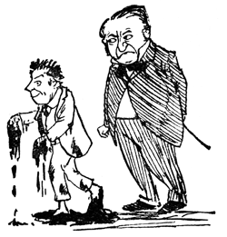
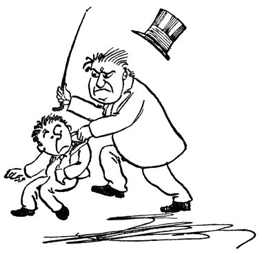
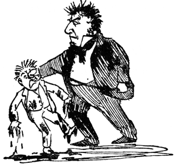
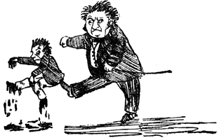

## Franklin Hyde

*Que se revolcaba en la mugre y fue corregido por su tío.*

{width=50%}

A Franklin Hyde su tío ha pillado
de parranda en la porquería;
lo zarandeó de lado a lado
y

{width=76%}

le pegó hasta que dolía.

Gritó, con golpe final, ruidoso:
«¡Toma

{width=60%}

eso, niño perdido!
¡Por jugar con barro asqueroso
como si un juguete hubiera sido!».

### Moraleja

De Franklin Hyde, por su aventura,
tu tiempo libre aprende a pasar
con limpia alegría, y procura
del barro, cieno y lama escapar,
de toda inmundicia, igualmente;
pero, en cambio, cabe notar:
los niños de ropa corriente
siempre pueden con arena jugar.

{width=64%}
