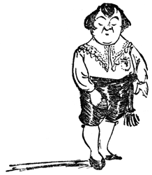
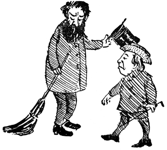
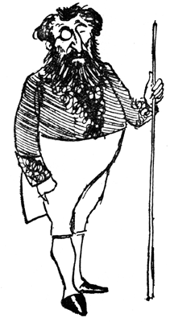
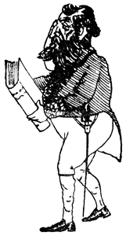
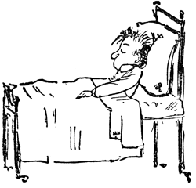
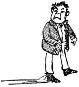
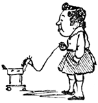
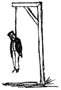
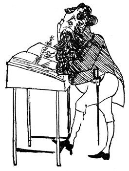
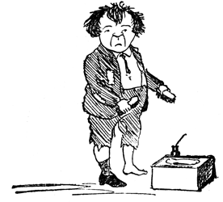

## Godolphin Horne

*Que fue maldecido con el pecado del orgullo y llegó a limpiabotas.*

{width=44%}

Godolphin Horne, noble y ufano,
despreciaba al género humano,
con todas sus hermanas moraba
do su padre, en Berkeley Square, estaba.
¡Y oh, el chico era orgulloso a muerte!
Ni mano ni venia daba al verte:
burlón, solo asentía

{width=66%}

así:
¡cosa más ridícula no vi!
¡Ay, que esos afectados amaños
crezcan en un niño de seis años!
(Esa edad Godolphin tenía.)
La Corte un paje entonces quería,
y así,

{width=42%}

el lord Chambelán Mayor
(el más amable, el hombre mejor)
fue y, con buen talante y conforme,

{width=32%}

tomó un libro de lo más enorme
(*Personas de calidad
que sirvan a Su Majestad*),
y murmuró, revisando la lista
(por no perder a nadie de vista):
«Pues...

{width=50%}

William Coutts con gripe ha caído,

{width=32%}

y Billy Higgs, jamás: excluido,
y Guy

{width=29%}

de Vere, joven demasiado,

{width=20%}

y... ¿no era D'Alton de padre ahorcado?
¡Y en cuanto a Alexander Byng!...
Creo que sé qué hace falta, en fin:
noble, pulcro y devoto del templo...
Vamos... ¿Godolphin Horne, por ejemplo?».
Mas, apenas lo dijo, se oyó
un murmullo que disintió.
Del rey de Islandia el hijo mayor
dijo: «¡Gracias! Yo no, por favor».
La anciana duquesa de Athlone
dijo, con algo agria entonación:
«¡Dudo que él sea lo indicado!».
Y cada obispo lo ha secundado.
Y hasta lady Mary Flood
(tan amable, ¡y oh, cuánta virtud!)
exclamó: «¡No! ¡De ningún modo!
¡Nos haría pequeños del todo!».
«... Bien, bien, bien», dijo el Chambelán,
«¡quién sabe!... Sí, razón tendrán».
Tomó su pluma de oro y diamante
y

{width=53%}

tachó a Godolphin al instante.
Por eso, Godolphin es hoy
el lustrabotas del Savoy.

{width=55%}
