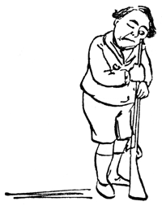
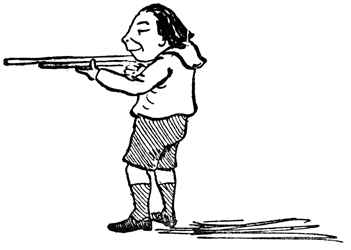
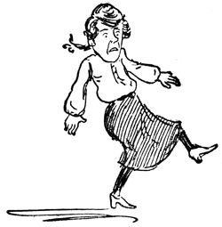
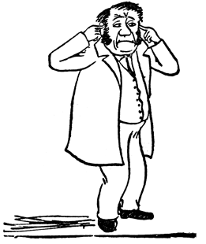
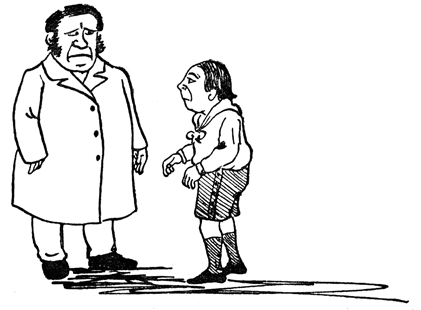

## Algernon

*Que jugó con un arma cargada y, por errar a su hermana, fue reprendido por su padre.*

{width=40%}

El chico del doctor, Algernon,

{width=70%}

jugaba, cargado el mosquetón.
Hacia su hermana lo apuntó
con gran esmero, mas...

{width=50%}

¡falló!

{width=52%}

Su padre, cerca, por azar
la fuerte explosión llegó a escuchar,

{width=84%}

y reprendió a Algernon
por jugar, cargado el mosquetón.
