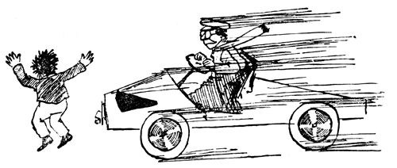
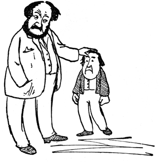
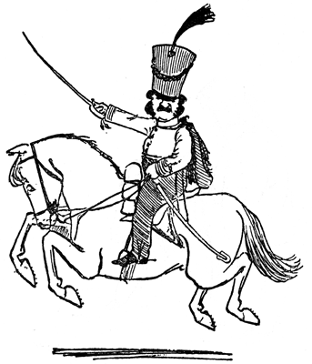
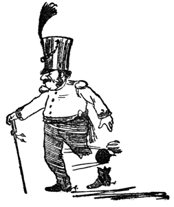
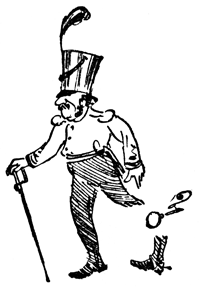
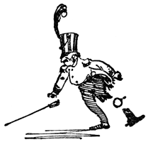
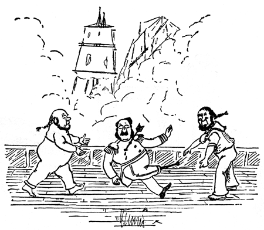
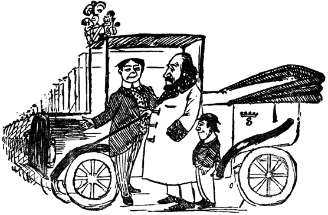

## Hildebrand

*Que se asustó con un automóvil que pasaba y fue llevado a la razón.*

{width=100%}

«¡Que me matan! ¿Qué fue, papá?».
«Hijo, un auto pasó por acá,
¡juguete ingeniosísimo es!

{width=62%}

Creado para cautivar
y encantar, mucho más que alarmar
a cualquier niño inglés.

»¿Qué diría tu bisabuelo, que

{width=69%}

fue edecán del general Brue,
y una pierna perdió en

{width=51%}

Waterloo,
y

{width=40%}

Quatre-Bras,

{width=42%}

Ligny, ¡mira tú!,
¡y además murió en Trafalgar!...

{width=90%}

¿Qué habría dicho al escuchar
al bisnieto de miedo chillar
por estar cerca, por azar,
de un auto que no ha de dañar?
¡Pero no te inquietes! ¡Ven, vamos!
¡Al centro,

{width=100%}

y algunos compramos!».
