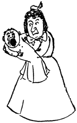
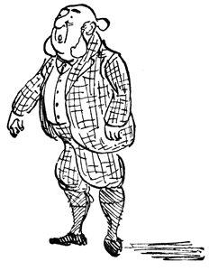
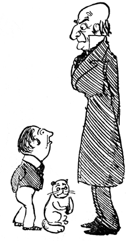
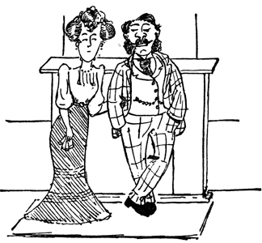
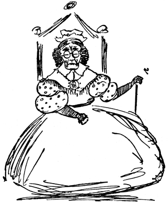
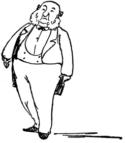
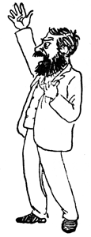
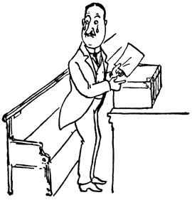
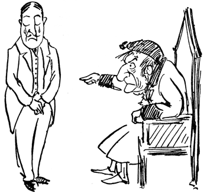
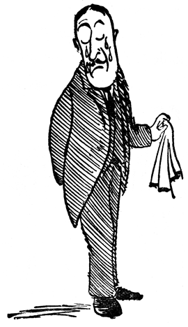

## Lord Lundy

*Que se conmovía hasta las lágrimas con demasiada facilidad y así arruinó su carrera política.*

{width=31%}

Lord Lundy, desde la niñez,
lloraba en exceso cada vez.
Si su madre, por ejemplo, exclama:
«¡Lundy! ¡Es hora de ir a la cama!»,
brama como un turquito. O si

{width=46%}

lord Dunquerque, el padre, dice así,
«¡Eh!», con tono de capataz:
«¡Eh, Lundy! ¡Deja al gato en paz!»,
lord Lundy, al soltar el rabito,
lanza tan terrible grito
que al

{width=43%}

duque, su abuelo, lo mueve
a reprensión severa y breve:
«¡Cuando era yo, señor, pequeñete,
un animal no era un juguete!».

Su tía mayor, que se hizo
esposa de un advenedizo,

{width=65%}

confió a su marido: «¡Maldición!
¡Mocoso miserable y llorón!
¿Por qué no ahogan al renacuajo?».
Sugerencias que, por lo bajo,
no son lo que se espera de quien es
hija de todo un par inglés.
La abuela materna, que tenía
una dignidad u otra, a fe mía
(la Jarretera, o lo que sea;
¡no me acuerdo de todo, ni idea!),
dijo: «¡Oh, quién fuera ágil, para dar
un buen motivo de llorar!».
(¡Vano deseo, ay!, pues ella es

{width=66%}

ciega, y de casi noventa y tres.)

{width=49%}

El mayordomo, querido y viejo,
pensó... ¡pero mejor lo dejo!
No sé ni me importa lo pensado
por el viejo mayordomo amado.
Opino que todo mayordomo
sepa su sitio, sin asomo
de hacer, noche y día, el papel
del viejo servidor, criado fiel.
Me canso, y tú te cansas: vamos,
¡que el poema en dos lo partamos!

### Segundo canto

A lord Lundy entonces le ocurría
lo que a tantos les sucedía:
a los veintiséis, o así, cayó
en política; alguien lo empujó.
Y en tal oficio cobraba
sueldo que su rango demandaba,
y ocupó, por turnos, la cartera
de la India, Colonias y Guerra.
Mas pronto sus amigos dudaban
si era cabalmente el que esperaban.
Y si un diputado se ponía
de pie (como hacen día a día),

{width=23%}

«¡Sobre esa contestación...!»,

{width=54%}

lord Lundy lloraba a borbotón.
Mentarle un chanchullo inofensivo
le daba un sollozo convulsivo.

Las revelaciones (¡pesadillas!)
lo hacían caer de rodillas,
y gimiendo, cual niño llorón:
¡sus colegas perdían la razón!
Fue de un puesto a otro, hacia atrás,
de mil quinientas, todo lo más,
a ochocientas, a seiscientas, y en
seguida, ¡a curador del Big Ben!...
Y, al fin, la amenaza (¡vaya brete!)
de echarlo fuera del Gabinete.

El duque, anciano abuelo, sufría
la deshonra, hasta que no podía.
Sus menguantes fuerzas reunió,
al mozo a Brackley Towers citó
y le habló así, amargado:
«¡Señor! ¡Nos ha decepcionado!
Pensábamos que usted sería
primer ministro, tras tres, un día:
acciones, vendidas; prensa, untada;
la clase media, ya preparada.
¡Así...! ¡Ni hablar puedo! ¡A gobernar

{width=70%}

Nueva Gales del Sur! ¡A volar!».

***

Gimió el viejo patriota y murió:
¡cielos, cómo lord Lundy lloró!

{width=54%}
