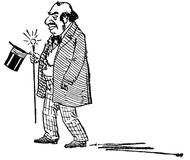
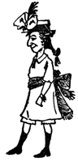
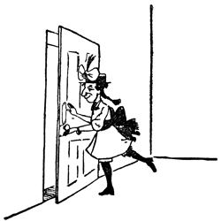
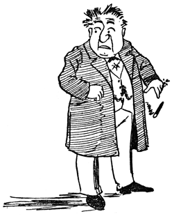
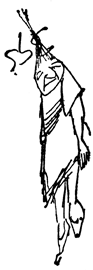
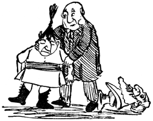
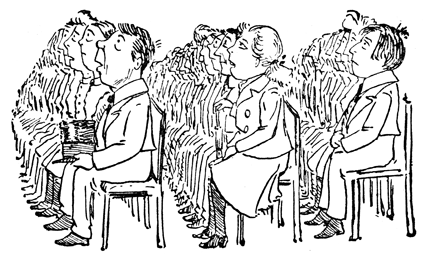

## Rebecca

*Que daba portazos por diversión y murió miserablemente.*

Maña que a todos da rechazo
en las niñas es el portazo.
De un

{width=76%}

rico banquero

{width=20%}

la hijita
(Palace Green, Bayswater, su casita)
Rebecca Offendort se llamaba,
y al deporte furioso se daba.

Iba, con propósito pleno,

{width=50%}

¡y daba un portazo como un trueno!

{width=50%}

por dar al tío Jacob un susto.
No era mala, si he de ser justo,
sino grosera y desbordante:
una niña harto exasperante...

Sucedió que había un busto
de mármol de Abraham, justo
sobre la puerta que, con esmero,
iba a azotar el tierno cordero,
¡y cayó! ¡La dejó aplastada!

{width=20%}

¡Tumbada! Quedó así, retratada.

{width=50%}

***

Su sermón fúnebre (prolongado
y seguido de un canto sagrado)
sus virtudes nombró, es verdad,
mas se extendió en su maldad,
mostró el fin atroz, a grandes trazos,
de quien goza dando portazos.

***

Los niños, traídos a escuchar
el cuento atroz, de todo lugar,
muy impresionados, y sin más,
juraron: ¡portazos, nunca más!
(Tal como a menudo, tiempo atrás.)

{width=85%}
