## George

*Que jugó con un juguete peligroso y sufrió una catástrofe de considerables dimensiones.*

Cuando la abuela de George oyó

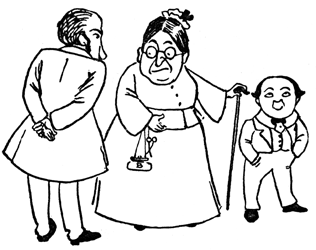{width=63%}

que George como un oro se portó,
le prometió, una tarde, conforme,
que le compraría un GLOBO enorme.
Y

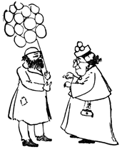{width=34%}

así lo hizo; mas, al llegar,
de una vela en la llama fue a dar,
y, siendo de clase peligrosa,
¡voló

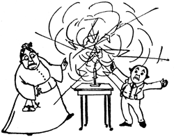{width=50%}

con detonación ruidosa!

¡Luz apagada! ¡Vidrio quebrado!
¡De humo hediondo el cuarto colmado!
Y en lo oscuro, gritos y chillidos
a timbres eléctricos unidos,
y caer de muros, y gemidos,
y crujir, cual de huesos partidos,
y alaridos; y, cosa aún más fiera,
¡comenzó a caer la casa entera!
Se meció, temblando, vaciló,
y en la calle, abajo, se estrelló
(que resultó ser Savile Row).

***

Llegó ayuda; murieron, ¡horror!,

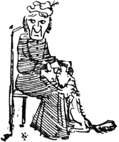{width=33%}

la prima Mary,

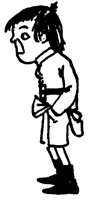{width=20%}

Fred, el menor,

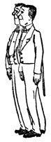{width=20%}

lacayos

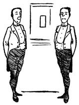{width=32%}

(ambos),

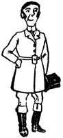{width=20%}

palafrenero,

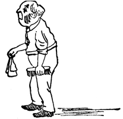{width=41%}

el que limpiaba el billar entero,

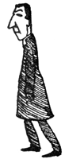{width=20%}

el capellán y

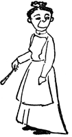{width=21%}

la despensera.
Y temo, de terrible manera,
que el chef, monsieur Champignon,
será

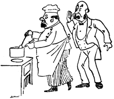{width=46%}

sordo ya, sin remisión,
y sus dos ayudantes,

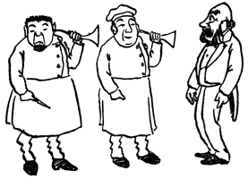{width=55%}

igual;
y George, que tuvo culpa parcial,
recibió, y oírlo te aqueja,
un feo chichón

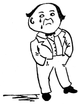{width=32%}

tras la oreja.

### Moraleja

La moraleja es que al pequeñete
no den peligroso juguete.
