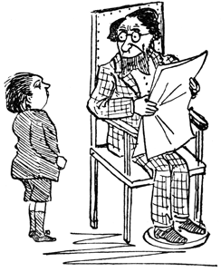
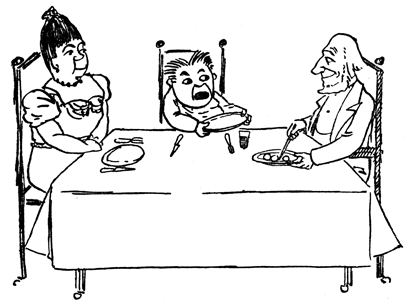
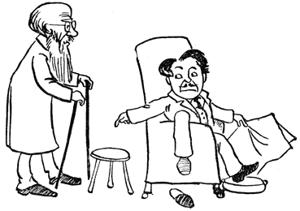
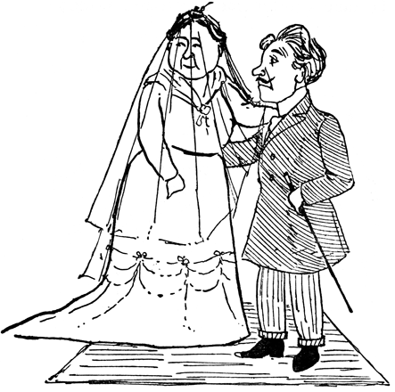
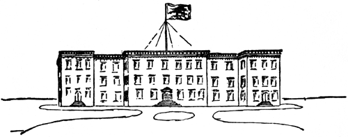
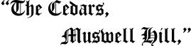

## Charles Augustus Fortescue

*Que siempre hizo lo correcto y así acumuló una inmensa fortuna.*

Charles Augustus Fortescue fue
el niño más bueno que he visto, a fe.
Jamás perdió gorra, ni rompió
medias ni delantal que vistió;
comiendo pan, miga no dejaba;
por las sumas loco se mostraba,

{width=49%}

aunque prefería, al estudiar,
la voz latina analizar;
si le era posible, sin demora
se informaba dos veces por hora.

Y, ¿hallar poco sabrosa
la grasa de cordero? ¡Otra cosa!
En la mesa de su padre, a diario,
rogaba, de modo voluntario,

{width=82%}

le dieran, si no les molestaba,
lo más grasiento que se encontraba.
Su madurez no fue a desmentir
lo que la infancia hizo presentir.

En público, siempre procuraba
un juicio amplio, que todo abarcaba;

{width=74%}

en privado, nadie lo excedía
en fama de quieta cortesía.
Subió enseguida en su carrera,
casó, antes que cuarenta tuviera,
con Fifi,

{width=89%}

única hija del señor
Bunyan, de Aberfylde primer lord.
Así, riquísimo quedó,
y una mansión espléndida alzó
que se llama

{width=100%}

{width=54%}

donde vive aún, con lujos mil,
mostrando qué puede ser cualquiera
con
SOLO HACER LO QUE DEBIERA.
