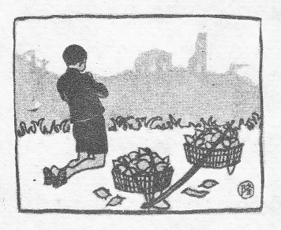
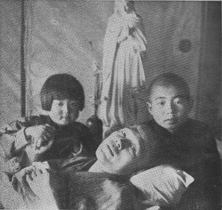
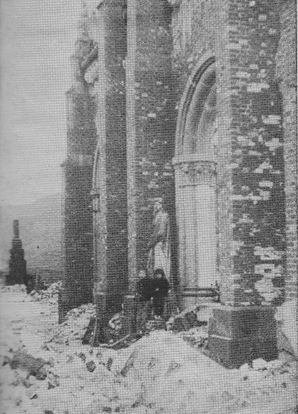
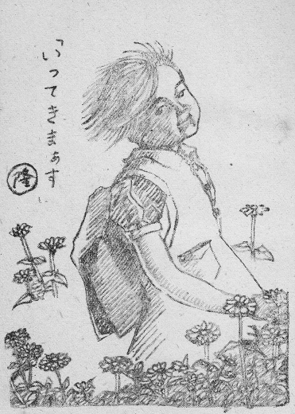

## Dejar a esta niña

{width=60%}

{width=75%}

{width=60%}

Me había quedado dormitando cuando Kayano, que no sé en qué momento había vuelto de jugar, pegó su mejilla fría a la mía y, pasado un rato, dijo: «Ah... el olor de papá...».

¡Dejar a esta niña, y tener que irme muy pronto de este mundo!

Como ha olvidado el olor de su madre, añora al menos el de su padre, y espera a verme dormido para acercarse a escondidas: ¡qué conmovedora es el alma de una criatura! La guerra le arrebató a su madre; a su padre apenas se le salvó la vida, pero ¿sabrá esta niña que pronto tendrá que perderlo también?

Dicen que hasta el árbol seco, mientras no cae, da cobijo en el hueco de su tronco a los pajarillos y los resguarda de la lluvia y del viento. Aunque yo esté postrado en una cama de enfermo cada vez más pesada, sin poder moverme en absoluto, mientras me quede aunque sea el aliento, quizá esta pequeña me tenga por la sombra de un árbol grande donde apoyarse. Pero el día en que mi cuerpo desaparezca por fin de este mundo, esta niña volverá del cementerio, y ¿en qué lugar de esta habitación se sentará, ante quién, qué lamento dirá?

¿Sacará a rastras mi colchón del armario, hundirá la cara en el olor de su padre que todavía quedará en él, apretará las muelas que aún no ha cambiado y, entre sollozos, volverá sin darse cuenta a la casa de sus sueños, donde juega con su padre y su madre? Es como si viera con mis propios ojos aquel día la habitación en silencio, desmesuradamente ancha y vacía, con el sol del atardecer entrando de lleno. Cuando pienso en el día en que yo ya no esté, me dan ganas de no morir todavía. Por lo menos hasta que esta niña pueda abrocharse sola el botón de los tirantes de sus *monpe*, los pantalones de trabajo... aunque solo sea hasta entonces.

No es que no se pudiera prever desde hace tiempo el cruel destino de este padre y esta hija. Cuando terminé la universidad y elegí como especialidad la radiología, y resolví entregarme a las investigaciones con radio y con rayos X, sabía ya muy bien que muchos sabios mayores que yo habían contraído en el cuerpo, por las radiaciones que manejaban a diario en esta investigación, un mal que al final les costó la vida, convertidos en víctimas de la ciencia; por eso tenía el presentimiento de que quizá yo también caería en el mismo destino. Sin embargo, no era un destino inevitable. Gracias al sacrificio de aquellos ilustres predecesores se iban ideando poco a poco métodos eficaces para prevenir los daños de la radiación, y los que trabajábamos en ello también tomábamos las debidas precauciones. Pero como en la Primera Guerra Mundial muchos médicos radiólogos tuvieron que atender a tantos pacientes que, a pesar de las precauciones, recibieron más radiación de la que el cuerpo puede soportar, enfermaron y murieron, pensé que también a mí, por alguna circunstancia, podía ocurrirme algo así. Y es que entonces acababa de comenzar el incidente de Manchuria, y se advertía que Japón iba camino de provocar una gran guerra. Por eso, cuando me casé con la madre de esta niña, le conté con detalle todo esto de antemano, y formamos nuestro hogar con su pleno consentimiento.

En Hamburgo hay un monumento a más de cien sabios de todo el mundo que fueron víctimas de la radiación y murieron en el ejercicio de su oficio como enfermos de la enfermedad atómica; sus nombres están grabados allí como los de los mártires de la ciencia caídos en el camino de la búsqueda de la verdad. Pero yo soy un hombre común, que quiere vivir, y de todos modos prefería vivir a morir. Más que morir joven y sumarme a aquellos sabios, deseaba vivir un día más, terminar una investigación más de las que me gustan y, en lo familiar, ver la cara de mis nietos, quedarme tranquilo sabiendo que quienes me sucedan estarán bien, y tener una gran muerte serena, como un buen abuelo. Además, sabiendo que los sufrimientos de la enfermedad atómica causada por la radiación atómica no son cosa ligera ni mucho menos, sino un dolor como de arrancarse la carne viva, es natural que uno quiera, si es posible, no padecerla. Por eso yo cuidaba con mucho esmero de prevenirla. De natural apocado y miedoso, en mis tiempos de colegial era tan incapaz de hacer ejercicios en la barra fija, por miedo a caerme, que huelga decir que le tenía miedo a la enfermedad atómica.

Hoy día los equipos de rayos X han mejorado, y el tubo emisor está bien envuelto en metal, de modo que solo sale por una ventanita el haz necesario de rayos X, y por eso no son muy peligrosos; pero antes nosotros usábamos tubos desnudos, que irradiaban rayos X terribles en todas direcciones. Cuando esta radiación choca con un objeto, produce a su vez radiación secundaria dispersa. Y cuando esa radiación dispersa vuelve a chocar con un objeto, de allí sale todavía más radiación. De este modo, en la sala de radiación, además de la radiación principal que sale del foco del tubo, innumerables rayos secundarios dispersos cruzan por delante, por detrás y por los lados, como en un fuego cruzado.

El poder de esta radiación para destruir las células es notable: en una dosis determinada cura enfermedades como el cáncer, pero si se pasa de la dosis convierte en enfermas las partes sanas. Para prevenir la enfermedad atómica que así se origina, medimos siempre con exactitud la cantidad de radiación y cuidamos de no excederla jamás. Por eso hoy, mientras la maneje un especialista, la radiación no causa daño a los pacientes.

La radiación es detenida por metales pesados como el plomo, y por eso para la protección se emplea mucho el plomo. Al irradiar el cuerpo del paciente, se cubren con planchas de plomo o de goma plomada las partes que no hace falta irradiar. Las paredes, el suelo y el techo de la sala de radiación se revisten con planchas de plomo para que no se escape nada al exterior. Delante del cuadro de distribución se coloca un biombo de vidrio plomado que protege al técnico. El médico que atiende al paciente a su lado se protege de forma aparatosa con delantal, guantes y botas de goma plomada y con gafas de vidrio plomado. Pero con semejante coraza de plomo puesta pesa tanto que no se puede mover uno, de manera que no es una defensa perfecta, y la espalda, la parte alta del brazo y los muslos suelen quedar al descubierto. La radiación principal que sale del tubo queda así bien detenida, pero no se puede impedir la radiación secundaria dispersa que llega por detrás o de lado. La cantidad de esta radiación secundaria es notablemente menor que la de la principal, pero con el tiempo llega a ser considerable. Aunque la radiación que se recibe en una jornada de trabajo sea poca, trabajando día tras día de forma continua, a los cinco, a los diez años, los tejidos del cuerpo van quedando destruidos sin que uno se dé cuenta, y así se produce la enfermedad atómica como enfermedad profesional. Son el cáncer de piel, la anemia perniciosa, la leucemia crónica, la esclerosis pulmonar, la esterilidad y otras.

Entonces, ¿quien trabaja largos años en una sala de radiación enferma sin remedio de la enfermedad atómica? No es así: si solo se recibe una radiación inferior a cierta cantidad, por mucho tiempo que se trabaje no hay peligro. Esa cantidad es, para un uso continuado diario, 0,2 roentgen por día. El roentgen es la unidad con que se mide la cantidad de rayos X. En los países de Europa y América, por razones humanitarias, esta norma se respeta bien: el personal de las salas de radiación trabaja como máximo siete horas al día y cinco días por semana, está obligado por ley a pasar al año más de un mes de descanso en otro clima, y recibe además ventajas como un subsidio especial de peligrosidad y una pensión. En Japón también se ha incorporado a la Ley de Normas Laborales, pero hasta que se cumpla en la práctica me parece que falta todavía mucho.

Pero en mi caso, después de todo, la guerra me impuso a mí, igual que a todos los ciudadanos, toda clase de sacrificios desmedidos. No eran exigencias que se pudieran eludir, y eran además un deber que, como ciudadano, debía cumplir de buen grado. Yo, plenamente consciente de lo desmedido de aquello, daba hasta la última gota de mi alma y de mi cuerpo y despachaba como podía el sobrecargo de cada día. Los jóvenes ayudantes de la cátedra se iban uno tras otro al frente y no volvían, el personal de la cátedra quedó escaso y yo tuve que asumir las tareas de varias personas. Las clases en la universidad, las clases en la sección temporal de estudios médicos, las investigaciones de la llamada movilización científica, los exámenes colectivos en fábricas, escuelas y gremios para prevenir la tuberculosis, el diagnóstico con rayos X, el tratamiento, el tratamiento con radio: cualquiera de ellas habría bastado para llenar los esfuerzos de un médico y de un profesor, y me mandaban cumplirlas todas yo solo; ¡qué tremendo! El espíritu se lanzaba, pero la carne era débil,[^ed1] y no había manera de hacerlo todo bien. En aquel tiempo las enfermeras de la cátedra compusieron una copla de cuenta y me la hicieron oír. Estaba en ella lo siguiente: «Tres: de tanto mirarlo qué buen mozo, el jefe, con su cara de dormido». Retrata muy bien al que yo era, demacrado por la falta de sueño y el exceso de trabajo. Y también: «Seis: le toca dar clases a la fuerza; con eso, pobres estudiantes». Es una crítica certera a mi persona, que no podía dar una clase serena y completa. Y luego: «Diez: a las diez por fin reventó, el viejo asmático, preparándose para el invierno». Y es cierto que reventé: agoté las fuerzas de mi cuerpo y me desplomé muchas veces. Esa copla la cantaban todas juntas al terminar el trabajo, limpiando los aparatos. «Cinco: en el cuarto oscuro, siempre en tinieblas, se oye la voz de aquella chica tan linda», o «Ocho: con su delantal tan poco elegante, bien atado, la señorita de la radiografía indirecta»; así cantaban, tal cual, la vida de nuestra cátedra.

Mientras yo cargaba con las tareas de varias personas, la multitud de pacientes que se abalanzaba sobre nosotros crecía cada vez más. Aquel grupo de gente llamado obreros movilizados, personas de cuerpo endeble que habían pasado media vida en el comercio o en oficinas, y que de pronto eran sacadas a las fábricas para hacer trabajos pesados, enfermaban una tras otra por el exceso de trabajo y el descenso del nivel de vida; además, entre los ciudadanos comunes eran cada vez más los atacados del pecho por el cansancio y las penurias; y como el excelente poder de la radiación se había convertido en un conocimiento común, también aumentaba por sí misma la gente que acudía a ella. Por estas y otras circunstancias, los pacientes que llegaban a mi cátedra eran innumerables, y cuando yo entraba a trabajar, desde bien temprano la sala de espera y el mostrador de recepción estaban en una aglomeración que cortaba el aliento. Al verlo, me venían a un tiempo las ganas de huir y las de decir: «¡Vamos a ello!». Atendía a aquellos pacientes hasta dejarlos lo mejor posible, y al terminar, ¡ah, por la tarde llegaban en tropel los grupos de cientos de personas de las radiografías indirectas colectivas! Cuando acababa eso ya había oscurecido, y la enfermera jefe me ofrecía una taza de té con la que me reanimaba por completo y entraba en silencio en mi laboratorio. ¡Cuántas veces, ya de madrugada, de camino a casa, se me paralizaron las piernas y me senté de golpe en el camino! A veces, apoyado en el hombro de mi esposa, que preocupada venía a buscarme, llegaba por fin a la puerta de casa. Tenía preparado el sake caliente con huevo... Yo era feliz.

Con ese ritmo de vida, las horas que de verdad trabajaba en la sala de radiación llegaban a diez diarias. Mi cuerpo recibía radiaciones que superaban de largo las 0,2 unidades roentgen por día. Si seguía así durante unos años, la aparición de la terrible enfermedad atómica era tan segura como la predicción de un eclipse de sol. Y aun sabiéndolo, seguí trabajando como siempre. En parte, porque el Estado exigía que trabajara y no había otro especialista que pudiera ocupar mi puesto; pero yo tenía el instinto de que, por agotado y deshecho que estuviera, no podía dejar de atender a un paciente en cuanto veía su cara. O mejor dicho, simplemente es que me gustaba muchísimo, hasta no poder más, la investigación de la radiación.

La enfermedad atómica que se esperaba y contra la cual había puesto tanto cuidado se manifestó por fin en mi cuerpo en forma de leucemia mieloide crónica y anemia perniciosa. Fue trece años cumplidos después de comenzar mi investigación, y cinco años cumplidos después del trabajo desmedido de los tiempos de guerra. El diagnóstico quedó confirmado, y el pronóstico fue que viviría todavía unos tres años. No había nada que hacer.

Esa misma noche se lo conté todo a mi esposa, en quien confío. Ella escuchó en silencio, contuvo el pecho agitado y dijo: «Vivamos o muramos, que sea para la gloria de Dios, ¿verdad?».[^ed2]

Cuando hablamos del porvenir de nuestros dos hijos pequeños, dijo: «Como es el trabajo por el que usted arriesgó la vida investigando, seguro que los niños también heredarán su ideal».

Esas palabras me devolvieron por completo la calma. Con esto ya no me quedaba nada pendiente en el corazón: podría seguir tranquilo en el laboratorio hasta caer.

Desde el día siguiente trabajé en la cátedra con nuevos ánimos renovados. Me entregué a mi tarea como si fuera otro hombre. ¿Sería esto lo que se llama jugárselo todo? La guerra se agravaba cada vez más, y con los bombardeos que se sucedían el hospital universitario se llenó de pacientes. Mi cátedra parecía un hospital de campaña. Al atardecer se me iban las fuerzas de las piernas y los músculos se me agarrotaban, y para subir las escaleras tenían que empujarme las enfermeras. El único que se reía al ver aquello era yo mismo. Los estudiantes corrían hacia mí y me llevaban los libros de consulta que yo tenía en la mano. Cuidado por todos, yo andaba de un lado a otro, feliz y atareado.

Y entonces, de repente, cayó la bomba atómica. En la sala del radio vi el destello. En ese instante no solo fue arrasado mi presente: también mi pasado quedó destruido y mi futuro, deshecho. Ante mis ojos, mi querida universidad se convirtió, junto con mis queridos estudiantes, en una sola masa de llamas. Mi esposa, a quien yo había confiado a los hijos para después de mi muerte, tuvo que ser recogida en un cubo, convertida en huesos livianos, de entre las ruinas quemadas de nuestra casa. Había muerto en la cocina. Yo mismo, a la enfermedad atómica crónica sumé ahora la enfermedad atómica aguda causada por la bomba, y con las heridas del lado derecho del cuerpo quedé inmovilizado antes de lo previsto. Pero, por fortuna, mis dos hijos, a quienes por casualidad tres días antes había mandado a casa de la abuela en la montaña, se salvaron sin un rasguño.

Los muchos datos de investigación acumulados durante más de diez años, las numerosas radiografías de experimentos, los cuadernos, los gráficos y tablas que pensaba reunir y publicar en forma de tesis cuando terminara la guerra, estuvieron brotando un rato en llamas rojo oscuras por las ventanas del laboratorio, y a la mañana siguiente, cuando los vi, ya eran simple ceniza. No es de extrañar que me invadiera una desesperación como si me hubieran arrojado al infierno. Pero esa desesperación no duró ni medio día. Porque de inmediato concebí una esperanza enteramente nueva. Esa nueva esperanza era... una enfermedad completamente nueva que se presentaba ante mis ojos, una enfermedad que no había existido en ninguna parte, una enfermedad que los sabios de todos los tiempos y lugares jamás habían visto, una enfermedad para cuya observación fuimos elegidos como los mejores observadores de la historia de la medicina: ¡la enfermedad de la bomba atómica! ¡Voy a investigar esta enfermedad nueva! En cuanto tomé esa decisión, mi corazón, hasta entonces oscuro y aplastado, se llenó de esperanza luminosa y de valor. Mi alma de hombre de ciencia se encendió. Mi cuerpo ensangrentado y envuelto en vendas recobró el vigor. Me levanté, literalmente, de la piedra calcinada sobre la que estaba sentado.

Los pacientes innumerables de la enfermedad de la bomba atómica, los síntomas más variados, las muertes que se sucedían, y la angustia de pensar y pensar cómo salvar a esa gente a toda costa. Nunca como entonces sentí tan hondo lo que significa ser médico. Con un bastón por apoyo y el cuerpo herido, torpe, crucé montes, anduve por campos, pasé ríos visitando a los pacientes durante aquellos dos meses. Pero también eso tuve que interrumpirlo, porque yo mismo caí en estado crítico por la enfermedad de la bomba atómica.

Lo que llegó hasta mi cama de convaleciente fueron los murmullos llenos de inquietud de la gente: ¿se podrá o no se podrá vivir en el páramo atómico? Sin saber de dónde, corría el rumor de que durante setenta y cinco años no solo no podría vivir nadie, sino que ni siquiera crecerían plantas. Yo seguía pensando, acostado. No lograba creer de ningún modo que las partículas radiactivas caídas de la bomba, y la radiactividad adquirida por los átomos del suelo, durasen tanto tiempo. Esa radiactividad debía de disminuir rápidamente. Aunque en teoría se pudiera pensar así, al ser el primer caso no se podía asegurar nada sin comprobarlo en la práctica. Quería hacer cuanto antes mediciones experimentales, y me desesperaba por hacerlas, pero, para mi desgracia, los aparatos habían desaparecido sin que quedara uno solo. Aunque no hubiera aparatos, había que investigarlo. Recogí vidrios que estaban por el suelo en el centro de la explosión y los examiné. El vidrio cambia de color cuando recibe radiación durante largo tiempo. Encontré varias botellas de leche que se habían vuelto de un color violeta pálido. El cambio era tanto más notable cuanto más cerca del centro de la explosión. Así pude deducir que en el centro de la explosión había habido una radiactividad residual bastante fuerte. Además, me fijé en los pequeños animales que viven bajo tierra, como las lombrices y las hormigas. Si en el suelo hubiera una gran cantidad de radiactividad, esos animalitos habrían muerto y no aparecerían. Sin embargo, siete semanas después encontré en el centro de la explosión muchas hileras de hormigas. Tres meses después encontré también muchas lombrices. Con estos animalitos vivos, razoné que difícilmente habría radiactividad como para amenazar la vida de los seres humanos, que son más grandes. En el páramo atómico los soldados desmovilizados habían despejado un poco los restos del incendio, levantado chozas y comenzado a vivir en ellas. Visité esas chozas y examiné el estado de salud de la gente. Durante unas dos semanas después de la explosión sí había peligro, pero después no parecía haber efectos demasiado graves. Así hice lo que pude. Sin embargo, lo que más agradecí, por encima de todo, fue que vinieran a investigar, con sus aparatos, sabios de otras universidades de mi mismo campo. Gracias al doctor Ishikawa y al profesor Shinohara se obtuvieron resultados exactos. Mis dos hijos pequeños también aguantaron el dolor de las repetidas extracciones de sangre y otras pruebas, y aportaron un valioso material. Así se llegó pronto a la conclusión de que no había inconveniente en vivir en el páramo atómico, y pudimos exhortar a los ciudadanos que se habían refugiado en las aldeas de las afueras a volver cuanto antes a las ruinas y emprender la reconstrucción.

Así quedaron resueltas las dos tareas más urgentes. La fiebre continuaba, y muchos días pasaba de los treinta y ocho grados, pero al menos podía caminar apoyado en un bastón. En aquellos días, para hacer duelo por mis alumnos y por mi esposa, que habían perecido en el fuego de la guerra y habían pasado a engrosar el número de los muertos, guardé medio año de luto sin cortarme el pelo ni afeitarme la barba ni bañarme, de modo que muchos conocidos me tenían por un hombre raro. Mi choza me la habían construido en las ruinas donde recogí los huesos de mi esposa. Desde allí se veían de cerca las ruinas de la universidad. Mañana y tarde me volvía hacia allá y elevaba mi oración. Solo se veía de tarde en tarde a algún anciano que andaba buscando huesos.

Las aulas provisionales de la universidad se abrieron en la ciudad de Omura. Ir a trabajar, dos horas en tren, era penoso. Durante la clase me salía el sudor frío, me faltaba el aliento y no podía levantar la voz con energía, y no hacía más que molestar a los estudiantes. En una sola clase tenía que sentarme cuatro o cinco veces para recobrar el aliento. Era una clase silenciosa. Los pocos estudiantes supervivientes mostraban todavía en alguna parte de su cuerpo heridas recientes. También la mitad derecha de mi cara, mientras hablaba, estaba llena de cicatrices. Pero era una enseñanza que de verdad llegaba al corazón. Después de que muchos colegas murieran en la tribuna y muchos estudiantes expiraran tomando apuntes, solo nosotros seguíamos así el camino de la búsqueda de la verdad... Al pensarlo, nos sentíamos unos a otros portadores de una misión que no se podía tomar a la ligera.

Al volver a la sala de médicos terminada la clase, toda la fuerza que había mantenido tensa en el cuerpo se me iba de golpe, y me desplomaba, estirado sobre el taburete, como una marioneta del teatro de títeres jōruri tirada entre bastidores.

Y así, mientras asistía a las clases y a las reuniones de profesores, las fuerzas del cuerpo fueron menguando poco a poco, y a fines de julio caí desplomado en la estación de Nagasaki. Al atardecer llegué a duras penas a la choza, y desde entonces no pude salir de la cama. Desde ese día hasta hoy, la enfermedad ha ido avanzando sin pausa. Hoy hasta para que me alcancen un papel de manuscrito tengo que pedírselo a alguien cada vez. No ya atender a un paciente: no tengo fuerzas ni para mirar por el microscopio. Pero, por fortuna, la enfermedad atómica que yo quería investigar está en mi propio cuerpo. Puedo observar y reflexionar con calma sobre su evolución día a día, la relación entre lo que siento y las lesiones, la valoración del efecto de los tratamientos, y eso me resulta muy conveniente. Bajo la dirección del profesor Kageura, de medicina interna, me atiende el doctor Tomonaga; yo, como paciente, y yo, como médico, discutimos con mi médico tratante en grandes controversias, lo cual es verdaderamente divertido. Cuando se suma además el profesor adjunto Wakahara, de anatomía patológica, la discusión se vuelve aún más seria. Mi muestra de sangre contiene toda clase de glóbulos, normales y patológicos, de modo que para estos estudiantes que últimamente no tienen libro de texto es un material de enseñanza magnífico. El doctor Tomonaga, cuando me extrae sangre, prepara de más muchas muestras y se las regala a sus queridos estudiantes. Para mí, que estoy en cama y no puedo dar clases, eso será al menos mi manera de pedirles perdón.

Mi piel tiene la palidez propia de la leucemia, y con solo verla da grima. Las piernas y los brazos se han adelgazado hasta lo máximo, hasta un punto en que no se puede adelgazar más, porque estorbaría el hueso, así que ya no hay riesgo de seguir enflaqueciendo. De joven, cuando jugaba al baloncesto, tenía una complexión excelente, de un metro setenta y uno de estatura y setenta y un kilos de peso, y los amigos que me ven después de mucho tiempo se quedan con los ojos húmedos nada más verme.

Estoy flaco por todo el cuerpo, y solo el vientre se ha hinchado hasta un punto en que la piel no da más de sí. Ni más ni menos que una rana verde con el vientre hinchado. El contorno del vientre, a la altura del ombligo, mide noventa y un centímetros, igual que el vientre de una mujer en el décimo mes de embarazo. Es porque el bazo se ha agrandado desmesuradamente. El bazo, de por sí, es algo más pequeño que la palma de la mano; pero el mío ocupa toda la mitad izquierda de mi vientre y todavía le sobra, pasa por encima del ombligo y se extiende bastante hacia el lado derecho. A este bazo tenso hasta más no poder, si desde fuera le da algún golpecito, se rompe de inmediato, produce una hemorragia interna y tengo que morir. Es como llevar dinamita en el vientre: no se puede bajar la guardia.

Los niños son de los que quieren abrazarse a sus padres. Al volver de la escuela, querrían gritar «¡Ya llegué!» y lanzarse sobre mí. Pero si se lanzaran sobre mí, el bazo reventaría al instante, seguro. Por eso el doctor Tomonaga, mi médico tratante, les ha ordenado a los niños: «¡No se acerquen a su papá!». Los niños obedecen bien esa orden: reprimiendo las ganas de acercarse, de retozar, de colgarse de mí, de mimarse, hablan conmigo siempre un poco lejos. Yo también quisiera, como cualquier padre del mundo, tomar en brazos a esta niña, voltearla y sujetarla, hacerle cosquillas, jugar hasta que chille de risa. Pero un niño que hace eso se va acostumbrando y podría ocurrir que, cuando yo me descuide y esté dormido, de pronto se me eche encima con un golpe, o que, jugando junto a mi cama, caiga sobre mí. Para evitarlo, endurezco a propósito mi corazón, amontono libros alrededor de mi cama y alineo frascos de medicina: he levantado una barricada que separa el afecto.

{width=60%}

Que Kayano, al volver de jugar, se asegurara de que yo dormía, se acercara a escondidas y buscara el olor de su padre, se debía a esta razón.

Yo también... saboreé después de mucho tiempo el olor de mi hijo. Con la palabra leucemia uno se imagina que corre por las venas una sangre blanca y fría, pero por mis vasos sanguíneos empezó a correr, después de mucho tiempo, algo caliente. Sentí ganas de estrechar con fuerza a esta niña. Como juegan la perra y su cachorro, sin reparar en nada, mordiéndonos, lamiéndonos, golpeándonos, sacudiéndonos, quisiera chocar con ella cuerpo contra cuerpo hasta no poder más, olvidando el paso del tiempo. Entonces a esta niña se le cortaría el aliento de alegría y se retorcería con la risa tras la risa. Si el bazo se ha de romper, ¡que se rompa! Si esta niña pudiera, aunque fuera por un instante, recibir de mí el amor de su padre y alegrarse... Pero eso no me está permitido. Tengo que vivir un mes más, un día más, una hora más, y retrasar el momento en que esta niña quede huérfana. Tengo que conseguir que me concedan un minuto, un segundo más de vida, y acortar así el tiempo en que esta niña se sienta sola.

Reprimo el afecto que de vez en cuando brota con fuerza en mi pecho, como el humo del Sakurajima, y a propósito aparto con frialdad a los niños. Es el afecto de la sangre, que cuanto más lo reprimo más hierve y más sube, parecido al vapor de la tetera del brasero junto a mi almohada. Si al menos estuviera la otra mitad de los padres, la madre, esta niña renunciaría a su padre y se aferraría a ella; pero esa madre ha muerto, no queda ningún recuerdo con el olor de la madre, y hasta las fotografías con que evocar su rostro se quemaron y no hay ni una.

Como yo seguía haciéndome el dormido, Kayano se tranquilizó y siguió con la mejilla pegada. La mejilla se fue calentando poco a poco.

Como quien disfruta a escondidas de un pequeño tesoro que no quiere que nadie sepa, Kayano dijo en voz baja: «Papá».

No me estaba llamando a mí; era un sentimiento que llevaba oprimido en su pequeño pecho y que se le escapó, apenas audible.

[^ed1]: Cf. Mt 26, 41.
[^ed2]: Cf. Rm 14, 8.
