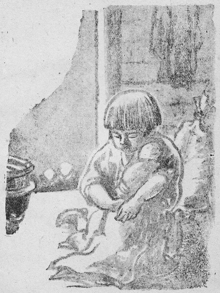

## Providencia

«El Señor me lo dio, el Señor me lo quitó. ¡Bendito sea el nombre del Señor!»[^ed1]

Desde el origen yo fui creado de la nada por el amor de Dios. El momento en que fui concebido en el seno de mi madre fue mi creación. Desde entonces hasta hoy, todo lo que he recibido me lo ha dado Dios. La salud, el talento, la posición, los bienes, la familia: nada de eso era originalmente mío. Por eso, si Dios me lo quita en cualquier momento y lugar, yo ni pierdo ni gano nada. No hay por qué lamentarse ni afligirse. Lo natural es abandonarse a la providencia. Y la providencia merece siempre gratitud y alabanza. Porque Dios creó a un hombre al que amaba, y ese hombre era yo. Dios me creó porque quería amarme; no hay en Dios una sola creación hecha con mala intención. Dios me ama siempre y desea sin cesar mi felicidad. Así como lo que me dio fue por designio de amor, también lo que me quita es por designio de amor. Todo lo que sucede a mi alrededor es manifestación de la providencia del amor de Dios. Por eso, cualquiera que sea la suerte que me toque, no puedo sino alabar el nombre de Dios.

Cuando estalló la bomba atómica, de los diez mil fieles católicos de este Urakami murieron ocho mil. Aquí había dos colegios femeninos, Junshin y Josei. Ambos eran dirigidos por congregaciones de religiosas, y desde la directora hacia abajo casi todo el profesorado eran monjas. Las alumnas de Junshin estaban movilizadas en una fábrica, pero entre las llamas cantaban himnos y fueron expirando una tras otra y convirtiéndose en ceniza. Era exactamente como el holocausto de antaño, en que se ofrecían y quemaban sobre el altar de Dios corderillos sin mancha para complacerlo.[^ed2] ¡Ah, el gran holocausto que ardió en el suelo sagrado de Urakami, en Nagasaki, el último día de la Segunda Guerra Mundial!

> Cantando en medio de las llamas del holocausto,
> ¡ay, las muchachas, blancos lirios, ardieron!

En el colegio Josei el final fue el mismo. Allí fueron llamadas al cielo veintisiete monjas profesoras. Aquella noche yo envié a los de mi cátedra, Ozasa y los demás, a asistir a los heridos, y según me contaron, a medianoche, a la orilla de un río a doscientos metros al este del colegio, se oía a ratos, y a ratos se interrumpía, un himno en latín cantado por varias voces a coro. Cuando amaneció, las monjas estaban todas juntas, ya frías... ¿Habrían sido estas monjas las que cantaron el himno de la noche anterior? ¿O no habrían sido más bien las huestes de ángeles que bajaron a recibir sus almas? ... Allí yacían, alineados, unos rostros muertos de una pureza que no permitía pensar otra cosa.

Los supervivientes que vimos aquello pensamos que la bomba atómica no era en modo alguno un castigo del cielo, sino sin duda una manifestación de la providencia, que encerraba algún designio profundo.[^ed3]

Yo, el mismo día, convertido en un hombre débil y sin nada, me vi de pie entre las ruinas con dos hijos pequeños a cuestas, y no dudé de que aquello, fuera lo que fuese, era manifestación de la providencia del amor.

Han pasado tres años desde entonces hasta hoy, y se va demostrando poco a poco que mi fe de aquel día era acertada.

La bomba atómica quitó de en medio los obstáculos que bloqueaban mi camino recto, y me permitió gustar la verdadera felicidad.

También la «muerte» que pronto vendrá a visitarme será, sin duda, el mayor regalo de amor que me hace Dios, que es el amor sin límites. Por eso las angustias del corazón y los sufrimientos del cuerpo por los que tengo que pasar antes de la muerte los pienso recibir con gozo, como algo necesario para que se manifieste la gloria de Dios. La muerte es que el alma abandona el cuerpo. Es como la cigarra que deja su muda en el suelo y levanta el vuelo hacia el cielo luminoso. La larva que vive bajo tierra no conoce la tierra inundada de luz, y quizá se entristezca, se lamente o se asuste al ver la muda, pero la cigarra que ha volado al cielo canta con voz clara...

## Herencia

Cuando murió mi esposa, muchos amigos, al verme seguir con una vida llena de incomodidades en todo, no podían soportarlo y me aconsejaban que tomara una segunda esposa, y además me propusieron en concreto algunos casamientos. En aquel tiempo yo, aunque enfermo, todavía podía dar clases y atender pacientes, y por eso aún reunía las condiciones para que me aconsejaran volver a casarme. Y la verdad es que, habiendo perdido a mi esposa de repente, con dos hijos pequeños a cuestas, y en medio del terrible ambiente de la posguerra, con un cargo público y mucha ocupación, salir adelante era extraordinariamente difícil. Desde el punto de vista de la vida diaria, de verdad hacía falta una segunda esposa. En las chozas de todo el barrio de Urakami había viudas y huérfanos en cada una. Ellos, bendecidos por Dios, trabaron cada uno un buen enlace y formaron un nuevo hogar. En cuanto se vuelven a casar, de inmediato les cambia el semblante y se les ilumina, hombres y mujeres encuentran cada uno su lugar, la vida cobra firmeza y aumentan notablemente las fuerzas para reconstruir. Desde fuera, se veía bien.

A veces pensaba, no digo que no: si hubiera una buena persona, podría venir a vivir con nosotros. En la vida diaria, más que estar en apuros o incómodo, con frecuencia me quedaba completamente desorientado. Cada vez que corría la voz de que ya venía el racionamiento, o la declaración que había que presentar, o el trabajo comunitario, tenía que pedirles a las señoras del vecindario que lo hicieran por mí, y sentía vergüenza. Al ver cuán aseados iban los hijos de los vecinos que se habían vuelto a casar, y la mugre del único vestido de verano, siempre el mismo, de mis hijos, a veces me quedaba pensando con seriedad si no sería bueno recibir a una nueva madre que se ocupara de ellos. Cuando llegaba el racionamiento de sardinas, la sopa era siempre de hojas de verdura arrancadas por ahí; y yo solo podía pensar cuánto se alegrarían si se las preparara en ensalada con miso, o en vinagre, o en tempura. Con un poco de trabajo también al boniato se le puede dar forma envuelto en un paño, y sería una buena merienda; y tampoco pasaba de pensarlo. Al ver a Kayano jugando sola, con una botella de sake recogida entre los escombros, envuelta en un trapo, que llamaba Sasano, Sasano, y la abrazaba y la cargaba a la espalda, pensaba que si en esta choza hubiera manos de mujer le harían una muñeca que fuera de verdad una muñeca... Si su hermana Sasano estuviera viva, Kayano no estaría tan triste; y hasta yo, al recordar días pasados, no hacía más que morderme los labios. Al llegar la tarde, en las chozas, aquí y allá, se encendían fogatas, se mezclaban las voces alegres de las mujeres, las voces de los niños se animaban y se oían charlas y risas bulliciosas. Allí había un aire de valle de lágrimas a punto de convertirse en colina de esperanza.[^ed4] Solo mi choza apagaba el fuego en cuanto se terminaba la cena, y los dos pequeños, pegados a ambos lados de este enfermo, cerraban los ojos con frío, deseando que amaneciera pronto. Aunque no lo dijeran, seguro que pensaban sin cesar: si estuviera mamá...

{width=60%}

Pero cuando me llegaba una propuesta de matrimonio de verdad, enseguida me daban náuseas y no podía ponerme a escucharla. Era como cuando uno, con fiebre, desea fruta, pero en cuanto se la ponen delante pierde todo apetito y la rechaza sin querer verla.

Volver a casarse es cosa buena; si se puede evitar, es todavía mejor no hacerlo, pero si por no casarse de nuevo se van a producir inconvenientes, que se case: esto lo enseñó también Pablo.[^ed5] En este mundo, quienes fueron esposos no vuelven a serlo en el otro. El vínculo conyugal se corta con la muerte de uno de los dos. Los saduceos preguntaron a Jesús: una mujer a quien se le fueron muriendo los maridos uno tras otro, hasta enterrar a siete hombres, y que murió después ella misma, cuando resucite, ¿de quién será esposa? Y Jesús respondió: «Los hijos de este mundo se casan y ellas son dadas en matrimonio, pero en el otro mundo no se casarán ni serán dadas en matrimonio».[^ed6]

«Cásese, por la crianza de sus hijos», era la frase de muchos amigos. Si es una mujer de corazón amable, aunque sea madrastra, derramará sobre ellos el mismo cariño que una verdadera madre. Aunque mi enfermedad sea de naturaleza desesperada, todavía estaré bien por lo menos unos tres años; si en este tiempo afianzo un nuevo hogar y los acostumbro a llevarse bien, la madrastra y los niños, aun cuando yo ya no esté, ¿no seguirían viviendo largos años, queriéndose y en armonía? En el mundo hay muchos casos que salieron bien de ese modo.

Pensándolo desde varios puntos de vista, tanto por los niños como por mí, volver a casarme parecía la mejor opción. Que yo recibiera una esposa prometía toda clase de comodidades. Pero mi corazón se atascaba en que esa esposa sería al mismo tiempo la madre de los niños. Dejando de lado la conveniencia inmediata de los niños, cuando pensaba en el futuro lejano, no me decidía de ninguna manera a darles una nueva madre. La razón era que...

No tengo nada que dejar en herencia a estos dos niños. No tengo bienes: la casa y el terreno donde vivo ahora son prestados, de la abuela. Los muebles y la ropa se quemaron. Los pocos ahorros se agotaron. Lo que tendrán los dos huérfanos después de mi muerte es... recuerdos. Solo recuerdos. El recuerdo de un padre y el recuerdo de una madre.

Quiero dejarles un hermoso recuerdo. Quiero dejarles un recuerdo limpio. Quiero dejarles un recuerdo entrañable. El recuerdo de un padre y de una madre, de unos padres puros...

## Padre y madre

Cuando esta niña quede huérfana, ¿en manos de quién será acogida y criada?

Siendo tan pequeños, es seguro que no podrán vivir sin la ayuda de otras personas. Ya ahora muchos amigos ofrecen encargarse de ellos después, y también los tíos me han prometido que se harán cargo, que no me preocupe. Pero los bienes de estos tiempos, quién sabe qué será de ellos el año que viene, no se puede contar con ellos, y hasta la persona más bondadosa puede morir de repente mañana mismo; lo cierto es que casi no hay en quién confiar con tranquilidad. Esto lo sé mejor que nadie, yo que en un instante perdí a mi esposa y mis bienes.

Pero, de todos modos, en algún lugar, alguien, de alguna manera, los mantendrá. Quizá los internen en un albergue de huérfanos.

Un albergue de huérfanos... ay, me ha entrado un escalofrío. Que esta niña fuera internada en un lugar así...

Dicen que la proporción de niños que huyen de los albergues de huérfanos de todo el país es de más de la mitad. Más de la mitad de los niños, dicen, escapan, son capturados, son internados y vuelven a escaparse. En la radio y en los periódicos se ha usado la expresión «caza de niños vagabundos». Cazar es palabra que se usa para las fieras. ¿Llegará algún día en que a mi Makoto y a Kayano se los trate como a fieras? ¡Ay! ¿Y para impedir que huyan los tendrán desnudos? ¿Los meterán en una habitación con rejas? Ay, ¡qué frialdad la de la palabra «internamiento»!

Si aquel día, no solo mi esposa sino yo también hubiéramos perecido en el fuego atómico, seguramente a estas horas Makoto y Kayano estarían internados en uno de esos albergues. Y los dos, escapándose una y otra vez, estarían siendo cazados como fieras. Solo de pensarlo me tiembla todo el cuerpo.

Comparado con esta choza del páramo atómico, el albergue de huérfanos tiene mejores instalaciones, personal completo y un trato superior. En los dormitorios hay hileras de camas, y hay sala de estudio, sala de recreo, salón de actos, cocina, comedor, baños y retretes modernos con agua corriente, solario y hasta enfermería. Comparado con el cuarto de dos tatamis de nuestra choza, que sirve para todo eso a la vez, es un palacio. La ropa viene de LALA: algodón y lana puros, con un corte tan moderno que parece insolente. Y la comida, además del racionamiento, incluye carne en conserva y mermelada en conserva de LALA, y de merienda hasta chocolate. (LALA = Federación de Socorro a Asia.)

Y, a pesar de eso, hay huérfanos que se escapan: ¿por qué? ¿Y cómo es que se fugan justamente los inteligentes, los formales?

Según los propios huérfanos, los que se quedan en el albergue son unos cobardes, unos holgazanes, unos atontados, y los desprecian.

¿Será que en el albergue la disciplina es severa y agobiante, y en la calle pueden hacer lo que les da la gana? Pero entre los huérfanos de la calle cada grupo tiene su código de honor, y ellos saben mejor que nadie que no pueden hacer lo que quieran. Entonces, ¿será que en el albergue no pueden ahorrar ni un centavo, y en la calle, limpiando zapatos, liando cigarrillos y otros oficios, cuanto más trabajan más dinero les entra, y eso es divertido? También hay algo de eso. Pero con los precios del mercado negro de estos días, por mucho que ganen siempre andan acosados por comer, el cabecilla se queda con su tajada, y si le compran comida a los compañeros sin negocio para repartirla, es sabido, y ellos mismos lo conocen por experiencia, que no les queda dinero en el bolsillo. Entonces, ¿tendrán una inclinación innata al vagabundeo? No es así. Hasta justo antes de caer la bomba, cada uno se criaba bajo el cálido afecto de sus padres, y eran hijos de buena familia a quienes llamaban señorito y señorita. Eran niños obedientes y cariñosos con sus padres.

Si las instalaciones del albergue son buenas, el trato es bueno y los niños no son malos, ¿entonces será que el personal es malo?

No es posible que haya malas personas entre quienes se proponen espontáneamente cuidar de huérfanos. Si no es alguien de afecto muy profundo, no se decide a criar con cariño de verdadero padre a niños de quienes no se sabe de quién son. Los huérfanos traídos de las estaciones y de los mercados al albergue huelen a cubo de basura. Con la ropa tiesa de mugre, tierra, sudor y lluvia, los piojos que se mueven, las pulgas que saltan, y la piel asomada por los rotos con marcas de uñas de tanto rascarse, con sangre que rezuma, toda cubierta de sarna. A un pedazo de carne tan sucio se le tiene cariño sin más: ¡eso sí que es valor! Y no, valor es poco: es el afecto de quien abraza porque simplemente quiere a este niño. El personal tiene este gran afecto. Les cortan el pelo, los meten en el baño, les ponen medicina, les cambian a ropa nueva, les dan una bebida caliente, una comida rica, los alojan en una habitación limpia, y luego, de noche y de día, se quedan a su lado sin apartarse y se desviven pensando de mil maneras cómo hacerlos felices y cómo criarlos hasta que sean adultos hechos y derechos.

Pensándolo así, resulta que no hay personas malas ni lugar malo. Entonces, ¿por qué se fugan los huérfanos buenos?

Como una de las causas, quiero considerar que el personal es demasiado bueno y ejerce un afecto excesivo.

El personal piensa: ¿qué es lo que el huérfano más intensamente busca? ¿De qué está más hambriento? ¿Qué lleva siempre, siempre en su pecho? ¿Qué debemos darle primero? ¿Qué actitud debemos tener con los huérfanos? ¿De qué manera administraremos este albergue?

Lo que el huérfano lleva siempre en su pecho debe de ser la imagen de sus padres. De lo que está más hambriento es del amor de los padres. Lo que más intensamente busca es sin duda un padre y una madre. Por tanto, está claro que lo que debemos darle es el afecto hacia el padre y la madre. Con los huérfanos debemos portarnos como un padre y como una madre. Es decir, hay que administrar este albergue como un solo gran hogar. El director del albergue será el papá, su esposa será la mamá, y el personal, según la edad de cada cual, serán tíos, tías, hermanos y hermanas mayores. Y estos muchos huérfanos son hermanos y hermanas de verdad. Así se decide. Se les hace llamarse así. Se les hace actuar así. En eso se acostumbrarán y acabarán creyéndolo. Así saldrá bien...

Esto es lo que normalmente piensa el personal.

... Es cierto. Es un hecho que los huérfanos están hambrientos del amor de sus padres. Es probablemente un instinto más fuerte que el apetito. Si papá viviera... Si al menos mamá hubiera quedado con vida..., piensan siempre, siempre, esos niños. No quieren nada más. Aunque sean pobres, aunque papá esté con heridas graves y no pueda moverse, si estuviera papá... si mamá estuviera con nosotros... No hay día en que no lo piensen. Por eso lo primero que se piensa, naturalmente, es satisfacer lo que buscan. Hasta ahí no hay nada forzado. No hay falsedad.

Pero un paso más allá de eso, donde el personal se hace padre y madre, hermano mayor y hermana mayor, es donde surge la falsedad. Hay algo forzado. Esta falsedad es de verdad el gran problema.

Está clarísimo que no se puede hacer volver a este mundo a los padres que ya murieron. Exactamente igual, no se puede dar de nuevo un amor esencialmente idéntico al amor del padre y al amor de la madre. Es absolutamente imposible. El amor de padre que yo vuelco en Kayano es un amor singular que existe solo entre Kayano y yo, único y absoluto. En modo alguno es un amor universal y general. El amor de madre que mi esposa derramaba sobre Makoto es un amor que Dios dio a esta madre para este hijo, que une a estas dos personas, madre e hijo, y que no se puede intercambiar con nadie más. El afecto entre padres e hijos es completamente personal, nunca es cosa de un colectivo social ni un amor de validez universal. El amor que yo vuelco en Makoto y el que vuelco en Kayano ya no son el mismo, y el amor que Makoto siente por su padre, yo, es distinto del que dirige a su madre.

Yo perdí a mi madre cuando era estudiante universitario, y entonces supe por primera vez qué profundidad singular hay entre mi madre y yo. El solo hecho de haber sido concebido en su seno prueba ya que es un vínculo único, que no se puede mover ni trasladar. Y más aún en mi caso, que me hice grande con su sangre, que amenacé su vida al nacer, que engordé chupando el líquido que sale del pecho de su cuerpo, que crecí gracias a sus delicados cuidados. El amor intercambiado entre esta madre y yo no puede valer en cualquier parte, ni se puede suplir con un amor sustituto.

Cuando regresé del frente de Guangxi, mi padre ya había dejado este mundo. De pie ante su tumba nueva, sentí hondamente que también entre mi padre y yo había existido un amor difícil de volver a encontrar. La gente del pueblo comentaba a un lado que el joven doctor era igualito al viejo doctor, que oyendo solo la voz pensaban que el viejo doctor había vuelto a la vida. Solo con pensar que la constitución y el carácter de mi padre se habían heredado en mí tal cual, no pude sino reconocer que entre estas dos personas hay un lazo que ninguna fuerza humana puede mover ni un ápice.

Yo ya envié al cielo a mis dos hijas, Ikuko y Sasano. La inocencia que tenían en vida no se me borra de los ojos hasta hoy. Aquella niña a la que despedimos cubierta de flores de azucena... Cuando cayó en su enfermedad mortal, yo, que como médico examinaba y trataba con calma a los hijos de otros con la misma dolencia, al ver a mi propia hija jadeando con las aletas de la nariz no podía agarrar el estetoscopio ni la jeringa, y solo me turbaba, con un sentimiento ciego de padre.

Cuando observaba con atención el comportamiento de Makoto y Kayano tras la muerte de su madre, comprendí que el corazón con que un hijo añora a su madre es muchas veces más hondo que aquel con que yo recuerdo a mi esposa. Así que los lazos de sangre son más fuertes que todo. Los esposos no están unidos por la sangre, y por eso no pueden igualar el amor entre padres e hijos.

Yo también tendré que separarme pronto de esta niña, dejándola. Cuando lo pienso, es como si me retorcieran el corazón.

Como he perdido así a mis padres y a mis hijas, y ahora quedo en situación de dejar en este mundo a dos hijos pequeños como huérfanos, he podido conocer desde todos los ángulos la esencia del amor entre padre e hijo, entre madre e hijo. Es la fuerza con que la misma sangre se atrae, y la fuerza con que repele a una sangre distinta. Es el instinto de la sangre, sobre el cual no puede influir ninguna otra fuerza. Es algo completamente fijo y, a la vez, notablemente excluyente.

Hay que discernir hondamente la esencia del «padre».

Hay que ver rectamente la esencia de la «madre».

El «padre» es una autoridad digna de respeto cuyo puesto no puede ceder a nadie más. Esta autoridad le ha sido dada a ese hombre por Dios.

La «madre» es un amor absoluto y único que nadie más puede sustituir. Este amor le ha sido dado a esa mujer por Dios.

Quisiera que el personal de los albergues reconociera primero esta autoridad y este amor de los padres, dados por el cielo. Que otros que no poseen esa autoridad y ese amor dados por el cielo, y encima sin delegación alguna de los padres, se hagan por su cuenta padre y madre, ¿qué es sino una falsedad? ¿Cómo llamarlo, si no algo forzado? Y si se me permite decirlo en términos extremos, parece que habría una voz que murmura desde la tumba: «Es una falta de respeto».

Hoy, en muchos albergues, el personal piensa a la ligera que este amor de padres dado por el cielo se puede fabricar artificialmente, y, satisfecho de sí mismo, se hace padre, madre, hermano o hermana por su cuenta, obliga a los huérfanos a llamarles «papá» y «mamá» y, con toda clase de artificios, maquina usurpar el «puesto de los padres».

¡Si ni siquiera han sufrido en su propio vientre, qué «mamá» ni qué nada!

¡Dejan a un niño enfermo en manos de la enfermera y duermen a pierna suelta de noche en el despacho del director, qué «papá» ni qué nada!

Esto atenta contra los «padres» sagrados. Mancha el «amor de padre» y el «amor de madre» absolutos. Y al fin y al cabo, muestra a los niños un ejemplo de falsedad.

El padre verdadero y el padre sustituto no son lo mismo. Por mucho que el director se afane, por mucha ciencia que tenga, por profundo que sea su afecto, no puede llegar a ser el verdadero padre de un huérfano; ni se acerca.

El amor de la madre de verdad que sufrió en su vientre y el afecto de carácter maternal no son lo mismo. Más que el chocolate que de merienda da en el albergue la «llamada mamá», alegra el recuerdo de aquella mamá de antes, que decía «hoy no hay nada, ¿sabes?» y los abrazaba y les frotaba la mejilla con la suya.

Como el personal usa artificios, los huérfanos los imitan y también usan artificios. Los huérfanos piensan enseguida que si hacen como que se dejan mimar los querrán. Si por ser queridos consiguen una galleta más, ¡viva! Como les mandan decir «papá», dicen «papá» de boca. ¡Qué mezquindad de los adultos, que creen que así va bien! Que llamen con la boca, ¿acaso se aferran a él de corazón como a un padre? Como les mandan decir «mamá», eso es todo, lo dicen como les mandan. En ese pequeño pecho, aun en el breve instante en que lo dicen, la imagen de la madre muerta no se desvanece, sonríe. Más bien les repugna que a otras personas totalmente extrañas se les deje usar a la ligera el nombre de «mamá», que es como una joya única. Y además, si es mi papá no debería ser el papá de él; ¿cómo es esto de un «papá común» de más de cien niños de este albergue? ¿No es una cosa chapucera? «Padre», «papá», «papaíto», «papi», «papito»: ¡esas voces! «Madre», «mamá», «mamaíta», «mami», «mamita»: ¡esas voces!

Según la tierra y el hogar, cada uno los llama de manera distinta, pero esas dos voces, «papá» y «mamá», son para el huérfano el tesoro más precioso y secreto. A ese tesoro no quiere que se lo quite nadie.

Los hijos guardan fidelidad hacia sus padres. Esa fidelidad no quieren que la manche nadie.

El personal que le arrebata ese tesoro. El personal que pisotea sin piedad esa fidelidad.

Si es un niño de corazón puro, ¡lloremos! Si es un hijo cariñoso con sus padres, ¡sintamos asco!

Y para guardar este tesoro y proteger esa fidelidad, ¡decidámonos a escaparnos del albergue!

Los buenos niños se escapan. Los formales se escapan. Es lo natural.

Y, sin embargo, el personal no tiene mala intención desde el principio. Lo hace deseando únicamente la felicidad de los huérfanos. Pensando que, si aun esforzándose tanto los huérfanos se escapan, será que todavía les falta «hacerse padre» y «hacerse madre», redoblan con más fuerza su papel de «papá» y «mamá».

¿Será esto una tragedia que producen las personas de buena voluntad?

Y esto no vale solo para los albergues de huérfanos.

Cuando yo muera, Makoto y Kayano serán acogidos en manos de alguien. Quizá peque de falta de respeto, pero lo dejo dicho aquí con firmeza.

«¡No permito que nadie, sea quien sea, se presente ante estos niños llamándose papá o mamá!»

[^ed1]: Cf. Jb 1, 21.
[^ed2]: Cf. Lv 1, 9-10 (el holocausto de corderos sin defecto, «de suave aroma en honor del Señor»).
[^ed3]: N. del E.: que el autor vea en la bomba una manifestación de la providencia no significa que Dios la quisiera: fue obra de hombres. El Catecismo enseña que «Dios, en su providencia todopoderosa, puede sacar un bien de las consecuencias de un mal, incluso moral, causado por sus criaturas», y añade: «no por esto el mal se convierte en un bien» (Catecismo de la Iglesia Católica, 312).
[^ed4]: Cf. la Salve («gimiendo y llorando en este valle de lágrimas»); cf. Sal 84, 7.
[^ed5]: Cf. 1 Co 7, 8-9. 39-40.
[^ed6]: Cf. Lc 20, 34-35.
