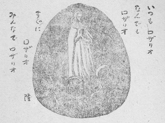
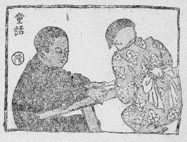

## Las aves del cielo

Escuchemos las palabras de Jesucristo.

«¿No se venden cinco pajarillos por dos ases? Pues bien, ni uno solo de ellos queda olvidado ante Dios. Aún más, hasta los cabellos de su cabeza están todos contados. No tengan miedo: valen más que muchos pajarillos».[^ed1]

Oyendo estas palabras, ¿quién no se tranquiliza? Con tal de dejarlo todo en manos de Dios, Makoto y Kayano estarán absolutamente bien.

El gorrión que no vale ni un sen, el gorrioncillo insignificante que no sirve para nada: baja al jardín como una hoja que cae del tejado, mira a derecha y a izquierda, y sin saber que yo lo observo a través del cristal, se tranquiliza porque no hay ni persona ni milano, bosteza a lo grande, va dando saltitos hacia la estera, picotea los boniatos secos, picotea tres veces y levanta la cabeza para vigilar el cielo, vuelve a picotear dos bocados más, se asusta al pasar suavemente la sombra de una nube y sale volando de golpe, deja caer, qué lástima, el boniato que llevaba en el pico, da una vuelta apresurada sobre el huerto con sus compañeros, alineando las alas, y al volver se posan tres en fila en la pértiga de tender la ropa, y se llaman entre sí con su pío pío; los tres se arriman, el más grande pierde y es empujado una y otra vez hacia un lado, hasta que uno grita pío y se va, y los otros dos bostezan amistosamente, estiran una pata, se arreglan las plumas y por fin cierran los ojos, se acurrucan y, esponjados, se adormecen. Dios no se pierde ni un movimiento de las patas ni de las alas de este solo gorrión, y lo mira sin cesar con ojos de amor, lo guarda. No lo olvida. Porque a este gorrión Dios lo creó por sí mismo, con amor. Es decir, porque es su verdadero gran padre.

Si hasta con un gorrión es así, cuánto más con Makoto y Kayano, hijos de hombre, que valen más que los gorriones: ¿cómo los va a olvidar? ¿Podría apartarse de ellos, ni por un instante, la mirada del amor de Dios?

Dios sabe hasta el número de cabellos de esta niña. Y es natural: porque Dios creó cada uno de esos cabellos con amor... Ni siquiera el propio Makoto sabe cuántos miles y cientos de cabellos tiene en la cabeza, porque no fue Makoto quien los creó... Tampoco yo, su padre, sé su número: yo no fui el creador... Quien recuerda el número de puntos de un suéter es solo la mujer que lo tejió con amor. No lo sabe quien lo lleva puesto, ni el padre que lo recibió. ¿Quién siente el apego más hondo por este suéter? ¿Quien pidió que se lo hicieran? ¿Quien lo lleva puesto? ¿O quien lo hizo? Quien lo hizo.

¿Quién ama más a Makoto? ¿El propio Makoto? ¿Yo, su padre? ¿O Dios, su creador?

El propio Makoto no sabe cuántos cabellos tiene en la cabeza. Yo, ni qué decir de los cabellos: ni siquiera he contado sus caries. Yo, que digo y pienso que quiero a Makoto, en realidad solo tengo un amor así de imperfecto. Si yo, el que más quiere a este niño en la tierra, estoy en esto... En cambio, ¡qué delicadeza, qué profundidad, qué grandeza la del amor de Dios, que hasta a cada cabello ha atado un cariño inolvidable! De veras, para cuando yo falte, a quien puedo encomendarlos con tranquilidad es a Dios, a nuestro Padre que está en el cielo. Y Dios, sin que nosotros tengamos que volver a confiárselos ni a pedírselo, desde el principio tiene en brazos a este niño.

Si lo pienso bien, yo mismo, que me creía absolutamente confiable para estos niños, ¿no soy en realidad un hombre en quien no se puede confiar? ¿No era yo mismo un hombre débil que no podía vivir ni un segundo sin apoyarse en el Padre del cielo? Cuando mi cuerpo estaba sano, pensar que con mi propia fuerza los alimentaba y criaba era, de entrada, algo risible. No eran mis fuerzas las que criaban a los niños.

{width=55%}

Era Dios quien, valiéndose de mí, criaba a los niños. Yo no era más que un instrumento al que se empleaba en la punta de su mano, según su voluntad. Por ejemplo: cuando un médico pone una inyección para calmar un dolor de vientre, ¿quién hace de verdad el trabajo, el médico o la jeringa? Y cuando un pescador lanza una cuerda y salva a alguien que se ahoga, ¿quién lo salvó de verdad, el pescador o la cuerda? ¿Hay algún enfermo que dé las gracias a la jeringa y se haga el desentendido con el médico? ¿Hay algún náufrago que, al ser subido a la barca, se abrace reverente a la cuerda como a su benefactor, dándole las gracias, y le dé la espalda al pescador? Si se rompe la jeringa, el médico pensará en una medicina oral o en algún otro tratamiento y le calmará el dolor de vientre al enfermo. Si la cuerda no alcanza, el pescador lanzará un flotador, un cajón de madera, lo que flote. Y si no tiene nada que lanzar, se tirará al mar de un salto y seguro que lo sacará. Aunque no haya jeringa, mientras esté el médico hay tranquilidad. Aunque no haya cuerda, mientras el pescador esté cerca el náufrago se salvará.

Yo era la jeringa. Aunque yo me rompa y muera, Dios, que me usaba, sigue estando, y por algún otro medio sanará el sufrimiento de estos niños. Yo no era más que la cuerda. Aunque yo me hunda al fin en el fondo del agua, Dios, que me lanzó, sigue estando aquí, y seguro que sacará a estos niños de las olas bravas. ¿No hay entonces de qué preocuparse?

«Por tanto, no tengan miedo».[^ed2]

Una gran garantía. Quien oiga esto no puede seguir cavilando, temiendo y dándole vueltas a las cosas.

«No temas, tu Padre te guarda. No te angusties, tu Padre está a tu lado», susurra Dios. «Makoto es el niño querido que tu Padre creó. Kayano también nació del amor de tu Padre. No pasa nada, no pasa nada. ¡Vamos, con alegría!».

Pero, sin embargo...

El Padre que está en el cielo es algo sobrenatural, religioso, invisible, de voz inaudible. Puede ser un consuelo para el alma, pero ¿podrá también producir y repartir lo necesario de la vida material real, por ejemplo la comida de hoy, la ropa de hoy? A esta pregunta Jesús respondió con claridad:

«Miren las aves del cielo: no siembran, ni siegan, ni almacenan en graneros, y su Padre celestial las alimenta. ¿Es que no valen ustedes mucho más que ellas? ¿Quién de ustedes, por mucho que cavile, puede añadir un solo codo a su estatura? Y sobre el vestir, ¿por qué se preocupan? Fíjense en los lirios del campo, cómo crecen; no se fatigan ni hilan, y yo les digo que ni Salomón en toda su gloria pudo vestirse como uno de ellos. Y si a la hierba del campo, que hoy es y mañana se echa al horno, Dios la viste así, ¿cuánto más a ustedes, hombres de poca fe? Así pues, no anden preocupados diciendo: “¿qué vamos a comer, qué vamos a beber, con qué nos vamos a vestir?”. Por todas esas cosas se afanan los paganos. Bien sabe su Padre celestial que de todo eso están necesitados. Busquen primero el Reino de Dios y su justicia, y todas estas cosas se les añadirán. Por tanto, no se preocupen por el mañana, porque el mañana traerá su propia preocupación. A cada día le basta su contrariedad».[^ed3]

## La fuerza de Dios y la fuerza del hombre

El traje del gran rey Salomón, que reunió en su persona todo el esplendor del mundo, tuvo sin duda toda la belleza que puede lograr el arte humano, la flor y nata de lo refinado, y aun así no igualó a una flor de lirio del campo. El hermoso traje del gran rey Salomón fue hecho con fuerza humana; la belleza del lirio fue obra de Dios. ¡Qué pequeña es la fuerza del hombre!

El hombre que se apoya en esa pequeña fuerza y se angustia es justamente el de poca fe. ¿De qué sirve confiar en una fuerza humana que ni siquiera puede hacer una sola flor de lirio? El Padre del cielo sabe bien que el hombre no puede vivir sin comer, ni sin beber, ni pasar sin vestido. Y seguro que lo provee.

Al hombre le basta buscar primero que venga el reino de Dios. Le basta esforzarse con todas sus fuerzas para que la voluntad de Dios se cumpla en la tierra como se cumple en el cielo.[^ed4] Le basta con obrar de modo que Dios lo reconozca como bueno. Si lo hace, con seguridad se le dará todo: la comida, la bebida, el vestido.

Mirando a san Francisco de Asís se ve que estas palabras de Jesús son verdaderas. Francisco repartió todos sus bienes propios entre los prójimos pobres y, quedándose sin nada, alabó a Dios sin cesar, oró por el reino de Dios y recorrió los caminos cantando, ebrio del amor de Dios. Y al final no pasó hambre ni sed ni se resfrió, y vivió una vida entera en paz.[^ed5] Sin necesidad de recurrir a un santo italiano de tiempos remotos, hoy mismo en nuestro país, en cualquier convento que se visite, se encontrará uno con ejemplos concretos ante los ojos.

La tragedia de nuestro tiempo es esta: la humanidad, orgullosa, niega la existencia de Dios, no confía en la fuerza de Dios, cree que solo con fuerza humana puede hacerlo todo perfectamente, y ella misma monta la obra. Esta tragedia, de autoría y escenificación propias, tenía decidido en la primera previsión que terminaría con un final feliz, pero como los hombres que actúan en ella, después de todo, no son todos ángeles, siguen saliéndose del guion en sus papeles, y el argumento de la obra rueda hacia derroteros sombríos y violentos que nadie imaginó, hasta el punto de que ya no se logra unidad ni armonía solo con las indicaciones verbales del director materialista, y no queda más camino para reconducirla que hacer avanzar el argumento a como dé lugar, con violencia, amenazas y conspiraciones; y, si uno se descuida, parece que la obra va a bajar el telón con una catástrofe verdaderamente aterradora en que toda la humanidad que actúa tenga que suicidarse.

Para evitar esta catástrofe y que acabe con un final feliz, hay que despedir sin falta al director materialista; si se deja todo en manos de ese director de traje rojo, parece que la humanidad entera lo pasará muy mal. Si el director tiene una cabeza algo corta o algo desquiciada, aunque no tenga mala intención, el escenario se vuelve un caos. No quisiera pensar que las personas de traje rojo tienen mala intención y están haciendo un experimento con la humanidad viva a esta escala tan grande. Ellos llegaron a director con el alto y hermoso ideal de traer a la humanidad una utopía. Eran muy fervientes. Eran muy puros. Pero, qué pena, tenían un prejuicio extraño: negar la existencia de Dios. No reconocer a Dios, que creó el universo y que los creó también a ellos. Teniendo un padre, no reconocerlo y presumir de ser un niño sin padre: no queda sino diagnosticar que les falta algo de cabeza. A estos de traje rojo convendría apartarlos y poner un director de buen sentido y equilibrio. Una persona de buen sentido y equilibrio es la que cree en dos realidades: la de lo creado y la del que creó. No sirve el que solo admite el mundo material, ni sirve el que niega el mundo material diciendo que es la sombra del espíritu y solo admite el mundo espiritual. Ni uno ni otro puede decirse que tenga buen sentido y equilibrio.

Quien se limita a decir de boca «Señor, Señor» sin hacer nada por su cuenta no recibe ni comida ni bebida ni ropa.[^ed6] Solo cuando uno, rogando al Señor, se esfuerza para que su voluntad se cumpla en la tierra y venga su reino, entonces por fin se le da. Es necesario orar al cielo, y es necesario también hacer cuanto uno puede. No hay que inclinarse hacia un solo lado. No se trata de hacer cuanto uno puede y esperar lo que el cielo disponga. Hay que hacer cuanto uno puede rogando a Dios.

Este será el camino de vida de mis dos hijos.

## Dejarse mimar por Dios

¿Cómo se hace para amar a Dios y ser amado por Dios? Déjense mimar. ¡Déjense mimar como el niño pequeño se deja mimar por su madre!

Esto quisiera enseñarles a mis dos hijos.

Dejarse mimar. ¿No es esta una actitud que solo se puede tener amando totalmente a Dios, creyendo totalmente en Dios y apoyándose totalmente en Dios? Solo pegado a Dios se puede, por primera vez, dejarse mimar.

¿Por qué me aprietas tanto la cara y me empujas, que me haces cosquillas? Ja, ja, ja, ja, mira, que me manchas de moco la ropa de papá... Antes Kayano hacía esto con frecuencia. En mi corazón borbotó un cariño enorme por esta niña...

El hijo del vecino, cuando viene a mi casa, quizá porque me cree un profesor universitario, se sienta muy lejos, derecho, tieso, hablando con rigidez y poniendo en fila palabras dificilísimas a propósito, de modo que sin darme cuenta yo también me vuelvo frío y me veo obligado a responderle: ah, sí, claro, ya lo pensaremos.

También Dios, siendo el Padre del cielo, tendrá probablemente un sentimiento parecido.

¿Qué sentimientos tendrá Dios hacia los fieles que, tiesos, recitan por pura formalidad difíciles oraciones y celebran los ritos con toda solemnidad, pero una vez terminado el rito, al dar un paso hacia los negocios del mundo, barren a Dios de su cabeza y alardean de que fe es fe y negocio es negocio, que hay que marcar bien la separación entre lo público y lo privado? Esas personas se empeñan en pensar que Dios es alguien que está arrellanado, muy ufano, en el fondo de algún templo determinado, que concede favores solo a los que vienen a rezar y a pedir en ese templo, y que además, desde detrás de la reja, con ojos agudos y brillantes, espía para castigar a los hombres si descubre alguna maldad. Por eso, solo cuando se ponen delante de ese dios se muestran muy formales y se postran, y cuando se alejan del templo o cierran las puertas del templo y se aseguran de que el ojo de ese dios no alcanza, hacen lo que se les antoja.

Dios, nuestro Padre, no es como ese dios. No está encerrado en el fondo de ningún templo determinado. Está en todas partes. También aquí. Siempre. Ahora, aquí. También después de que yo muera estará junto a Kayano. Makoto está en brazos de Dios. Siempre en brazos. Aunque lleguen a ser una anciana y un anciano, estarán en brazos.

Dios no se da aires. No tiene rivales, y no necesita darse aires, y por naturaleza no es de los que se dan aires.

Dios no está para enviar un castigo del cielo a los hombres. Para hacer felices a los hombres no les quita los ojos de encima.

Dios quiere darle todo al hombre y, inquieto, casi no sabe cómo empezar. Sin que el hombre se lo pida expresamente, le da a raudales lo necesario. Y si además se le pide con mimo, da cuanto se quiera. Como el niño pequeño, que pide con tenacidad una y otra vez hasta que se lo dan: así, seguro que Dios da.

A Jesucristo le gustaban los niños. Siempre los tomaba en brazos, sobre sus rodillas, y los acariciaba.[^ed7] Y a los adultos, en la flor del buen juicio, les enseñó:

«Quien no reciba el Reino de Dios como un niño no entrará en él».[^ed8]

Para entrar en el cielo, para ser habitante del reino de Dios, todos deben hacerse como niños pequeños. Para ser amado por Dios no hace falta buen juicio. No hace falta mucho saber. No hace falta ciencia. No hace falta experiencia ni donativos; basta con la ingenuidad espontánea de un niño. Mis dos hijos son aún pequeños. Ahora, tal como son, son ciudadanos del reino de Dios. Creen en Dios y aman a Dios con total ingenuidad. Aunque vayan cumpliendo años, les basta seguir conservando tal cual esta fe sin malicia.

{width=55%}

«¿Quién de entre ustedes, si un hijo suyo le pide un pan, le da una piedra? ¿O si le pide un pez le da una serpiente? Pues si ustedes, siendo malos, saben dar a sus hijos cosas buenas, ¿cuánto más su Padre que está en los cielos dará cosas buenas a los que se lo pidan?».[^ed9]

Así que, con tal de dejarse mimar por Dios, no pasa nada.

## La oveja perdida

Si estos niños, durante toda su vida, siguen siempre la voluntad de Dios y buscan primero su reino y su justicia, Dios les dará seguro todo lo que necesiten y, por fin, los guiará hasta la felicidad eterna, de modo que no hay por qué preocuparse. Pero cabe que, por algún tropiezo, quebranten la ley de Dios y le den la espalda. ¿Qué pasará entonces? ¿También Dios los abandonará?

No.

Por muy grave que sea el pecado cometido, Dios aún no abandona. Espera con paciencia hasta que se vuelva a Él habiéndose arrepentido de ese pecado, enmendado de corazón, decidido a no cometerlo otra vez y pedido además valor para luchar contra el pecado. Espera hasta el instante final de la vida de este mundo. Pero si muere sin haberse arrepentido, ya todo está perdido. Entonces es el infierno de quien ha sido abandonado por completo.[^ed10] Quien cae en el infierno ya no se salva. El infierno es una realidad desesperada: es el estado de las almas separadas de Dios para siempre.

«¿Quién de ustedes, si tiene cien ovejas y pierde una, no deja las noventa y nueve en el campo y sale en busca de la que se perdió hasta encontrarla? Y, cuando la encuentra, la pone sobre sus hombros gozoso, y, al llegar a casa, reúne a los amigos y vecinos y les dice: “Alégrense conmigo, porque he encontrado la oveja que se me perdió”. Les digo que, del mismo modo, habrá en el cielo mayor alegría por un pecador que se convierta que por noventa y nueve justos que no tienen necesidad de conversión».[^ed11]

Los pastores que, en los campos de Israel, escuchaban a Jesús contar esta parábola, seguramente asentían unos a otros con la cabeza. Porque todos los pastores habían vivido por sí mismos el mismo suceso. Entre un gran rebaño hay ovejas que obran por su cuenta, que desobedecen la guía del cuerno del pastor principal, se dejan engañar por las flores, se dejan arrastrar por el agua y se pierden sin darse cuenta en un peligroso zarzal. El buen pastor deja el rebaño y, sin hacer caso de los caminos peligrosos, va tras esa oveja extraviada para salvarla. La alegría del pastor cuando la rescata sana y salva resuena también en nuestro pecho. En el punto en que ordena a sus amigos: alégrense conmigo, las palabras de Jesús transmiten la escena sin que quede nada por decir. Dicen que cuando un solo pecador se convierte hay gran alegría en el cielo.

«No es voluntad de su Padre que está en los cielos que se pierda ni uno solo de estos pequeños».[^ed12]

Que caiga en el infierno una sola persona no es lo que Dios quiere. Aunque por un extravío momentáneo no cumpla la ley de Dios y entre por su cuenta en el camino del mal, Dios con seguridad lo hará volver, lo rescatará y lo incorporará de nuevo a la grey de los ciudadanos justos del reino de Dios.

## Receta

«El arrimado, a la tercera ración de arroz, extiende el cuenco con disimulo...».[^ed13]

«¡Ja, ja, ja...!».

«¡Ja, ja, ja, ja...!».

El aula, un remolino de voces jóvenes, en gran alborozo...

Pero entre ellos hay tres o cuatro alumnos con la cabeza gacha. Huérfanos acogidos por otros.

«Niños, ¿qué les dio ayer su mamá de merienda?».

«¡Yo!».

«¡Yo, maestra!».

«¡Yo!».

Un bosque de manitas que se alzan...

Pero en ese bosque hay claros aquí y allá. Niñas y niños con la cabeza gacha.

«¿Por qué no levantas la mano? Ah, es cierto, tú no tienes mamá...».

La hora de redacción...

En la pizarra, escrito en grande, el título: «Mi casa».

Alumnos que hacen correr afanosos el lápiz, que de vez en cuando levantan la cara y miran por la ventana, con qué claridad en el rostro. Algunos escribirán la mesa de esta mañana en su alegre casa. Dos o tres, solo mordisqueando la punta del lápiz, con los ojos bajos, aún sin haber puesto en el papel ni una letra.

El día del examen físico...

«¡Pero si ayer la maestra lo dijo con tanta insistencia! Que vinieran con la ropa interior limpia... ¿Y esta ropa interior tan sucia, qué es? ¿Se han olvidado de la higiene? Aunque no tengas mamá, ¿no habrá alguien que te cuide? ¿Eh? ¿Por qué no se lo pides? ¿Por qué te quedas callado? No te pongas retorcido. Si te cuesta pedírselo tú, la escuela te dará una carta para llevar».

Una excursión...

«... La tortilla de huevo está rica, pero yo, la verdad, en las excursiones lo que quiero es una ciruela encurtida... Mamá lo sabía...».

En el camino...

«¡Oh! ¿Cómo estás, bien? ¿Vuelves de la escuela? ¿Eh? Muy bien, muy bien. Tuviste suerte de que te acogiera una buena casa. Últimamente el control de los huérfanos de guerra es muy estricto, y en cuanto los encuentran los envían a los albergues. ¿Te encuentras alguna vez con tus antiguos compañeros? ¿Eh? ¿No? Mm. Mejor que no te juntes con ellos, no vayas a causar problemas en la casa donde estás ahora. En fin, ¡estudia mucho! Y, cuando seas un hombre hecho y derecho, tienes que devolver el favor. Mm».

Al atardecer...

«Si haces eso, cuando llegue a casa se lo digo a mi mamá».

A un dedo meñique al que se ha arrancado la uña, algo que normalmente no le hace nada le da un pinchazo de dolor con solo rozarlo. Duele, sí, pero el meñique no tiene por qué guardarle rencor a lo que lo tocó. Se le ha caído la uña, ha desaparecido lo que protegía la punta del dedo, y por eso, al tocarlo, duele. La cosa externa que lo tocó no tiene culpa, y tampoco el meñique tiene falta. Solo como consecuencia del desastre de haber perdido la uña, con rozarlo un poco da un pinchazo. El meñique no guarda rencor ni odio a nada, simplemente soporta el dolor como dolor. No debe envidiar ni tener celos de los otros dedos que sí tienen uña. Y, si además maldijera diciendo qué rabia que solo a mí me haya tocado el desastre y tenga que sufrir así, ojalá a los otros nueve dedos también les arrancaran la uña, entonces cometería un pecado inexcusable.

Quien no ha experimentado el sufrimiento es ingenuo. Quien no ha pasado por cosas duras es desconsiderado. Quien no tiene heridas en el corazón es insensible. Como uno mismo es insensible, no se da cuenta de que a su lado hay alguien sensible. Y así, sin malicia, toca la herida del corazón de otro. Sin miramientos, irrita el dolor del pecho de otro. Y como lo hace con toda ingenuidad, sin saber que toca una herida y sin darse cuenta de que provoca dolor, no tiene culpa. No tiene culpa, pero quien lo sufre lo pasa muy mal. Arrimado, carga, hijastro, hijo que se trae de otro matrimonio, retorcido, lento, ayuda, favor, hombre de bien: palabras que quien las dice usa como si nada, con total naturalidad. Pero para el huérfano que las oye...

Si el huérfano quiere recorrer de verdad el camino del huérfano, quiera o no, entran por sus oídos palabras que duelen y ve con sus ojos tratos fríos. No puede taparse los oídos; no puede caminar con los ojos cerrados. No le queda más remedio que avanzar, oyendo palabras que duelen y mirando tratos fríos, por un camino sin engaño.

Mientras Makoto y Kayano vayan por este camino, ¿no llegarán a concebir, sin darse cuenta, rencor, odio, envidia, celos y deseos de maldición? Esto es lo que ahora me preocupa en secreto dentro del corazón. Si llegara a ser así, el camino se desviaría hacia un lado y los llevaría al infierno.

¡Ojalá estos niños se beban con honradez, tal cual, la copa amarga que les ha tocado![^ed14] ¡Ojalá no codicien la copa dulce que está en manos de otros! ¡Ojalá no envidien al otro que bebe la copa dulce, sino que, al contrario, celebren con ingenuidad su felicidad! Y, yendo aún más lejos, ¡qué bueno sería que bebieran hasta el fondo esta copa amarga con exactamente la misma alegría con que otro apura sonriente la copa dulce! Si llegaran a ese estado yo quedaría satisfecho.

Apurar la copa amarga del destino que a uno le ha tocado lo puede hacer cualquiera que llegue al estado de ánimo llamado «resignación». Pero apurar la copa amarga con gran alegría no se puede con la resignación sola. Es un estado al que solo se llega creyendo en la providencia de Dios. Tanto la copa dulce como la amarga son el mejor regalo, dado por la providencia del amor de Dios. Que ahora se me haya dado a mí una copa amarga es porque ahora la copa amarga es la que necesito para mi verdadera felicidad, y Dios me la dio a propósito. Que ahora a aquel se le haya dado una copa dulce es porque a él, ahora, la copa dulce le es necesaria para su felicidad, y Dios se la dio a propósito. Dios, que quiere mantener siempre en estado de verdadera felicidad a cada hombre que creó con su propia mano, receta el cóctel adecuado a cada momento y lugar. Prepara la medicina. Yo soy médico y conozco bien el trabajo que cuesta una receta. A un enfermo con dolor de vientre se le da polvo de raíz de genciana, que es amargo. Para curar el estómago del enfermo hay que servir una medicina amarga. Un médico no piensa: tiene mal el estómago, pero la medicina amarga da pena, vamos a darle de comer mucho *oshiruko* dulce (sopa dulce de judías rojas). Al paciente que ha cogido un resfriado y tiene tos y flema se le da jarabe de poligala, que es dulce, y se le hace chupar caramelos para la tos. Es que este paciente necesita ahora algo dulce. Si a este paciente se le dijera: la buena medicina es amarga, o lo que sea, y se le diera a beber swertia (*senburi*, una hierba muy amarga), ¿qué ocurriría? Para el enfermo, la medicina amarga y la dulce son por igual una receta apropiada en ese momento a su cuerpo para curar la enfermedad. ¿Se alegrará el enfermo porque la medicina es dulce y le dará las gracias al médico, y se entristecerá porque la medicina es amarga y le guardará rencor? Dios, que es omnisciente y todopoderoso, quizá no se afane ni se esfuerce hasta el agotamiento en la receta; pero aunque decida la receta con soltura, como es todo amor, jamás se equivoca en la receta.

Para un hombre como Makoto, pasar la vida como huérfano será la mejor vida. Así lo ve Dios de antemano. Porque lo sabe todo.

Para una persona como Kayano, pasar la vida como huérfana será una vida más llena de gloria que la que viviría como hija con padres. Dios, que lo prevé así, por su gran amor la hace huérfana.[^ed15]

Makoto, esa copa amarga que bebes es la receta del amor de Dios.

Kayano, esa copa es amarga, ¿verdad? Pero es la medicina que Dios te ha dado. Si la tomas, seguro que tendrás la felicidad eterna. Demos gracias a Dios por habernos dado esa copa amarga.

[^ed1]: Cf. Lc 12, 6-7; Mt 10, 29-31.
[^ed2]: Mt 10, 31.
[^ed3]: Mt 6, 26-34.
[^ed4]: Cf. Mt 6, 10. 33.
[^ed5]: Cf. Tomás de Celano, *Vida primera de san Francisco* (la renuncia a sus bienes ante el obispo de Asís). N. del E.: no se ha ubicado el pasaje exacto al que alude el autor.
[^ed6]: Cf. Mt 7, 21.
[^ed7]: Cf. Mc 10, 13-16.
[^ed8]: Mc 10, 15.
[^ed9]: Mt 7, 9-11.
[^ed10]: N. del E.: el autor acaba de decir que Dios no abandona al pecador y lo espera hasta el último instante; el abandono del infierno es el de quien rechaza ese amor hasta el final. Así lo enseña la Iglesia: morir en pecado mortal sin arrepentirse ni acoger la misericordia de Dios «significa permanecer separados de Él para siempre por nuestra propia y libre elección» (Catecismo de la Iglesia Católica, 1033; cf. 1037).
[^ed11]: Lc 15, 4-7.
[^ed12]: Mt 18, 14.
[^ed13]: N. del E.: senryū (poema humorístico) de la época de Edo, de autor desconocido, que se volvió dicho popular («la tercera ración del arrimado»): el huésped que vive a costa de otro, a la tercera ración de arroz, tiende el cuenco con timidez y disimulo.
[^ed14]: Cf. Mt 26, 39 (el cáliz).
[^ed15]: N. del E.: el autor contempla la orfandad de sus hijos a la luz de la providencia. La Iglesia enseña que Dios «no es de ninguna manera, ni directa ni indirectamente, la causa del mal moral», pero lo permite y sabe sacar de él un bien: «La fe nos da la certeza de que Dios no permitiría el mal si no hiciera salir el bien del mal mismo, por caminos que nosotros sólo conoceremos plenamente en la vida eterna» (Catecismo de la Iglesia Católica, 311 y 324).
