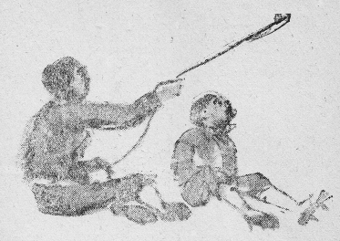

## Volar cometas

> ¡Quiero subir al cielo!
> Suena como un órgano
> porque la cometa baila.
> ¡Quiero subir al cielo![^ed1]

{width=60%}

## La felicidad completa

El camino del verdadero huérfano es solitario. El verdadero camino del huérfano es doloroso. Recorrerlo es duro, triste y difícil. Es un camino oscuro, estrecho, escarpado, lleno de piedras y con pocas flores; cuando parece cerrarse, se abre, y cuando se abre, vuelve a cerrarse. Los que se quedan al borde del camino son fríos como árboles secos, nada confiables, desabridos, y a menudo extienden sus ramas para estorbar el paso. ... Dos niños pequeños avanzan de la mano: el hermano, de catorce años; la hermana, de ocho.

La fe no hace desaparecer esa soledad. Tampoco acaba con el dolor. No quita lo duro ni lo triste. La soledad dura para siempre. El dolor sigue doliendo hasta el final. Lo duro y lo triste siguen siendo duros y tristes. La religión no es opio. El fin de la fe no es borrar el sufrimiento del cuerpo ni la pena de los sentimientos humanos. No es un beneficio que se obtenga por la devoción. Es cierto que, como Dios es amor, a veces quita el sufrimiento a los hombres que sufren. Son muchos los milagros de enfermedades que la medicina no curaba y que sanaron de golpe por la oración. Dios los obra de vez en cuando para que los hombres reconozcan su existencia y sepan que es amor; serán pequeñas alteraciones del orden. Creer en Dios para que Él nos libre de los sufrimientos y las penas de la tierra es una fe inmadura. No se debe entrar en la vida de fe con el ánimo del que le pide al médico: «Me duele el vientre, póngame morfina». La verdadera vida de fe va mucho más alto.

Por naturaleza, el hombre busca la felicidad completa. Como no sabe dónde está esa felicidad, calcula a su antojo y sale a buscarla. Unos creen que tiene que ver con la fortuna y juntan dinero. Otros piensan que va unida al poder y procuran abrirse camino y ascender. Otros juzgan que se encuentra en el estudio y el saber, y se quedan en el laboratorio de la universidad. Y hay muchos otros caminos. Yo también, de joven, perseguí la felicidad con todas mis fuerzas: primero con la fuerza del cuerpo y, a medida que subía de posición, aprovechando esa posición. Como fui de los que prosperaron mucho, me dejé ver por casi todos los ámbitos que parecían prometedores. Y al final no encontré la felicidad completa. En esas estaba cuando caí bajo la bomba atómica, y entonces supe por primera vez que para alcanzar la felicidad completa no hay más camino que la religión. La felicidad completa era la unión con Dios. Hoy soy feliz. Y rezo para que mis dos hijos tengan también este estado de ánimo.

La religión es el camino del hombre hacia Dios. Por eso, lo primero que hay que cumplir es el deber para con Dios.

¡Que se manifieste la gloria de Dios!

Este es mi primer anhelo, y el anhelo que mis dos hijos no deben olvidar nunca. Vivir este anhelo es, en sí mismo, el estado de la felicidad completa.

Cuando uno está solo, esa soledad es una manifestación de la providencia de Dios; hay que agradecerla tal cual, sentirla como soledad, y cuando uno siente dolor, ese dolor es precisamente la manifestación de una providencia necesaria; hay que sentirlo con gratitud, como dolor. Y, sin salir de esa soledad y de ese dolor, pensar cómo manifestar la gloria de Dios, rezar y hacer todo lo que se pueda. Esto no tiene nada que ver con esa psicología perversa que siente placer en dañarse y herirse el propio cuerpo. Porque quien lleva una verdadera vida de fe hace lo mismo, al contrario, también cuando está alegre. Es decir, cuando está alegre, esa alegría es una manifestación de la providencia de Dios; la agradece tal cual, la siente con alegría y, dentro de ella, piensa cómo manifestar la gloria de Dios, reza y hace todo lo que puede. En suma, lo que el mundo llama placer, buena marcha, adversidad, fracaso, dolor, salud, enfermedad y demás no influye en absoluto en la actitud de «trabajar para la gloria de Dios». Como trabajar para la gloria de Dios es el camino de la felicidad completa, la enfermedad, el dolor, el fracaso y la adversidad no tienen nada que ver con mi felicidad. Cuando estoy enfermo, ofrezco mi enfermedad para la gloria de Dios. Si hay dolor, ofrezco ese dolor para la gloria de Dios. Si estoy en la adversidad, trabajo para la gloria de Dios en medio de la adversidad. Entonces, aunque haya dolor físico o mental, se siente de manera sobrenatural la felicidad completa.

El camino del cuerpo que esta niña recorrerá como huérfana está lleno de penalidades. El camino del alma, que avanzará unida a Dios, está lleno de felicidad. Por más que su cuerpecito sea oprimido, despreciado, humillado y atormentado, su alma está unida directamente al amor de Dios y por eso tiene paz y es feliz.

Jesús dijo así en el Sermón de la Montaña:

«Bienaventurados los que lloran, porque serán consolados».[^ed2]

Llora, hija mía.

## Los que lloran

Quien ha perdido a su madre, ¿no se siente desdichado porque ya no hay nadie que lo consuele? Muchos adultos recuerdan la felicidad de su infancia, pero ¿en qué consistía realmente? ¿En juegos sin importancia? Los adultos también juegan con entusiasmo a juegos sin importancia. ¿En los dulces de la merienda? Los adultos entran en cafés y suben a restaurantes y comen cosas mucho más ricas. ¿En no tener trabajos de responsabilidad? Hay muchos adultos que andan sin oficio y, con todo, tienen la cara triste. ¿En vivir en familia, en armonía? Los adultos tienen hogares tranquilos. Y, sin embargo, el adulto que ha perdido a su madre siente en el corazón un vacío que no sabe qué es. Arrastra una desazón distinta de la de haber perdido al padre.

La felicidad de la infancia parece estar siempre ligada a la madre. Y, más aún, a que ella nos consolaba después de llorar.

Rodeándonos suavemente los hombros, acercando la boca al oído, solo la madre nos consolaba poniéndose de veras en el corazón del niño. Con pensar que la madre estaba en casa, a mi lado, ya no había nada que temer. No había miedo. No había soledad ni dolor.

Cuando uno estaba enfermo, se notaba especialmente. A medianoche abría los ojos y, por la fiebre, tenía un ligero mareo: la lámpara cubierta con su pantalla se balanceaba como una aparición, o se sentía que el cuerpo se hundía hasta el fondo de la tierra junto con la cama, o la cabeza le dolía como para partirse, y allí estaba la figura de la madre, sentada sin pegar ojo (ni siquiera la veía bien: solo veía el cuello blanco, de corte antiguo, de su vestido), y bastaba eso para tranquilizarse y volver a cerrar los ojos. Entonces ella cambiaba con suavidad la bolsa de hielo de la frente y nos susurraba: «¿Cómo estás? ¿No te sientes mal? Ya falta poco para que amanezca; cuando amanezca verás cómo te pones mejor». Con solo oírlo, parecía que la fiebre iba bajando.

Cuando estaba mi madre, yo era feliz. Era feliz porque, si lloraba, me consolaba.

Aun de adultos, todos los días hay cosas por las que se quiere llorar. Quisiéramos llorar a voz en cuello, con todas las fuerzas. Quisiéramos llorar pataleando. Quisiéramos llorar hasta quedar roncos, dejando correr las lágrimas, los mocos y la baba. Hay momentos en que, de repente, nos entran esas ganas: cuando algo nos irrita, cuando se burlan de nosotros, cuando nos quitan lo nuestro, cuando nos duele el vientre... Pero los adultos no lloran. Porque, aunque lloren, no hay quien los consuele, los calme y los haga parar, y es inútil. Saben que sería trabajo perdido y que solo acabarían más cansados. Lejos de ser consolados, serían la risa de todos. Nadie llora para que se rían de él.

Cuando uno llora, el pecho se despeja como el cielo tras un chubasco de verano, cuando sale la luna. Si se llora cuando hay que llorar, no queda nada acumulado en el pecho. Los niños son tan naturales y alegres porque lloran a menudo y así se limpian por dentro.

Quien no tiene madre no llora en limpieza general. Como no llora, le quedan telarañas y cosas parecidas dentro del pecho, y se acumulan día tras día. En el pecho se va cuajando algo que no tiene nombre ni consuelo... y eso se convierte en semilla de desdicha.

Si hubiera, aun de adultos, alguien ante quien se pudiera llorar sin freno, con todas las ganas, como ante una verdadera madre... si hubiera alguien que nos consolara de todo corazón, exactamente como una verdadera madre... ah, ¿cuán felices podríamos llegar a ser?

«Bienaventurados los que lloran, porque serán consolados».[^ed3]

Ese que consuela es Dios.

El ser humano que está unido a Dios por el amor puede aferrarse a Él en cualquier momento y llorar hasta quedar satisfecho. Y, cuando llora así, ¡qué felicidad ser consolado por Dios!

Aunque haya perdido a su madre de este mundo, si está con Dios, el Padre verdadero cuyo amor supera al de una madre, puede llorar como cuando era niño.

El que tiene verdadera fe, en cualquier situación, tiene siempre un rostro sin preocupaciones, alegre como el de un niño, ¿y no será porque de vez en cuando llora a mares, es consolado por Dios y saborea una felicidad sin límites?

## Los más pequeños

Se pasa frente a la iglesia de Oura, en Nagasaki, y se sube hacia el sur por el camino empedrado hasta llegar a una ladera desde la que se domina de un vistazo el azul del puerto y uno aspira hondo sin darse cuenta. Sobre el camino hay, aquí y allá, la sombra de los alcanforeros, cuyas ramas siempre verdes se agitan sin cesar con el viento del puerto. No pasa mucha gente. Arriba y abajo del camino se alzan las casas que ocuparon residentes europeos de distintos países a comienzos de la era Meiji, rodeadas de plantas tropicales y subtropicales; con los años la pintura se ha desconchado y oxidado, y las casas, tranquilas y sosegadas, tienen a veces una orquídea tropical roja en la ventana. Por encima de las ventanas de las buhardillas y de los tejados donde asoman con buena forma las chimeneas cuadradas de ladrillo, queda cerca el puerto de siempre. Aquí fue donde entraron, con las velas desplegadas, tantos barcos holandeses. Aquí fue donde se reflejó en las olas la proa de vivos colores de los barcos chinos. Aquí fue donde echó el ancla, en pesada formación, la escuadra rusa. Aquí fue donde se botaron gigantescos buques de guerra como el Tosa, el Nagato y el Musashi. De esos buques de guerra ya no se ve ninguno; hacia el final de la guerra entraban uno tras otro, remolcados, buques con enormes boquetes; hoy, en cambio, hay fondeados muchos barcos de las fuerzas de ocupación que ondean sus hermosas banderas. Con qué rapidez cambiaron los barcos que reflejaron su sombra en las aguas de este puerto: el movimiento del mundo, imposible siquiera de prever, quedó registrado con belleza en este puerto.

* * *

Después de unos setecientos metros por el camino empedrado se llega a un hermoso convento de tres plantas, de ladrillo, al estilo francés. Es el convento de las Hermanas del Niño Jesús. Hace más de setenta años, dicen, que llegaron al Japón y empezaron aquí su labor de oración, trabajo y enseñanza. Hoy solo hay religiosas japonesas.

Prestemos oído al canto que sale de una ventana del tercer piso.

«María querida, con tus manitas juntas, todos los días, por mí, ruegaaas...».

La niña que canta tendrá tres años, cuatro a lo sumo. Parece que todavía no domina la lengua. Se oye que varios niños pequeños hacen un juego con gestos al compás de la canción. La voz amable de una religiosa, risas y chillidos de alegría. De pronto, desde la ventana de la habitación siguiente, un llanto a voz en cuello, y la religiosa que dice: «¡Ay, ay, es el pipí!», y se oye el trajín de sus pasos.

En la habitación de al lado parece que empieza la lección de catecismo: un diálogo entre una religiosa y una niña mayor.

«¿Quién es Dios?».

«Dios es un espíritu infinitamente perfecto que creó el cielo, la tierra y todas las cosas, y que además las gobierna».

«Y entonces, ¿qué es un espíritu?».

Con la voz de otra niña:

«Un espíritu es un ser que no se percibe con los cinco sentidos, pero que tiene inteligencia y voluntad».

«¿Se ocupa Dios de manera especial de los hombres?».

«Sí, Dios se ocupa de manera especial de todo lo que toca al alma y al cuerpo del hombre, empezando por su vida, su salud, el vestido, la comida y la vivienda. A esto se le llama providencia de Dios».[^ed4]

«Así es. Todo lo que ocurre en el mundo no depende de un destino ineludible, sino que es conducido por la providencia de Dios».

«Pero si Dios se ocupa de manera especial de los hombres, ¿por qué no aparta las desgracias?», pregunta una niña.

«Porque la desgracia sirve de prueba, de expiación de los pecados, de advertencia y de origen de la felicidad del otro mundo».

«¿Por qué la desgracia se convierte en la felicidad del otro mundo?». La pregunta de una huérfana es acuciante.

«“Bienaventurados cuando los injurien, los persigan y, mintiendo, digan contra ustedes todo tipo de maldad por mi causa. Alégrense y regocíjense, porque su recompensa será grande en el cielo”. Estas son las últimas palabras del famoso Sermón de la Montaña de Jesús. ¡Bienaventurados, alégrense y regocíjense! ¡Qué grande será la recompensa del cielo!».[^ed5]

Es como si se viera a los niños escuchando con los ojos brillantes.

En este edificio, la tercera planta es el Jardín de María, donde se cuida a los huérfanos; la segunda es el instituto Shin'ai, con su escuela media y su escuela superior para niñas; y la primera es el jardín de infancia.

Desde allí, tomando el sendero de la montaña hacia arriba, después de unos quinientos metros más se llega a un anexo del convento. Es la llamada Casa de la Montaña, donde se atiende a los huérfanos débiles o enfermos. Hay religiosas de hábito negro ordeñando vacas. Otras traen el forraje segado en la montaña. También se ve a figuras de negro manejando la azada en la huerta. Hay una religiosa anciana que lava pañales con una sonrisa. Todas guardan silencio y trabajan sin descanso, con rostro alegre. La seriedad de su trabajo asombra incluso a las campesinas de Urakami. Para estas religiosas, ordeñar, segar el forraje, cultivar el campo y lavar pañales es, precisamente, oración. Hay quien pasa toda la vida en silencio cuidando las vacas. Hay quien, día tras día, no hace más que lavar ropa. Con el hábito negro bien puesto y una gran cruz de plata colgada del cuello... Sudando.

Son personas que se han separado de sus padres y hermanos, han renunciado a todos sus bienes, se han apartado de la gloria y los placeres de este mundo y han hecho de por vida los votos de castidad, pobreza y obediencia. Han dejado incluso el nombre y apellido por los que las llamaban en el siglo y solo tienen un nombre cristiano: Teresa, Catalina, Coleta. Trabajan aquí con tanto ahínco y no reciben ni un centavo de paga. Nadie les da las gracias. Y consideran que es lo natural que no se las den.

Jesús enseñó:

«¿Es que tiene que agradecerle al siervo el que haya hecho lo que se le había mandado? Yo pienso que no. Pues igual ustedes, cuando hayan hecho todo lo que se les ha mandado, digan: “Somos unos siervos inútiles; no hemos hecho más que lo que teníamos que hacer”».[^ed6]

Ellas se tienen a sí mismas por siervas inútiles, y por eso no piden agradecimiento. Día tras día lavan pañales con una sonrisa.

Lo que hacen las religiosas no se sabe en el mundo. Lo único que se sabe es que ningún huérfano se escapa de este Jardín de María. Y la gente se pregunta con extrañeza por qué nadie huye del Jardín de María.

Ellas no enseñan a nadie este secreto. No predican a la sociedad que así es como debe cuidarse a los huérfanos, ni nada parecido. Es porque guardan con fidelidad las palabras de Jesús.

«Tampoco se dejen llamar doctores, porque su doctor es uno solo: Cristo. Que el mayor entre ustedes sea su servidor. El que se ensalce será humillado, y el que se humille será ensalzado».[^ed7]

Todo lo dirige Cristo. Toda la dirección del orfanato corresponde a Dios. Las religiosas solo trabajan como siervas. Trabajan callando, con obediencia absoluta.

«En verdad les digo que cuanto hicieron a uno de estos mis hermanos más pequeños, a mí me lo hicieron»,[^ed8] son palabras de Dios. Todo lo que se hace por los más pequeños se hace, tal cual, por Dios. Cuando uno de los más pequeños pide un vaso de agua y se corre a sacarlo y dárselo, en realidad se le ha ofrecido un vaso de agua a Dios. El huérfano, cuando se convierte en objeto de una buena obra, es Dios.[^ed9] No se lo hace solo al huérfano: se le hace lo mismo a Dios. Las religiosas ven en el pequeño huérfano a Dios, al Niño Jesucristo. Quien sirve a un huérfano sirve, sin más, a Dios.

¿Quién fue la sierva que sirvió al Niño Jesús? La Virgen María. Santa María, Madre de Dios y virgen durante toda su vida.

En la Anunciación, es decir, cuando el ángel se apareció a la Virgen María para anunciarle que concebiría por obra del Espíritu Santo y daría a luz al Hijo de Dios, María respondió con enorme humildad y fe absoluta:

«He aquí la esclava del Señor, hágase en mí según tu palabra».[^ed10]

Estas palabras no salen de labios de cualquiera.

Poco después visitó a su prima Isabel y, cuando esta la felicitó, entonó el himno:

«Engrandece mi alma al Señor, y se alegra mi espíritu en Dios mi Salvador, porque ha puesto los ojos en la humildad de su esclava...».[^ed11]

Cumplido el tiempo, estando de viaje, en una cueva fuera de la ciudad de Belén, en un lugar donde se guardaban bueyes y caballos, dio a luz a Jesucristo, Hijo de Dios, lo envolvió en pañales y lo acostó en un pesebre.[^ed12] Es un buen modelo de pobreza.

Después, cuando fue a presentarlo en el templo de Jerusalén, oyó del anciano Simeón la profecía de toda la vida de Jesús, y le dijo también que una espada traspasaría el alma de María. Así se le dio a conocer el triste destino de Jesús, que moriría antes que ella, a los treinta y tres años. Y ella lo guardó sola en su corazón.[^ed13]

Un ángel le avisó de que el rey Herodes buscaba la vida de Jesús, y huyeron a Egipto, ocultos por la noche. Con el niño de pecho en brazos, aquella huida debió de ser muy dura.[^ed14]

Murió el rey Herodes, regresaron y fueron a vivir a Nazaret. José, el carpintero pobre y trabajador, guardaba como padre adoptivo a la santa madre y al hijo. ¿Cuánto amó María a Jesús y cómo lo crió en esta casa de Nazaret? La Escritura lo dice de manera breve: «El niño iba creciendo y fortaleciéndose lleno de sabiduría, y la gracia de Dios estaba en él»;[^ed15] pero es de suponer que, sin enfermar siquiera una vez, criado con el cariño delicado de María, creció hasta ser un muchacho excelente, sin un solo defecto.

¿No serán las religiosas del Niño Jesús quienes procuran imitar a la Virgen María, que sirvió al Niño Jesús?

Santa María es la más alta del género humano. No es Dios. Es un ser humano. Pero, entre tantos hombres de todos los tiempos y lugares, fue la única elegida para ser Madre de Dios, preservada del pecado original, sin cometer en toda su vida ni un pecado venial, y, tras la muerte, llevada al cielo no solo en el alma, sino incluso en el cuerpo: la más grande de los santos. Basta pensar en cómo esta excelente madre crió a Jesús, con tierna atención y profundo amor, para ver que es algo en extremo venerable. Las religiosas, siguiendo las huellas de la Virgen María, sirven a los huérfanos viendo en ellos al Niño Jesús. En el rostro de estos huérfanos se ve claramente la verdadera felicidad.

## Servir a los huérfanos

El corazón con que se sirve a Dios: ese debe ser, sin más, el corazón de quien trata con los huérfanos.

«Cuanto hicieron a uno de estos mis hermanos más pequeños, a mí me lo hicieron... Cuanto dejaron de hacer con uno de estos más pequeños, también dejaron de hacerlo conmigo»,[^ed16] son palabras de Dios.

Un albergue de huérfanos no es una obra de beneficencia. Es un palacio de oración donde se sirve a Dios. Despertar a medianoche a un huérfano que se hace pis en la cama y llevarlo a cuestas por el frío corredor hasta el baño equivale a servir en presencia de Dios y orar. Dar una clase ante los huérfanos equivale a sentarse ante Dios y recitar una oración. La alegría de salir a buscar a un huérfano por la ciudad y por fin encontrarlo tiene que ser la alegría de la Virgen María cuando, en el regreso de Jerusalén, entre el gentío perdió de vista al Niño Jesús y, buscándolo y buscándolo, lo encontró al tercer día en el templo.[^ed17]

Llega a la recepción del orfanato una persona que solicita empleo, y dice:

«Quiero dedicar toda mi vida a salvar a los pobres huérfanos».

Son palabras del todo inadmisibles.

¿Con qué prueba afirma que el personal está por encima de los huérfanos y tiene capacidad para salvarlos? Si de verdad tuviera esa seguridad, no necesitaría venir a pedir trabajo en un orfanato que dirigen otros: podría hacerlo muy bien en su propia casa y con sus propias fuerzas. Justamente los que son así no logran valerse por sí mismos en la sociedad actual y solo presumen de ideales de ensueño. ¡Cómo se atreve a querer salvar a otros quien no puede salvarse a sí mismo!

Si le proponen ser ministro, cumple con responsabilidad como ministro. Si hace falta una fortuna inmensa, entra en el mundo de los negocios y puede reunir una fortuna inmensa. Si se aplica al estudio, llega a ser doctor; si trabaja en obras públicas, construye una gran presa. Si tiene capacidad para tanto, entonces sí, que diga «voy a salvar a los huérfanos»; no estaría mal. Entre los huérfanos saldrán ministros, saldrán hombres ricos, se criarán doctores, aparecerán grandes artistas, sin duda alguna. Que un desempleado que ni siquiera puede valerse por sí mismo diga «voy a salvar» a quienes tienen ese valioso futuro es presuntuoso.

Aunque sea una persona eminente, no tiene derecho a presentarse con altanería ante los huérfanos. Es cierto que el huérfano va vestido de harapos, cubierto de mugre y con aspecto lastimoso, y parece lógico compadecerlo, despreciarlo y mirarlo por encima del hombro; pero no se ha puesto en ese estado lastimoso por culpa suya, como ocurre con los adultos que viven en la calle. Hasta que una sola bomba destruyó su casa y a sus padres, vivía en un hogar excelente. Entre ellos habrá nietos de profesores. Habrá hijos de inventores. Habrá hermanos menores de artistas. Aunque una noche del destino los haya dejado huérfanos y sin casa, su naturaleza no ha disminuido en lo más mínimo. No son crías de perro.

No es lo mismo que recoger a un perro sin dueño y criarlo.

Por eso, el cuidado de los huérfanos también ha de ser distinto. El personal no tiene derecho a imponerles a su antojo la educación que le parezca. Entre los empleados hay, al parecer, quienes piensan que es un gran éxito que el huérfano llegue a ser una persona hecha y derecha y no pase apuros para comer. Hay quienes creen que ya es bastante lograr un hombre que no moleste a la sociedad. Porque su propia talla no da más que para eso...

Hay dos maneras de criar un árbol. Una es hacer un bonsái. Un bonsái de ramas bien recortadas, que da hermosas flores, que se pone de adorno en la entrada de una casa y recibe algún elogio de las visitas... Me parece que este modelo abunda en los albergues de huérfanos. Se fabrican hombrecillos de buenos modales, algo despiertos, aptos para criados de una casa, y quien los ha fabricado se enorgullece de ello.

Plantar cedros en la montaña es completamente distinto. No se acerca uno cada día a podar ramitas con tijeras de aquí para allá. Se talan los arbustos malos de alrededor y se deja que corra el aire, y basta; lo demás se confía al sol, a la lluvia y a los nutrientes de la tierra, y se vela de lejos con atención. Con los años, cuando el que los plantó ha muerto sin dejar nombre, el cedro llega a ser un árbol enorme y majestuoso que todos admiran por igual y que sirve a toda la sociedad.

Un cedro útil al mundo, en manos de un maestro de bonsáis, se convierte en un modesto objeto de exhibición. Lo que hay que temer es al educador de bonsáis.

El corazón con que se sirve a Dios, el corazón con que se cría al Niño Jesús: un corazón verdaderamente solemne. Con ese corazón deseo que se esté junto a los huérfanos.

[^ed1]: N. del E.: el original trae aquí un breve glosario del dialecto de Nagasaki en que está escrito el poema.
[^ed2]: Mt 5, 4.
[^ed3]: Mt 5, 4.
[^ed4]: N. del E.: el autor cita el catecismo japonés de preguntas y respuestas de su tiempo; no hemos hallado la edición. Sobre la providencia, cf. Catecismo de la Iglesia Católica, 302-303.
[^ed5]: Cf. Mt 5, 11-12.
[^ed6]: Cf. Lc 17, 9-10.
[^ed7]: Mt 23, 10-12.
[^ed8]: Mt 25, 40.
[^ed9]: N. del E.: el autor glosa Mt 25, 40, que acaba de citar: no identifica al huérfano con Dios, sino que, como dice en seguida, las religiosas ven en él a Cristo. La Iglesia invita a «reconocer su presencia en los pobres que son sus hermanos» (Catecismo de la Iglesia Católica, 2449).
[^ed10]: Lc 1, 38. Cf. Lc 1, 26-37.
[^ed11]: Lc 1, 46-48. Cf. Lc 1, 39-45.
[^ed12]: Cf. Lc 2, 1-7.
[^ed13]: Cf. Lc 2, 22-35.
[^ed14]: Cf. Mt 2, 13-15.
[^ed15]: Lc 2, 40.
[^ed16]: Mt 25, 40 y 45.
[^ed17]: Cf. Lc 2, 41-46.
