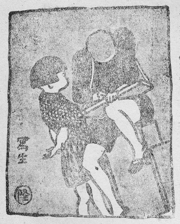

## El primer viaje

Las hermanas del convento de Junshin escribieron una carta dirigida a Makoto y a Kayano: como regalo por su entrada al colegio, les harían ropa, y los invitaban a ir antes de que empezaran las clases. La madre de estos niños había sido durante muchos años profesora en el colegio de niñas que dirige ese convento, así que entre las hermanas había antiguas alumnas suyas. Desde muy pequeños, los niños habían ido con su madre a menudo al convento y las hermanas los querían mucho. Cuando cayó la bomba atómica, tanto este convento como su colegio de niñas quedaron derrumbados y quemados. La madre superiora, la madre Magdalena, quedó atrapada bajo una enorme columna y parecía ya en peligro por el fuego que se acercaba, pero la salvó un transeúnte, y con muchas religiosas heridas se trasladó a una aldea católica de montaña llamada Koba. Nosotros también fuimos a esa aldea y abrimos un puesto de socorro, de modo que estuve todo el tiempo atendiendo a las religiosas. En una quebrada habían levantado chozas y había surgido un convento de pobreza tan pura que se parecía en todo al de santa Clara de Asís y sus hermanas. Era hermoso ver a las religiosas heridas rezando y cuidándose unas a otras. Hacia el comienzo del invierno, por la gracia de Dios, este pobre convento recibió en cesión instalaciones militares de la ciudad de Omura, a dos horas de Nagasaki en tren, y se dispuso a reconstruir el colegio de niñas. Las religiosas, todavía convalecientes y con las piernas vacilantes, se mudaron a Omura con una esperanza luminosa.

Cuando nosotros vivíamos temblando en el páramo atómico, en una choza levantada a la intemperie, vestidos con ropa de verano, las hermanas vinieron a visitarnos sin que lo esperáramos y regalaron a los niños ropa hecha con mantas. A Kayano le gustó muchísimo el bordado de una flor roja que llevaba en el cuello. Makoto se alegró abrochando y desabrochando los botones de su chaqueta. Fueron unos Papá Noel en el páramo...

Hoy el convento de Junshin, además del jardín de infancia, la escuela media y la escuela superior, tiene una facultad de teología de nivel universitario y ha llegado a ser una gran institución, el Instituto Junshin. Pero las amables hermanas, que siguen acordándose de nosotros aunque ya estamos a punto de ser olvidados por el mundo, pensaron que los niños, ahora que han entrado a la escuela media y a la primaria, sin madre no tendrían quien les hiciera ropa nueva, y así nos invitaron con tanta bondad.

Yo pensé en dejarlos hacer el viaje solos. Ese tren va a Sasebo y va siempre atestado. Dicen que ni para un adulto es fácil, que es cosa de arriesgar la vida. Los periódicos traen a menudo noticias de heridos y muertos. Además, en el trayecto hay un túnel largo. Ese túnel está en la divisoria de aguas, de modo que en el centro del túnel está la cumbre y desde allí la pendiente baja empinada hacia los dos lados. El tren apenas logra subir la cuesta y, agotadas por fin sus fuerzas, queda parado en el túnel una y otra vez. El túnel tendrá más de un kilómetro de largo. Encerrados allí, y con los cristales de las ventanillas rotos, el interior del vagón se llena de espeso humo negro. Falta el aire. Apretados sin poder moverse. No hay más que pensar que uno va a morir.

La verdad es que no me tranquiliza dejar ir solos a dos niños pequeños. Si pasara algo... pienso también que, después de haberlos criado hasta aquí con un esfuerzo de padre solo... Pero los dos, al leer la carta de las hermanas, se pusieron locos de alegría. Estaban abatidos pensando que tendrían que ir a la ceremonia de entrada con ropa harapienta, y ahora les decían que les harían ropa nueva. Si van, las queridas hermanas, a las que echan de menos, los mimarán. Seguro que tocarán el piano para ellos. Seguro que les harán dulces occidentales deliciosos... Se pusieron a brincar de entusiasmo como si fueran al país de los cuentos.

Si esperan tanto el viaje, los dejaré ir. De todas formas, de aquí en adelante son dos hermanos que tendrán que vivir siempre de la mano, sobrellevando la dureza del mundo. La hermana se apoyará en el hermano y el hermano ayudará a la hermana; ella no dependerá más que de él, y él le echará una mano antes que nadie; son dos que, convencidos de que una sola caña de cáñamo se rompe, pero dos se rompen con más dificultad, tienen que unirse en un haz y armarse de valor. Ahora, justo en el momento de un nuevo comienzo como es entrar a la escuela, es la mejor ocasión para que estos dos pequeños afiancen entre ellos solos la confianza y el cariño.

«Nos vamos».

Los dos salieron de la mano.

«Kayano, ¡no vayas corriendo a saltitos!», les grité desde la cama. Pero ya habían echado a correr y no hubo respuesta.

Saqué el rosario y, pasando las cuentas, pedí a la Virgen que su primer viaje fuera tranquilo. ¿Será por ser padre que me inquieto tanto hasta por un viaje tan corto? ¿O será por falta de fe?

De pronto me acordé del rumor de que en el tren de las siete hacia arriba hay muchos viajeros que van al campo a comprar alimentos y a veces algunos se quedan sin subir. Habría sido mejor ponerlos en el de las ocho. Si en esa estrecha puerta de subida se empujan, a Kayano la aplastarán sin remedio. Y, aunque no la aplasten, puede que pierda una sandalia de madera entre el andén y el vagón, o que su cuerpecito caiga en el hueco. Si no logran subir del todo y el tren arranca con ellos colgados... en el alto puente de hierro de Ohashi... ¿qué? ¡Ay!

Pero Makoto no es tonto. Si ve que no se puede subir, esperará al siguiente tren. Si no fuera capaz de juzgar siquiera eso, aunque hoy saliera bien, algún día fracasaría. ¿No los estoy haciendo viajar justamente para que practiquen ese juicio?

¿No les robarán el dinero? ¿No les robarán la comida? Kayano tiene buena vista; mientras su hermano compra los billetes, ya estará vigilando con los ojos bien abiertos. Pero si en ese momento llegara un grupo de músicos callejeros de publicidad... ¿qué? ¿Cómo van a venir tan temprano esos músicos?

Sonó el silbato. Miro el reloj. Las siete y cuarto, salió a la hora. No hubo ningún accidente. Si hubiera habido tanta gente que algunos se quedaran sin subir, habría salido uno o tres minutos tarde. Todo bien. Pero, aun si un niño se hiriera, la salida no se retrasaría. Si se hubiera herido, desde la estación en tranvía son quince minutos; si en esos quince minutos no han venido a avisarme de la urgencia, podré por fin tranquilizarme.

Aquel tren hacia arriba pasó con un ruido indiferente al otro lado de la colina. ¿Estarán los dos ahí dentro? ¿Habrán conseguido sentarse bien? ¿O estarán aplastados en la plataforma? ¿No estará Kayano llorando «¡hermano, hermano!» porque un señor desconocido se interpuso entre ellos? Con que hayan subido, ya estoy tranquilo. Y si a Kayano la hubieran empujado a la vía y le hubieran cortado una pierna... cubierta de sangre. ¿Se acordará Makoto del modo de detener la hemorragia de la pierna? Hay que apretar fuerte con el dedo en la raíz del muslo. Lo llevarían a la oficina del jefe de estación. ¿Un hospital? Ah, no hay ningún hospital cerca. ¿Lo llevarían en tranvía hasta el hospital de la universidad? Es lejos, ojalá se llegue a tiempo...

Quince minutos, es decir, las siete y media. ¿Vendrá corriendo Makoto a las siete y media, gritando «¡Una desgracia!»? Faltan siete minutos. Seguiré con el rosario. Pero si fuera una pierna cortada, solo quedaría impedida; si fuera el tronco... No, eso no. Es solo la punta del pie. Faltan cinco minutos. Ya no se oye el estruendo del tren. Acaba de llegar a la estación de Michinoo. Quizá los dos estén mirando por la ventanilla del tren los cerezos de toda la zona de la estación de Michinoo y diciendo «¡qué bonitos!». Papá está aquí tan angustiado y ellos, tan tranquilos, mirando las flores. En esa estación florecen magníficamente las azaleas. Las flores amarillas de la kerria también cubrían el suelo bajo la hilera de cerezos. Hace mucho, mi esposa fue allí a ver las flores con Makoto a la espalda. Al volver, cogimos lirios de día en aquel talud del río. Daba un sol cálido, y Makoto gateaba por la hierba nueva...

¡Pasos! Entraron corriendo con ímpetu por la puerta del jardín. Ya vienen. Me estremezco. ¿Es Makoto?

«¡El periódicoooo!».

Con un golpe seco entró volando por la puerta corrediza de papel el periódico, con olor a tinta.

Ah, qué alivio. Miro el reloj. Las siete y treinta y dos. Ya no hay peligro. No hubo heridos a la hora de salida. Entonces, claro, los dos se han ido tan tranquilos, mirando por la ventanilla las flores.

Recojo el periódico. Un gran titular me salta a los ojos: ¡Choque por alcance de un tren expreso! ¿Dónde? En Osaka. Hasta traen una foto del lugar. Es una noticia desagradable. No hacía falta publicar una foto así precisamente hoy. Entre los muertos hay muchos niños. Iban todos alegres en el tren... ¿La causa? Un fallo de frenos. Ahora mismo el tren de Makoto y Kayano estará saliendo del túnel y bajando por esa cuesta. Esa cuesta es peligrosa. Si ahí fallan los frenos, ¿qué va a pasar? Se lanzará de cabeza a la bahía de Omura. Por favor, Ferrocarriles Nacionales. Mi vecino trabaja en un taller de reparación de locomotoras y dice que el estado de los trenes en estos tiempos es lamentable. Dicen que los materiales están viejos y hay muchas partes que ya no se pueden reparar. Dicen que los usan arreglándolos como se puede, y mi vecino me dijo que, conociendo el estado real, no le dan ganas de subir a un tren. Si me hubiera acordado antes de esto, no los habría dejado ir. ¿Qué es más importante, la ropa o la vida de los niños?

En un momento así, una visita me distraería con la conversación; pero, como si lo hicieran adrede, con buena o mala intención, vienen justo cuando estoy escribiendo un manuscrito y me hacen olvidar la frase que tenía bien armada en la cabeza, y precisamente hoy no ha venido nadie.

«Hombre de poca fe, ¿por qué has dudado?».[^ed1]

Estas son las palabras con que Jesús reprendió a Pedro.

Una vez, en Betsaida, Jesús dio de comer a una multitud de unas diez mil personas, con panes y peces que sobraron después de que todos comieran hasta saciarse.[^ed2] Esa multitud se había reunido para que Jesús les curara las enfermedades y para oírlo hablar, pero al caer la tarde, sin nada que comer ni casa donde alojarse, estaba sin saber qué hacer. Jesús, al verlos, se compadeció, tomó los cinco panes y los dos peces que había allí, alzó los ojos al cielo, los bendijo, los partió y los repartió; y según los partía, los panes y los peces se multiplicaban, hasta que toda esa gente comió hasta hartarse y las migajas que sobraron llenaron doce cestos. Al ver este milagro con sus propios ojos, la multitud reconoció más aún que Jesús era el Salvador y quiso seguirlo a todas partes. Pero en sus corazones había una expectativa impura, porque podrían conseguir pan sin trabajar, y pensaban que la obra de la salvación consistía en eliminar los sufrimientos de este mundo y dar una vida abundante. Por eso Jesús se apartó de la multitud, subió a orar al monte y mandó a sus discípulos solos en una barca que se hicieran a la mar. A medianoche empezó a soplar un viento contrario y la barca comenzó a derivar mar adentro. A eso de las tres de la madrugada, Jesús bajó del monte y fue andando sobre el lago hacia la barca. Los discípulos, en la barca, vieron una figura que caminaba sobre el agua, y asustados dijeron alborotados que venía un fantasma. Jesús les habló en seguida:

«¡Tranquilos! ¡Soy yo!».[^ed3]

{width=50%}

Al oír esa voz querida, todos se serenaron. Pedro, ingenuo, tuvo de pronto una idea y dijo:

«Señor, ¿de verdad eres tú? Si es verdad, como prueba concédeme también a mí poder andar sobre el agua. Así iré a recibirte».

«Bien. ¡Ven!», dijo Jesús. Pedro saltó ligero sobre el agua.

Caminar sobre las olas no costaba ningún esfuerzo. Las olas seguían subiendo y bajando, pero justo debajo de las plantas de los pies estaban duras como el cristal, y no solo no se hundía sino que ni siquiera se mojaba. Pedro estaba feliz. Llegó cerca de Jesús.

De pronto, alzó los ojos y vio que una ola enorme se le venía encima con la fuerza de quien va a tragarlo de un bocado.

¡Esto es peligroso!, pensó Pedro.

En el instante en que lo pensó, el agua bajo sus pies se rompió y su cuerpo empezó a hundirse poco a poco.

«¡Señor, Señor, ayúdame!», gritó Pedro tendiendo la mano.

Jesús le agarró en seguida la mano, lo sacó del agua y lo reprendió:

«Pequeño de poca fe. ¿Por qué has dudado?».

Pedro puso cara de llorar. Comprendió con claridad cuán frágil es la fe, que se rompe por una ligera duda de aquel instante. Estaba empapado y los huesos le castañeteaban. ¿Cómo es que meto tanto la pata?, pensaba, y cuanto más lo pensaba, más triste se ponía. Se juró a sí mismo que no volvería a dudar. Las olas bajo las plantas de los pies eran duras como el cristal. Recordó otras palabras de Jesús que había oído antes. Decían que, con una fe del tamaño de un grano de mostaza, si se manda al monte que se traslade, el monte se traslada.[^ed4] La fe consiste en confiar y abandonarse del todo, como un niño pequeño en el regazo de su madre.

Cuando los dos subieron a la barca, el mar, que hasta entonces estaba agitado y maltrataba la barca, se calmó de repente.

Los discípulos se postraron ante Jesús y dijeron:

«Verdaderamente eres Hijo de Dios».[^ed5]

Cuando Pedro, de pronto, dudó pensando si no se iría a pique, se hundió de verdad. Cuando creía que no se hundiría, no se hundió. ¿No es igual hoy? Se supone que he confiado a mis dos hijos del todo a Dios. No hay nada que temer. Y, sin embargo, ando con tantas aprensiones prematuras. Es que mi fe no es firme. Dios sin duda protege a mis dos hijos. Y, sin embargo, pienso: ¿no descarrilará el tren? Quizá, en el instante en que albergo este pensamiento, de verdad descarrile ahora. No, no, no hay que dudar. Estará todo bien. Si los dejo en sus manos, estará bien. Seguí rezando, pasando las cuentas del rosario.

...

Al atardecer del día siguiente.

«¡Ya llegamos!», una voz grande.

«¡Ya llegamos!», una voz pequeña.

Al oír los pasos alegres que cruzaban el jardín corriendo, lo pesado que me oprimía y envolvía huyó de golpe. Me quedé sin fuerzas y caí de rodillas.

Los dos niños, sentados delante de mí, parecían volver de dar la vuelta al mundo. Los dos vestían, sonrientes, la ropa recién cosida con todo el cariño de las hermanas.

«Levántense. Extiendan los brazos hacia los lados», les dije, y ellos, riéndose y mirándose, se pusieron de pie uno al lado del otro. Las mangas eran largas y les tapaban el dorso de las manos.

## El primer día de escuela

Primero de abril. Kayano se despertó a las tres, se desanimó al ver oscuro fuera de la ventana y volvió a acostarse. Yo tampoco podía dormir. Aun así, debí de dormitar, porque no me enteré de las cuatro y me despertó el silbato de la fábrica de las cinco. Presté oído: no parecía llover. ¿Hará un día tan bueno como ayer? A las cinco y media sonó desde la iglesia la campana del ángelus de la mañana. Kayano, que siempre tardaba en contestar aunque la llamaran muchas veces, esta mañana ya tenía los ojos abiertos y despertó a Makoto:

«Hermano, hermano, se nos hace tarde».

Makoto se levantó y vistió a Kayano. El suéter se lo tejieron Tatsue y Fujie. Los *monpe* se los regaló Toizumi. Los calcetines se los tejió una señora de la Liga de Madres. El pañuelo vino de una muchacha de Tokio cuyo nombre no conocemos; la mochila, de Tomiko; los cuadernos, del maestro Matsuyama; los zapatos, de la tía de Izumo... Con regalos de la gente que quiere a Kayano puede tener una ceremonia de ingreso espléndida. Aunque no tenga madre, aunque su padre esté enfermo, Dios cría así a esta niña por medio de personas de buena voluntad. Como Kayano, mientras Makoto le abrochaba el broche del suéter, ya empezaba a ponerse la mochila al hombro, el hermanito se enfadó: «Si te mueves tanto, ¿cómo voy a vestirte?». Yo los miraba desde la almohada, sonriendo ante esa escena alegre.

Cómo han crecido. Ya va a ir a la escuela. Aquel día solo tenía cinco años. Presumía ante los niños del vecindario: «Mi mamá también murió». Y esta niña que no sabía nada ya va a aprender a escribir. Los *monpe* que llevaba aquel día ahora le llegan solo a las rodillas. Y están completamente gastados. Son el único recuerdo cosido a mano por su madre. Ya no puede ponérselos. Con esto se acabó la última huella del amor de su madre que seguía envolviendo y protegiendo su cuerpecito. Todo lo que lleva puesto ahora, con la ayuda de su hermano, ha salido de manos ajenas. ¿Desde ahora vivirá envuelta solo en el cariño de otros? Criada con el afecto de muchas personas; aunque no tenga padres, un hijo crece, pero, al fin y al cabo, el cariño de quienes no son de su sangre...

Quisiera envolver y criar a esta niña solo con mi cariño de padre. No quiero dejarla en manos de nadie. No quiero que ninguna mujer que no sea mi esposa toque a esta hija que dejó mi esposa. Aunque lo pienso con toda el alma, ¡qué rabia, qué pena no poder, postrado en la cama, coserle ni un botón!

La madre de estos niños enseñaba costura y labores en un colegio de niñas, de modo que toda la ropa de la familia, desde la ropa interior y los calcetines hasta los abrigos, era sin excepción hecha por sus manos. Mi abrigo, tejido con esmero con lana, se enviaba cada vez a las exposiciones, y durante todo ese tiempo yo andaba estornudando. Estos niños se criaron vistiendo solo ropa hecha con el cariño de su madre en cada puntada de lana y en cada costura de los bolsillos. Si hoy estuviera viva, quizá, por la pobreza, no habría podido reunir cosas tan buenas, pero, aun así, no los habría vestido con un atuendo de marquetería, de retazos: el suéter al gusto de aquella muchacha, los *monpe* al gusto de aquella señora... Habría adornado la alegría del día de la entrada con ropa sencilla, de aire uniforme, como a ella le gustaba...

De nada sirve pensarlo.

Ahora no hay más remedio que hacerles llevar puesta toda la buena voluntad de las personas que les han regalado la ropa y alegrar a quienes la dieron.

Los dos niños, discutiendo amistosamente, se fueron a la iglesia a asistir a Misa. Quedó todo en silencio y en la pequeña habitación flota el olor de los cuerpos infantiles. Yo también, tendido boca arriba, ofrecí mi oración de la mañana. Se va aclarando el cristal de la ventana del altarcito. La blanca imagen de la Virgen se destaca fresca a contraluz.

En el entablado de la iglesia los dos hermanitos estarán sentados juntos; ¿qué pedirán ante el Santísimo? Parece que oigo la voz aguda, de muchacho, de Makoto y la voz vacilante de Kayano, que añade aquí y allá oraciones que se sabe de memoria. Como anoche se despertaron muchas veces de pura alegría, quizá mientras rezan se les escape algún bostezo. Dios, que quiere a los niños, también eso lo dará por bueno y lo permitirá.

Kayano tardará dieciséis años en graduarse en la universidad. No será un camino fácil, ni mucho menos. No le exijo ni le pido que sea esto o aquello (científica, pintora, música, religiosa o madre de familia), pero sea lo que sea, que sea siempre una persona que no quiera apartarse de Dios.

Los gorriones del alero parecen haber bajado al jardín. Su alegre charla rodea la casita.

Pronto, por el camino empedrado, Kayano llega corriendo, haciendo sonar sus sandalias de madera. Más atrás, Makoto vuelve cantando. Ha salido el sol de la mañana.

La comida que con tanto esmero preparó la tía humea sobre la mesa. El tío también dejó de partir leña y se sentó.

«¡Oh, un besugo!».

Kayano abrió los ojos radiante al ver el plato con un gran besugo asado con la cola tiesa.

«¿Por qué hoy hacen esta comida tan buena?».

Kayano lo pregunta a propósito, porque quiere que se lo digan. Ahí la tía no se deja pillar.

«Es por la fiesta de entrada de Kaya al colegio».

«¡Ji, ji, ji, ji!», y Kayano sacó el pecho.

Pero está tan contenta, tan contenta, que solo pudo comer un cuenco de arroz. El besugo casi se lo zampó su hermano. Mientras comía, empezó a ponerse la mochila al hombro y su hermano la reprendió. Parece que le preocupan mucho también los calcetines con rayas rojas. Se los toca una y otra vez y sonríe para sus adentros.

Delante de la puerta, uno tras otro, pasan con voz alegre todos los de primer año.

«Todos buenos niños, adornan con flores, todos buenos niños...».

Ya se lo saben y lo gritan al pasar.

«Amigos, buenos amigos, todos buenos niños».

Ojalá sea así.

Mientras tomaba el té, la tía dijo:

«Iré yo con ustedes».

Yo no dije que sí, sino que me puse a pensar. Desde anoche venía pensando en mandar a Makoto de acompañante. Aunque tiene solo catorce años, es estudiante de escuela media y es el único hermano de sangre. De «padres y hermanos mayores», el padre está acostado, como ven, así que lo natural es que vaya el hermano. Si yo muero, Kayano no tendrá en quién apoyarse más que en este hermano. Quizá en el futuro vivan separados en países extranjeros, pero, aunque vivan en lados opuestos de la Tierra, los que tienen que apoyarse y ser apoyados son estos dos de sangre directa. Hoy es el día en que Kayano se inicia en los estudios. En este día tan significativo es bueno que Kayano salga por la puerta de la mano de su hermano.

«Que los acompañe Makoto», dije. Makoto pareció sobresaltarse y me miró con los ojos muy abiertos. Seguí hablando:

«Makoto es estudiante de escuela media. Tiene que hacerlo todo por sí mismo. Desde ahora cuidarás de Kayano en lugar de papá. Anden, váyanse los dos de la mano y llévense bien».

La tía parpadeó.

Los dos se calzan los zapatos recién estrenados. Los zapatos de lona parecen algo grandes, pero a Kayano parece alegrarle precisamente que sean grandes. Pedí que abrieran del todo la puerta corrediza para ver bien el portón.

«Papá, nos vamos».

«Que les vaya bien».

Los dos pequeños se dirigen al portón. Fuera del portón van pasando uno tras otro los alumnos de primer año. Qué animación. Parece una fila de gorriones.

Y de pronto Kayano se paró.

Makoto tira de su mano. No se mueve. Con la vista fija en el grupo de niños que entran a la escuela y pasan por fuera del portón, no se mueve. No llora. No patalea. Se ha plantado firme, con las piernas abiertas, como un ternero asustado por algo. Su hermano, tan pequeño aún, está desesperado y trata sin cesar de calmarla con mimos y razones. No sirve. Está dura como una muñeca de madera tallada, sin moverse ni un poco. Al final también su hermano empezó a poner cara de llorar.

¿Por qué? Hace un momento estaba tan contenta, tan emocionada con entrar a la escuela. El vestido es nuevo, los zapatos recién estrenados, la mochila de buena calidad, lleva un pañuelo con su nombre escrito en hiragana... ¿qué le falta?

Se acercaba la hora de comienzo, y los grupos que pasaban se hicieron un rato más numerosos. Como son niños pobres del páramo atómico, pocos van bien arreglados. Pero...

¡Todos van de la mano de su mamá! ¡Van charlando alegremente con su mamá!

Eso era. A Kayano, de repente, le habían hecho recordar un hecho que había olvidado.

Sin querer me eché la manta por la cabeza...

Ah, desde el momento de la partida esta niña ya tiene que soportar un viento tan frío...

Al rato, desde la escuela de arriba resonó la campana de comienzo de clases. Kayano había esperado oír esa campana, con el pecho hinchado, desde hacía medio año...

Saqué con cuidado la cara de la manta. Todo estaba empañado y la zona del portón se veía borrosa, como a través de un cristal en un día de lluvia. Kayano seguía allí, paralizada. Makoto, sin saber qué hacer, miraba hacia la escuela estirando el cuello. Ya no pude contener lo que me brotaba del pecho y grité:

«¡Vayan de una vez! ¡Se les hace tarde!».

Kayano se sobresaltó. Y, sin mirar la mano que le tendía su hermano, echó a correr con la mochila saltando a su espalda.

Aunque me arrepentí de haber levantado una voz tan áspera en una partida tan feliz, en ese momento no tenía otro modo de resistir que gritar así.

Al rato, por delante del portón, ya sin gente, pasó en silencio un grupo que iba a la escuela. Era un niño llevado por una colegiala. La colegiala tenía en la cara el queloide de una quemadura atómica, reconocible a primera vista. El niño parecía cojear un poco de un pie.

## Si hay un padre en casa

Los de primer año ya habían vuelto, pero solo Kayano no llegaba. ¿Qué habrá pasado? Como han pasado tres semanas desde que entró, no puede ser que la hayan retenido por algún encargo especial. Si se hubiera hecho daño, la escuela está ahí mismo y alguien habría venido a avisar.

Unos veinte minutos después, en el portón:

«¡Ya llegué!».

se oyó la voz animada de siempre. Pero hoy precisamente no entró corriendo con ruido. ¿Qué pasará?, pensé, y levanté la cabeza de la almohada y miré a través del cristal.

Kayano entró en el jardín. Llevaba algo en las dos manos, lo miraba con toda su atención y avanzaba arrastrando los pies, muy muy despacio. Una manera de caminar extremadamente cautelosa. Si vino así desde la escuela, no es extraño que tardara veinte minutos. Normalmente, que está ahí mismo, no tarda ni tres.

Por fin llegó a mi habitación de enfermo y dejó en la galería lo que traía en las dos manos: era el cuenco de la comida escolar. Kayano subió a la galería, volvió a levantar el cuenco con las dos manos y entró en la habitación con la mochila todavía a la espalda. Los ojos seguían sin apartarse del cuenco. Su expresión y todo su cuerpo estaban en tensión. Se me acercó con mucha precaución, arrastrando los pies, para que el cuenco no se moviera, en esos dos o tres pasos. Extendí la mano. En cuanto puso el cuenco sano y salvo en mi mano, a Kayano se le escapó por la nariz un gran suspiro. Seguramente venía conteniendo la respiración hasta entonces. Alzó la cara, me miró y sonrió.

«Es que, al salir por el portón, me empujaron las de segundo y se me derramó», dijo con evidente pena.

Miré dentro del cuenco: había lo que no se había derramado, menos de dos sorbos de jugo de piña.

«La comida de hoy... cuando probé un poco, estaba tan rica... Anda, papá, bébelo, es riquísimo».

[^ed1]: Mt 14, 31.
[^ed2]: Cf. Mt 14, 13-21; Lc 9, 10-17.
[^ed3]: Cf. Mt 14, 22-33.
[^ed4]: Cf. Mt 17, 20.
[^ed5]: Mt 14, 33.
