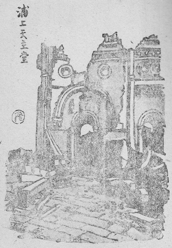

## Humildad

El nombre de bautismo de Makoto es Diego Kisai, ¿verdad? San Diego Kisai fue uno de los veintiséis santos mártires de Japón, el que murió mártir aquí en Nagasaki, en la colina de Nishizaka, el 5 de febrero del año 2 de Keichō (1597). Aunque se los llama los veintiséis santos, dentro de Japón los conocen pocos; como la Iglesia católica de todo el mundo celebra su fiesta cada 5 de febrero, son más famosos en el extranjero. Quizá sean, de todos los japoneses de antes y de ahora, los más conocidos. Porque los europeos, por la valerosa conducta de aquellos veintiséis mártires, supieron que los japoneses son un pueblo valiente.

Ahora bien, de este san Diego Kisai no se sabe nada más que esto: que nació en Bizen, que entró en la Compañía de Jesús y trabajaba como portero de la iglesia, y que murió a los sesenta y cuatro años, el más anciano de los veintiséis. Mientras vivió, no debió de ser nada famoso en la sociedad. ¿Por qué será que un viejecito así fue elevado al rango de santo, la mayor gloria a que puede llegar un hombre, y que las personas de buena voluntad de todo el mundo celebran una fiesta en su memoria?

La orden de Hideyoshi de ejecutar a todos los cristianos de Japón fue el 8 de diciembre del año 1 de Keichō (1596). El 8 de diciembre es un día que Japón no puede olvidar, ¿verdad? Las dos veces fue el día en que rompió con las naciones civilizadas del mundo y se encerró en una pequeña cáscara.

Pues bien, todos los cristianos resolvieron aceptar el martirio. En aquella época había entre ellos muchos hombres de cultura con influencia: Mitsunari Ishida, Yukinaga Konishi, Ukon Takayama y otros.[^ed1] A estos hombres, por haber sido cristianos, los historiadores de épocas posteriores hablan mal de ellos, pero en su tiempo eran personas de carácter y gozaban de gran estima. También eran muchos los cristianos entre los comerciantes de la región de Kioto y Osaka. Esta gente no solo ocupaba una posición social destacada, sino que además era fervorosa como creyente: se esforzaba en las obras de la Iglesia, gastaba de buena gana su fortuna personal en socorrer a los pobres y en otras cosas, y era incluso el centro de la evangelización. En cuanto oyeron el rumor de la ejecución, cada uno se puso de inmediato a prepararse para que lo mataran. Fue un gran alboroto: repartían la herencia, despedían a sus vasallos, ponían en orden sus cosas, componían su poema de despedida de este mundo, se vestían con el traje blanco de gala para estar listos cuando llegara el enviado, y así por el estilo. Algunos hasta ofrecieron banquetes de despedida.

Los japoneses aprecian hacer florecer su muerte. Desde siempre desean que se diga de ellos: «Así era él, de veras. Tuvo un final limpio, como corresponde a un guerrero digno de su nombre, un final brillante, una muerte admirable». Ser elogiados por la gente, dejar su nombre en la historia... Este era también un anhelo que existía en el corazón de los cristianos de entonces.

Pero, por diversas circunstancias, la ejecución general no se llevó a cabo, y se decidió que solo serían muertos veintiséis. Esos veintiséis eran, además de seis occidentales, entre ellos el padre Pedro Bautista, que se destacaba entonces por sus obras de caridad, veinte japoneses; y esos veinte eran todos sin excepción gente de la que el mundo no conocía ni el nombre. No hay ni uno del que se sepan a la vez el lugar de nacimiento, el nombre y apellido y la edad. Tampoco se sabe casi nada de sus vidas. Entre ellos hay incluso quienes solo se conocen por el nombre cristiano, y no se sabe su nombre civil.

Esta gente creía rectamente desde hacía tiempo en la doctrina de Dios y, dentro de lo que alcanzaba cada uno, aunque en pequeño, se esforzaba siempre en el camino de la perfección. Quienes los rodeaban los reconocían como creyentes sin una sola falta, pero no hacían ninguna gran obra de caridad que dejara boquiabierto al mundo, ni donaban cientos de monedas de oro a la Iglesia, ni se encargaban en las celebraciones de la Iglesia de ningún papel que llamara la atención; es decir, a los ojos de los hombres no se los veía muy grandes. Ellos mismos, cuando oyeron el rumor de la ejecución general de los cristianos, aunque habían resuelto aceptar el martirio, temían, débiles como eran, no poder soportar hasta el final tormentos tan terribles, y llegaron a pedir una ayuda especial de Dios. Estaban lejos de pensar en la gloria de ser santos, y tampoco tenían la seguridad de poder tener un final brillante que llamara la atención. Eran gente débil que solo rezaba, mirando a Dios: «Ayúdanos».

Pero a los que son elevados al rango de santos Dios los veía con claridad. Eran personas que acumulaban en el cielo un tesoro escondido.[^ed2] Eran personas que practicaban sin cesar buenas obras que no llamaban la atención.

Las palabras de Jesús:

«Guárdense de hacer su justicia delante de los hombres con el fin de que los vean; de otro modo no tendrán recompensa de su Padre que está en los cielos. Por lo tanto, cuando des limosna, no toques la trompeta delante de ti, como hacen los hipócritas en las sinagogas y en las calles, con el fin de que los alaben los hombres. En verdad les digo que ya recibieron su recompensa. Tú, por el contrario, cuando des limosna, que tu mano izquierda no sepa lo que hace tu mano derecha, para que tu limosna quede en lo oculto; de este modo, tu Padre, que ve en lo oculto, te recompensará».[^ed3]

se aplican a este caso, me parece. Mitsunari y Yukinaga tocaron la trompeta ellos mismos, ¿no? Por eso, ya en vida el mundo los mimaba y los elogiaba. Con eso ya recibieron su premio, así que de Dios no reciben nada.

¿Por qué no estuvo bien que los cristianos famosos armaran tanto alboroto ante la gloria del martirio? Porque, al fin y al cabo, era una muestra de vanidad. Todos, sea quien sea, desean que al menos su muerte sea hermosa; es un sentimiento natural. Pero querer en particular que de uno quede para mucho tiempo una buena fama en boca de la gente, eso se vuelve vanidad. La vanidad enturbia el corazón. Con un corazón turbio no se puede ver a Dios. Jesús dijo: «Bienaventurados los limpios de corazón, porque verán a Dios».[^ed4] Parece solo un pequeño desliz, pero se sale del camino de la perfección.

Otra cosa que me parece extraña es esta: ¿por qué Dios eligió a gente tan pequeña, dejando de lado a grandes sabios y grandes personajes? También esto lo dice claramente Jesús.

«Yo te alabo, Padre, Señor del cielo y de la tierra, porque has ocultado estas cosas a los sabios y prudentes y las has revelado a los pequeños. Sí, Padre, porque así te ha parecido bien».[^ed5]

Lo esencial de la enseñanza de Dios, al contrario, quizá lo entienden mejor los que no tienen estudios. Tal vez, cuando uno tiene sabiduría humana, justamente por eso se le nubla la vista y no puede captar bien la fe.

Cuando los veintiséis cristianos fueron apresados, dieron gracias a Dios enseguida y se alegraron de que un ser insignificante como ellos hubiera sido añadido a la compañía de los mártires. Fue porque Jesús había dicho:

«Bienaventurados los que padecen persecución por causa de la justicia, porque suyo es el reino de los cielos. Bienaventurados cuando los injurien, los persigan y, mintiendo, digan contra ustedes todo tipo de maldad por mi causa. Alégrense y regocíjense, porque su recompensa será grande en el cielo».[^ed6]

Y de veras se alegraron y regocijaron. Y hasta el instante de su muerte conservaron la mansedumbre, la humildad, la paz del alma, el valor sereno y la paciencia. Eran, en verdad, personas elegidas.

Los metieron a todos en la cárcel y, el 3 de enero del año siguiente, en la encrucijada de Ichijō de Kioto les cortaron las orejas y los pasearon por las calles de la ciudad. La sangre que manaba de los cortes en las orejas se helaba. El día 7 los pasearon por la ciudad de Osaka, el 8 salieron de la ciudad de Sakai y recorrieron a pie, por caminos de nieve, más de doscientos ri (unos ochocientos kilómetros) hasta Nagasaki. Con una sola prenda sin forro, atados por la cintura con una soga, descalzos, pisando el hielo... ¡Ay! El más pequeño se llamaba Luis Ibaraki y tenía doce años: un niño de cuarto grado, ¿sabes? Un poco mayor, Antonio, de trece. Ninguno cayó por el camino ni se rezagó, y por fin el 5 de febrero llegaron a Nagasaki. Pasaron por ese camino que está junto a nuestra casa, pasado el mediodía. Pasaron junto a la universidad de allá y, bordeando la orilla del puerto, alcanzaron Nishizaka al atardecer. Cuando el sol poniente teñía de rojo el lugar de ejecución, murieron en la cruz, atravesados por la lanza. Sonriendo... Cuando la lanza le atravesó el pecho, Luis dijo «Cielo, cielo», y cuentan que las puntas de sus dedos se movieron temblando. El anciano Diego Kisai parece que expiró tranquilo, sin decir nada. De principio a fin fue de los que no gustan de llamar la atención.

En el año 2 de Bunkyū (1862) se celebró en la basílica de San Pedro de Roma la fiesta oficial de los veintiséis santos de Japón, y salió un decreto del papa para que cada 5 de febrero la Iglesia del mundo entero celebrara esta fiesta. Como dice el refrán, «al pie del faro hay oscuridad»: los únicos que no lo sabían eran los japoneses.

El séptimo día del nacimiento de Makoto, cuando recibió el Bautismo, papá escogió entre muchos santos a este san Diego Kisai para que fuera el santo de su nombre. Lo hice porque quería que toda la vida tomaras de ejemplo a este viejecito.

«¡Humildad!»

Esto fue lo que atravesó toda la vida de este viejecito.

¡No te metas donde no te llaman, no te des aires, no te hagas un nombre, no te vuelvas popular, no te preocupes por el mundo, haz siempre el bien a escondidas!

No hay que olvidar las palabras de Jesús:

«Todo el que se ensalza será humillado, y el que se humilla será ensalzado».[^ed7]

## Coraje

«Cuando les di hojas de verdura a los pollitos, papá, se armó una gran pelea. Si tienen hambre, podrían comer enseguida, pero en vez de eso, cada uno quería llevarse la hoja para sí y no dejársela a los otros, y se picoteaban y se perseguían, se arrebataban la hoja, tiraban de ella, y al final la pisotearon y la ensuciaron para que no se pudiera comer. Qué tontos son los pollitos», informó Makoto al volver del gallinero.

«¿Por qué se habrán peleado tanto?», pregunté.

«Debió de ser que las hojas eran muy pocas, porque hay tres pollitos y solo les di una...».

«Entonces, ¿qué habría que hacer para que no peleen?».

«Darles muchas, ¿no?».

«Si lo sabías, haberlo hecho».

«Lo sabía, pero no había».

«Si no había, ¿qué haces?».

«Darles algo de reemplazo, como gnafalio o romaza. Pero últimamente todas las casas del vecindario crían cabras, y de eso tampoco hay».

«Entonces, ¿qué habría sido mejor?».

«A ver... Lo mejor sería abrir la puerta y dejarlos salir, pero arruinarían la huerta del vecino, así que no se puede...».

Makoto no parecía tener una buena idea.

«Cambiando de tema, a propósito... ¿y las palomas?».

«Bien».

«Esos compañeros de la paloma, tu grupo...».

«Sí».

«Hablo del trabajo de la liga juvenil para evitar la guerra. ¿Por qué no pensamos ese trabajo junto con este problema de las hojas de verdura de los pollitos?».

«¿Qué relación tiene?».

«¿Quién hizo la guerra? La hicieron porque faltaban hojas de verdura, ¿no? Si se les da comida de sobra, no hacen la guerra. Con las personas pasa algo parecido. Hay mucha gente, pero faltan los bienes necesarios, y por eso dentro del país estalla la lucha de clases y entre los Estados estalla la guerra. Está bien que los compañeros de la paloma griten “¡Evitemos la guerra!”, pero si solo se grita y no se quita la causa de la guerra, no sirve de nada».

«Es verdad».

«Desde antiguo se dice que a los japoneses les gusta la guerra, pero ¿acaso hay personas a las que, de por sí, les guste la guerra? A nadie le gusta que lo maten sin más. Tampoco le gusta a nadie matar de repente, al toparse con él, a alguien que no le ha hecho ningún daño. La guerra es que, por orden del jefe y en nombre de la patria, muchos pierden la cabeza y se matan unos a otros. Si matar a una persona por cuenta propia es un pecado grave, ¿cómo podemos decir que matarse en masa no es pecado? Creo que los samuráis japoneses bebían sake siempre antes de ir a la guerra y después de terminada, no tanto para disimular el miedo a que los mataran como para disimular los remordimientos de conciencia por haber matado. A los japoneses no les gusta la guerra. Pero desde la apertura del país, como la situación del país no permitía dejar de hacer la guerra, hicimos la guerra sin cesar y al final dimos a los extranjeros la impresión de que nos gusta la guerra. La situación que no permitía dejar de hacer la guerra era que, por vivir sobre un volcán que asoma la cabeza en el mar, no teníamos bienes suficientes para alimentar a la población. La historia de Japón es la historia de la guerra. Desde el emperador Jinmu hasta la bomba atómica se ha tenido por grande al más fuerte de brazo. ¿Cómo termina, al fin y al cabo, el pueblo japonés criado con esa idea? Así, como ves. Se cumplieron por completo las palabras de Jesús: “Vuelve tu espada a su sitio, porque todos los que recurren a la espada, a espada perecerán”.[^ed8] Ahora bien, al repasar la historia de dos mil años, descubrimos un error que los japoneses cometían sin darse cuenta. ¿Cuál es?».

«Pues... A ver...».

«No buscaron ni crearon nuevos recursos con la fuerza de la cultura. Solo se esforzaron en conseguir por la fuerza de las armas los escasos recursos que hay en la naturaleza. Eso es. Mira otra vez la historia pensándolo bien».

«...».

«En vez de tomar el método pacífico y productivo de enriquecer la vida con ingenio e inventiva, trataron de vivir cómodamente robando los recursos que otros habían desarrollado. Escogieron el método violento y destructivo».

«Pero Japón es un país que no tiene, así que no hay remedio, ¿no?».

«¿Un país que no tiene? No tiene porque no crea. Los japoneses dicen enseguida que Estados Unidos es un país que tiene. Entonces, ¿en América hay algún árbol en el que den aviones? ¿Algún lago donde se pesquen aparatos de televisión? ¿Eh? ¿Cavando en alguna montaña salen automóviles a montones?».

«No, claro».

«Tampoco Estados Unidos fue desde el principio un país que tiene. Creó los recursos desde dentro de la cabeza del hombre. ¿Y los japoneses?».

«Pero es que en Japón no hay materia prima para fabricar esas máquinas...».

«Como solo imitan los inventos y descubrimientos de los extranjeros, andan diciendo que no hay materia prima y cosas así. ¿No bastaría inventar algo nuevo con las materias primas que hay en Japón?».

«Tienes razón».

«Y ahora, el Japón de hoy parece un gallinero. En un territorio estrecho se aprietan unos contra otros hombres hasta desbordarse, y se disputan a la fuerza los pocos bienes. Hay incluso quienes tratan lo que se importa gracias a la buena voluntad de otros países como los pollitos que pisotean la hoja de verdura y la dejan incomible. ¿Cómo se podría salvar la situación? La respuesta es simple: dar lo suficiente para una vida mínima. Pero faltan esos bienes. Los sustitutos también se han agotado. Todavía no se permite tampoco emigrar a una parte de la población al extranjero. Y la población no deja de aumentar cada día. Por eso se propone la teoría de limitar la población. Se limita la población según la cantidad de bienes. Hay para ello un método que consiste en matar a todos los que vivan por encima de cierto número, y otro, en impedir que nazcan niños por encima de cierto número. Matar no quiere decir ejecutar: si no se aplican medidas de socorro social, los débiles que pierden en la lucha por la vida mueren por sí solos, así que, de este modo, la fuerza de toda la sociedad los hace morir de hambre de manera indirecta. Si no hubiera habido el racionamiento controlado de alimentos, sin duda habría ocurrido un estado así, pero esto es algo que solo hacen ciertas sociedades que no han madurado. Hay también intelectuales que sostienen con seriedad que impedir que nazcan niños es menos cruel que este método, pero de todos modos, sin duda es un homicidio disfrazado».[^ed9]

«¿Homicidio? Entonces la teoría de limitar la población ¿es una teoría que incita al homicidio?».

«Claro que sí, es una maldad. Porque Dios ha ordenado: “¡Crezcan, multiplíquense, llenen la tierra!”.[^ed10]...».

«¿No será excesivo seguir diciendo todavía “crezcan, multiplíquense”, con lo difícil que se ha puesto la vida?».

«Puede parecer excesivo. Pero un Dios omnisciente, omnipotente y todo bondad no puede imponer lo imposible».

«Pero de hecho está ocurriendo lo imposible, ¿no?».

«¿Quieres decir que la responsabilidad es de Dios?».

«Que Dios tenga la responsabilidad no puede ser, pero...».

«¿Crees que un Dios que es amor mandaría llenar la tierra[^ed11] sin haber preparado antes lo que el hombre necesita para vivir? No habría dado una orden tan descuidada. Aunque la humanidad crezca hasta llenar la tierra, tiene que estar bien preparado lo necesario para vivir. ¿No será que la humanidad aún no lo ha encontrado? Está escondido en alguna parte. La humanidad, por pereza, no ha llegado hasta ahora a sacarlo y aprovecharlo. A los hombres se les han dado de antemano inteligencia y libre albedrío. Y Dios manda también: “Con el sudor de tu frente comerás el pan”.[^ed12] ¿Ha ejercido la humanidad hasta ahora correctamente esta inteligencia, este libre albedrío y este sudor de la frente?».

«Creo que los ha ejercido bastante bien. Porque ha construido la sociedad civilizada de hoy, completamente distinta del mundo animal. El uso del fuego, el uso de las máquinas, con piedra, madera, cobre, hierro, aluminio y otros materiales, y también con vapor, corriente eléctrica, ondas de radio... Y además el aumento de los alimentos por el cultivo de arrozales y campos... y cosas así...».

«Sí. Es cierto. Pero entre ellos no son pocos los que usan tal cual lo que existe en la naturaleza. Carbón, petróleo, pescado, metales, algodón, lana, leche, carne de vaca... el ingenio del hombre apenas interviene en eso. Se cava el carbón y se quema, se pesca sin dejar uno, se cortan los árboles del monte para construir casas, se hace fuego, se reúnen plantas que dan fruto y plantas de hojas comestibles y se plantan en arrozales y campos. Es una vida que difiere poco de la de los animales, que viven solo de instinto, sin inteligencia. Es como un hijo imprudente que vive de comerse la herencia que le dejaron sus padres. Y cuando agota lo que tiene a su alrededor, sale a la casa vecina y trata de arrebatarlo por la fuerza. Esa gente son fieras. Por cualquier cosa sin importancia pegan enseguida la palabra “lucha” y quieren enseñar los dientes. Así uno ya no sabe para qué es hombre. Dan ganas de preguntarles otra vez: ¿dónde se les ha olvidado la inteligencia?».

«¿Qué recursos nuevos se han creado con la inteligencia? Por ejemplo...».

«La fijación del nitrógeno del aire, las resinas artificiales, el nailon, una parte de las ondas de radio, por ejemplo las de la telegrafía sin hilos, las ondas cortas, las ultracortas, los rayos X. Los ultrasonidos, la dinamita, la corriente eléctrica, el jabón, el lápiz, el papel, la aspirina, el motor, ah, el avión...».

«El jeep, el tractor, el buldócer, el chicle...».

«¿El chicle? Vaya, pues sí, tienes razón».

«La limonada artificial, la sacarina, la mantequilla artificial...».

«Vaya, vaya. Makoto solo nombra cosas de comer y de beber».

«Todavía sé otra. La más grande».

«¿Ah, sí? ¿Cuál?».

«¡La energía atómica!».

«¡Eso es!».

Los dos nos quedamos callados, excitados por nuestras propias palabras. El páramo atómico que rodea la casita, aunque era de día, estaba en completo silencio. El viento sopla a campo abierto y pasa por dentro de esta casita, pero afuera no se oye ni el ruido del viento. No hay árboles ni hierba en los que el viento pueda sonar. Todo es llano y pelado. Vuelvo a mirar afuera por el vidrio. ¡Qué fuerza tremenda fue! Todavía hoy me deja admirado. Con una sola bomba, toda una ciudad tan grande se convirtió en un campo liso y pelado.

«Son muchas las cosas que dice esta bomba atómica que estalló aquí», comencé a hablar con calma.

«La disputa por los recursos fue una de las causas principales de esta guerra. Ya se ha ido sabiendo, más o menos, la cantidad total de los recursos naturales que se pueden aprovechar. Por ejemplo, cuánto petróleo queda en total en toda la Tierra, cuánto carbón, cuánto hierro, cuánto aluminio, cuánta tierra cultivable... Como eso se ha ido sabiendo, también se pudo prever que dentro de tantos años se agotarán tales y tales cosas, que tal cosa se acabará de cavar en tantos años... Que, para que nuestro pueblo, solo nuestro pueblo, sobreviva y tenga vida cultural, es imprescindible asegurarse desde ahora estos y aquellos recursos. Que, si es posible, lo mejor es obtenerlos de manera pacífica por el comercio, pero que, si no se logra lo que se desea ni siquiera apelando a la fuerza de las armas, nuestro pueblo perecerá... Un egoísmo nacional precipitado de este tipo, que alegaba como motivo aparente la justicia o lo que fuera, fue, creo, lo que inició la guerra. Pero cuando la guerra empezó, resultó una guerra que consumía mucho más de lo previsto, y mira, uno pensaba conseguir recursos y se perdió capital e intereses: ya no hay aluminio para las fiambreras, no hay sartenes para la cocina, no hay carbón, no hay electricidad y, por si fuera poco, nos quedamos también sin dinero. Esto también es, como dije al principio, el resultado final de la tradición de nuestro pueblo, que rechazó por lenta la vía de enriquecer la vida con la fuerza de la cultura y escogió la de la fuerza de las armas, más rápida. En los últimos tiempos de la guerra, nosotros los japoneses habíamos caído en el llamado empobrecimiento paulatino, sin salida, en completa desesperación. Y entonces, con el Pikadon, estalló la bomba atómica.

{width=60%}

«La bomba atómica enseñó a la humanidad que existen recursos completamente nuevos. Aquí hay un gran significado. El petróleo escasea. Se le ve el fondo al carbón. Al desaparecer las fuentes de energía, ¿no terminaría también la civilización de la humanidad? Ante el porvenir de la supervivencia humana se alzaba una roca negra de desesperación. Esa roca la voló la bomba atómica. Por el agujero que abrió la bomba atómica vio la humanidad asomar la luz de un mundo nuevo. Una esperanza luminosa brotó en el pecho de la humanidad: entrando por este agujero y buscando, se podrá extraer energía nueva sin límite, se podrán sacar bienes nuevos sin límite. Todas las cosas están compuestas de átomos. Hay átomos por todas partes. En estos átomos escondió Dios, desde la creación del cielo y la tierra, una fuerza tan prodigiosa. Y además, dio también a la humanidad la inteligencia para buscarla, extraerla y usarla. Con solo poner en juego la inteligencia, sin duda se podrán encontrar todavía muchas otras fuentes de energía y de bienes.

«Todas las criaturas han sido creadas por Dios para estar al servicio del hombre. Dejar sin usar lo que ha sido preparado para que el hombre lo use es pereza del hombre. Una pereza imperdonable. Se nos manda trabajar con el sudor de la frente.[^ed13] Pero ¿dónde sudan trabajando la mayoría de los hombres? ¿No sudan las piernas? ¿No sudan los brazos? Se dice que el trabajo es sagrado; eso está bien. Las masas piensan que trabajo es sobre todo trabajo muscular. Y se arremangan y se dan aires. Apoyándose en el número, tratan de rebajar el valor de los que sudan con el cerebro. Pero seguro que lo sentiste vivamente cuando se allanaba el terreno de aquellas ruinas calcinadas: cientos de trabajadores japoneses sudaban brazos, hombros y piernas con los canastos de acarreo y las azadas, y con lo lento que era aquello, de repente llegó un solo buldócer y en un abrir y cerrar de ojos terminó de allanar el terreno.

«Si la fuerza de los brazos fuera lo noble, el oso sería más grande que el hombre. Si la fuerza de los hombros fuera lo noble, el hombre no podría competir con el buey. Corriendo, pierde con el caballo, y en olfato no llega ni a la mitad del perro. Lo que hace noble al hombre como hombre es poseer inteligencia y libre albedrío. La dictadura de quienes solo reconocen valor al trabajo muscular, ¡qué palabra más ajena para un hombre dotado de inteligencia y libre albedrío! Llevar una vida digna del hombre es usar correctamente esta inteligencia y este libre albedrío según la voluntad de Dios.

«Ya pasó la época de pereza en que la humanidad, igual que los animales que solo tienen instinto, malgastaba los recursos naturales. Con un solo Pikadon, la humanidad despertó de su cabeceo. De ahora en adelante empieza la era en que la humanidad usa correctamente la inteligencia y el libre albedrío que se le han dado y va encontrando uno tras otro los recursos escondidos. Ha llegado el momento en que gana la inteligencia y la fuerza de los brazos retrocede hasta su lugar legítimo. Es una buena época, en la que el hombre puede llevar una vida digna del hombre. Makoto y los de tu edad vivirán en esa época. Los envidio».

«Entonces, la bomba atómica fue un gran grito para despertar a la humanidad de su cabeceo, ¿no?».[^ed14]

[^ed1]: N. del E.: Mitsunari Ishida no fue cristiano: practicaba el budismo zen y está sepultado en el templo Sangen-in, de Daitoku-ji, en Kioto. Sí lo eran Yukinaga Konishi, ejecutado con él tras la batalla de Sekigahara (1600), y Ukon Takayama. Sobre el juicio que sigue acerca de unos y otros, vale lo que enseña el Catecismo: «el juicio sobre las personas debemos confiarlo a la justicia y a la misericordia de Dios» (Catecismo de la Iglesia Católica, 1861).
[^ed2]: Cf. Mt 6, 20; cf. Mt 6, 4.
[^ed3]: Cf. Mt 6, 1-4. N. del E.: la Biblia de Navarra dice en el v. 2 «no lo vayas pregonando»; se conserva aquí la «trompeta» porque el autor la retoma en el párrafo siguiente.
[^ed4]: Mt 5, 8.
[^ed5]: Mt 11, 25-26.
[^ed6]: Cf. Mt 5, 10-12.
[^ed7]: Lc 14, 11; cf. Lc 18, 14; Mt 23, 12.
[^ed8]: Mt 26, 52.
[^ed9]: N. del E.: el autor escribe veinte años antes de la encíclica Humanae vitae (1968). La Iglesia enseña que el aborto es un crimen abominable (Catecismo de la Iglesia Católica, 2271) y que la anticoncepción es intrínsecamente mala (Catecismo de la Iglesia Católica, 2370); al mismo tiempo, admite que los esposos, «por razones justificadas», espacien los nacimientos recurriendo a los períodos infecundos (Catecismo de la Iglesia Católica, 2368 y 2370), y que el Estado oriente la demografía con información, «pero no mediante una decisión autoritaria y coaccionante» (Catecismo de la Iglesia Católica, 2372).
[^ed10]: Gn 1, 28.
[^ed11]: Cf. Gn 1, 28.
[^ed12]: Cf. Gn 3, 19.
[^ed13]: Cf. Gn 3, 19.
[^ed14]: N. del E.: el autor, víctima él mismo de la bomba, habla aquí del descubrimiento de la energía atómica como recurso, no de la licitud del bombardeo. La Iglesia condena «toda acción bélica que tiende indiscriminadamente a la destrucción de ciudades enteras o de amplias regiones con sus habitantes» como «un crimen contra Dios y contra el hombre mismo» (Catecismo de la Iglesia Católica, 2314). Dios puede sacar un bien de un mal, «sin embargo, no por esto el mal se convierte en un bien» (Catecismo de la Iglesia Católica, 311-312).
