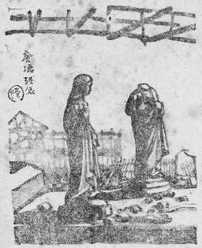
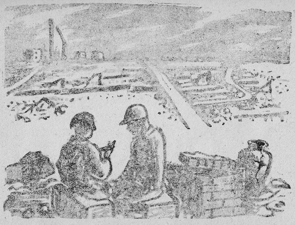

## El científico

Los mineros que sacan gemas de las minas llevan una vida completamente opuesta a la de quienes las lucen. La gema que brilla en el pecho de la dama que, bajo una brillante araña de luces, ebria de buen vino, baila y se divierte al compás de una música alegre, ¿quién la buscó, dónde y cómo? Un trabajador entra, guiándose por una lámpara en la frente, en la boca de una mina abierta en una montaña de África donde no vive nadie, avanza y avanza hasta llegar al fondo, y allí blande el pico contra la tierra. Fijando una mirada aguda de tasador en cada piedrecita, a ver si es gema o simple piedra, cava con todas sus fuerzas abriendo tierra nueva. Solo la voluntad de encontrar una hermosa gema, la convicción y la esperanza de que sin duda saldrá, la paciencia de no desistir hasta encontrarla y la fuerza física para seguir cavando hasta el final. Quizá cave toda la vida y termine sin haber encontrado nunca una gema. Muchos antecesores murieron así en la mina, con su propósito a medias. Pero, de manera literal, pasando sobre los cadáveres, el siguiente recibió el pico. No sabe quién usará, dónde y cómo, la gema que sacó; cava rogando que, al menos, no se convierta en causa de pecado.

El científico es un trabajador que produce civilización. En un laboratorio donde nadie mira, con todas las fuerzas del corazón y del cuerpo, va hallando poco a poco la civilización. Solo ruega que los inventos y descubrimientos que halla así no se usen para el pecado.

Vida cultural, sociedad civilizada. Mientras la humanidad vive alegre, animada y cómoda, el científico, pobre y sufriendo, sudando en el pecho, en la punta de la nariz y en la palma de la mano, produce los bienes de la cultura.

Muchos de los hombres modernos que presumen de vida cultural no son más que meros consumidores de cultura. Hundidos en lo hondo del sofá, sorbiendo cacao o una limonada con soda, con el oído atento al Chaikovski que sale del tocadiscos eléctrico, pero el dinero con que compraron los muebles y enseres de esa vida cultural lo ganaron apenas pasando bienes culturales de una mano a otra...

El productor no tiene nada que ver con la vida de consumo, y el consumidor no conoce las penas de la vida de producción.

* * *

Como había florecido un lirio blanco en el jardín, me lo pusieron en un florero junto a la almohada. En el páramo atómico, en este tercer año, por primera vez las flores de todas clases han empezado a florecer como de costumbre. El año pasado también florecieron, pero de manera rara. ¡La belleza y la nobleza del lirio que veo después de tanto tiempo! ¡Qué obra maravillosa de Dios! Sin duda supera el atavío de Salomón en el colmo de su esplendor.[^ed1] Qué bueno, qué bueno es el lirio. Para cultivar flores, nada como el lirio. Nada como el lirio blanco. Todos los que venían a visitarme elogiaban este lirio.

Al tercer día, un grupo de alumnas me regaló un ramo de lirios. ¿Cuántas flores serían? De un vistazo se contaba que no bajaban de veinte. Las metieron de cualquier manera, en abundancia, en un florero grande. Eso ya no era una flor. Era una masa resplandeciente. Más que hermosa, deslumbraba. No era cosa de elogiarla: lo aplastaba a uno. No se podía contemplar: lo embriagaba a uno. Vino un amigo a visitarme y, antes de abrir la puerta de entrada, lo oí murmurar: «Vaya, hay lirios». Y apenas entró, murmuró: «Qué buen olor».

Lo mismo ocurre con el mundo científico de un país. Es verdaderamente triste que se elogie, se contemple y se hable solo de uno o dos científicos. En un país con cientos y miles de científicos destacados, un país con varios premios Nobel, cada científico no llama la atención. Y en ese país el aroma de la ciencia lo llena todo. Perfuma incluso más allá de sus fronteras.

## El fin de la vida

Al renacuajo le salen patas, se le acorta la cola, y con el tiempo se vuelve rana. No hay ranas grandes ni ranas tontas. Todas son la misma rana. Nacen del todo iguales y se vuelven ranas del todo iguales. Pero estas ranas no pueden tener un sistema social. Muchas ranas con la misma fuerza se reúnen y se pasan la noche entera armando alboroto.

Si todos los hombres tuvieran capacidades iguales, ¿se habría formado una sociedad tan conveniente? ¿Y si toda la humanidad fuera por igual del nivel de primer ministro? ¿Y si toda la humanidad fuera por igual bonachona? En cualquiera de los dos casos, se reunirían solo para armar alboroto y no harían nada. ¿No será justamente porque las capacidades naturales de los hombres no son iguales por lo que el sistema social funciona?

Para que toda la sociedad humana funcione bien, quizá sí convenga que las dotes naturales de cada uno sean distintas, pero ¿no salen perdiendo los que nacen de poco talento, los de cuerpo débil, los que nacen en una casa pobre? Si Dios creó amando a cada uno, ¿acaso el amor de Dios por cada persona fue grande en unos y pequeño en otros? ¿No habrá parcialidad en el amor de Dios?

El genio hace grandes inventos sin esfuerzo y recibe los aplausos del mundo, pero el de pocas luces, por mucho que estudie, ni siquiera logra entrar en una escuela superior.

Aunque uno sea listo y fuerte de cuerpo, si su casa apenas puede subsistir el día a día, no puede desarrollar su talento y tiene que echarse a perder en la montaña.

El hombre es creado por primera vez cuando es concebido en el seno de su madre, y antes de eso es la nada absoluta. No existe ninguna vida anterior. Si hubiera vida anterior, se podría decir que la causa y el efecto de la vida anterior se manifiestan y por eso hay felicidad o desgracia de nacimiento, pero como no hay vida anterior, las diferencias naturales entre los hombres no son responsabilidad suya, sino que se deciden por completo según lo que Dios quiere. ¿Por qué obra Dios con esta parcialidad?

Cuando el grupo de Jesús llegó delante del templo de Jerusalén, allí estaba sentado, pidiendo limosna, un ciego de nacimiento. Los discípulos, dirigiéndose a Jesús, preguntaron:

«¿Por culpa de quién ha nacido ciego este hombre? ¿Por su propio pecado? ¿O por el pecado de sus padres?».[^ed2]

Jesús respondió:

«Ni este ni sus padres han pecado. Ha nacido ciego para que las obras de Dios se manifiesten en él».[^ed3]

Y, haciendo un milagro, hizo que sus ojos vieran.

Lo que el sentido común del mundo considera desgracia y mala suerte, la enfermedad, la pobreza..., todo eso es para que más adelante se manifieste sobre ellos la gloriosa obra de Dios. Si esas personas conservan un corazón dócil, algún día se manifestará la obra de Dios. No solo en quienes nacen desafortunados: aunque los dones naturales que recibe cada uno sean distintos, sin falta algún día se manifestará en su vida la obra de Dios. Hay diversos dones naturales para que la obra de Dios se manifieste de diversas formas. Como quienes manifiestan la gloriosa obra de Dios, cada uno de los hombres es del todo igual.

Que un hombre ascienda y se vuelva un gran político, un gran sabio o un rico no es, a los ojos de Dios, el fin de la vida. Es el fin de la vida a los ojos de quienes no conocen a Dios. El verdadero fin de la vida es «conocer a Dios, amarlo y servirlo, y alcanzar por fin la felicidad del cielo».[^ed4]

Para alcanzar este fin, las diferencias de nacimiento no tienen ninguna relación. Aunque uno no pueda ver, puede alcanzar plenamente este fin. Lo alcanzan igual los de poca capacidad y los genios. No se puede decir que, por ser pobre, no se pueda conocer a Dios.

Quien pasa la vida sin conocer a Dios, por más que llegue a ser gran general y conquiste muchas provincias, no ha alcanzado el fin de la vida. Quien conoce a Dios pero no lo ama y se hace amigo del demonio, por más que su nombre quede en la historia como gran pensador, es alguien que no alcanzó el fin de la vida. Quien proclama con fervor «Dios, Dios»[^ed5] con la boca, pero cuyo vivir diario sirve al demonio, no puede alcanzar el fin de la vida.

Makoto y Kayano no tienen nada de genios. Solo se les han dado capacidades corrientes. Además, la familia no es rica. Pero sin duda la obra de Dios se manifestará en ustedes. Con esa ilusión, quisiera que vivan amando con docilidad a Dios. Que no se equivoquen en el verdadero fin de la vida.

## El oficio

Después de morir, recibimos el juicio de Dios. Entonces, lo que importa no es «¿qué hiciste?» durante la vida, sino «¿cómo lo hiciste?». No se pregunta «¿de quién eras hijo?». Se pregunta «¿cómo serviste a tus padres como hijo?». No se pregunta en absoluto «¿cuál era tu oficio?», sino «¿cómo cumpliste con tu oficio?». Una vez en el cielo, lo alto o bajo de la posición en este mundo, ser sabio o ser necio, ser fuerte o débil... han desaparecido.

Ya en el cielo, el empleado no baja la cabeza ante el directivo. El empleado que cumplió con rectitud y seriedad su deber ocupará un asiento más alto que un directivo algo descuidado. Y entre sí no pensarán que uno fue directivo y otro empleado.

Ser directivo y darse aires dura hasta la muerte, presumir de profesor universitario solo dura mientras se vive, la distinción entre la señora de un multimillonario y la mujer de una modesta casa de vecindad es solo de este mundo; al llegar al otro, no hay ministro ni oficinista, capitán ni cocinero, princesa ni enfermera, director de escuela ni auxiliar, gran campeón de sumo ni persona con dificultad para caminar, diputado ni artesano. Ante los ojos de Dios no se toma en cuenta la clase de oficio, lo alto o bajo del sueldo, la buena o mala presentación, la popularidad, lo alto o bajo del puesto, lo grande o pequeño de la empresa, sino que se examina si cada uno escogió un oficio en que pusiera plenamente en juego los talentos que se le dieron, si fue fiel a ese oficio y si manifestó la gloria de Dios; y según ese resultado se determina el honor que recibe el alma.

En el mundo suele haber hombres que se hacen los valientes y dicen cosas grandes como «yo no quiero dinero, ni honores, ni título, ni vida», y que viven en la pobreza sin hacer nada; hay muchos perezosos que, sin poder ganar dinero ni subir a un puesto honroso, ni queriendo estudiar, se dan aires solo de palabra. Quien puede decir «no quiero dinero» tiene que ser alguien que de hecho tiene en la mano una gran suma. Quien dice «no quiero títulos» tiene que haber publicado trabajos de investigación dignos de que se le conceda un título.

Ante Dios no tienen sentido ni los títulos, ni los honores, ni los bienes; ningún oficio importa. Ser ministro o profesor universitario, auxiliar o portero, no tiene ninguna relación. Lo esencial es que cada uno haya tomado un oficio en el que ejerza plenamente los talentos que se le dieron, y haya amado a Dios, servido a Dios y manifestado la gloria de Dios: con eso, cualquier oficio sirve.

{width=45%}

Aun siendo alguien que solo puede recorrer las lindes de los arrozales gritando «¡Ho-i, ho-i!» para espantar a los gorriones, si se desempeña con seriedad toda la vida espantando gorriones y trabaja por el pueblo, a los ojos de Dios se le pone la nota máxima en el resultado de su vida. Un hombre al que se le dio talento para llegar a ministro, pero que, por haberse descuidado un poco en el estudio a medio camino, solo llegó a viceministro, recibe a los ojos de Dios noventa puntos. Así, en el cielo el espantador de gorriones se sienta en un asiento más alto que el viceministro. No es que, al llegar al cielo, el espantador de gorriones pase a estar por encima del viceministro: ya en vida está por encima. A nadie se le debe fijar su valor por el oficio. El valor del hombre lo decide si ejerce plenamente los talentos que se le dieron. Por ejemplo, si el presidente de un banco fracasara en una inversión y causara perjuicio a los depositantes, sería más grande el encargado que no se equivoca ni en un par de sandalias.

Que alguien sea inteligente no es motivo de orgullo en absoluto. Porque Dios, pensando en la conveniencia de toda la sociedad humana, se lo dio a esa persona para que desplegara esa buena capacidad, así que no es mérito suyo. Haberse hecho doctor, profesor o ministro por ser inteligente tampoco es mérito suyo. Eso también es solo un puesto necesario a la sociedad humana. Y en él hay que poner a la persona adecuada.

## La vida eterna

Nosotros vivimos. Se nace en tal año, tal mes, tal día, y se muere en tal año, tal mes, tal día. Es decir, vivimos en el tiempo. Se lleva un diario. Se escribe: 29 de abril, levantarse a las cinco y media, misa a las seis, desde las ocho y media competencia deportiva de la iglesia... Esto es la vida del tiempo.

Pero al mismo tiempo que vivimos en el tiempo, también llevamos una vida eterna. Lo eterno no es un tiempo infinitamente largo. Es de naturaleza distinta del tiempo. Lo eterno es la experiencia de tener yo una relación directa con Dios. Es decir, hacer el bien que agrada a Dios es vivir eternamente, y hacer el mal que se opone a la voluntad de Dios es morir eternamente. Dicho con sencillez, lo eterno es que en la libreta de notas que Dios tiene a mano se anoten ◎ o ×.

Pero en nuestra vida hay muchas cosas en las que no se anota en la libreta de Dios ni ◎ ni ×, es decir, que no son ni buenas ni malas. Por ejemplo, dormir de noche, caminar por el camino, comer, mirar las nubes, respirar, rascarse donde pica, estornudar, ver béisbol, escuchar la radio... Esto queda en el diario, pero no en la libreta de Dios. En la libreta de Dios está en blanco.

El tiempo desaparece el día del fin del mundo. El más allá no es una prolongación del tiempo de este mundo. El diario del hombre, es decir, la historia, desaparece sin dejar rastro junto con el fin del mundo. La vida del tiempo también termina ahí. Lo que queda es solo el registro de la vida eterna.

Al morir y presentarse ante Dios, cuando se le muestre la libreta de notas de toda la vida, si está en blanco... no se sabrá para qué nació uno como hombre. Se piensa que hay muchos así. Porque incluso lo que el mundo dice que es bueno, si se hace para uno mismo, no se anota como bueno en la libreta de Dios. Estudiar con seriedad no es malo. Pero si se estudia para ser un alumno sobresaliente y ser elogiado, o para aprobar el examen, conseguir el diploma y ganarse la vida, como no tiene relación con Dios, no cuenta como bien. Sudar afanosamente para cultivar arroz, tirar de un carro, cavar carbón: por mucho que se trabaje, si se trabaja para comer uno mismo, es vida del tiempo y no llega a ser vida eterna. Aunque se done mucho dinero a un orfanato, aunque se cure gratis a muchos enfermos, si se hace para dar a conocer el propio nombre al mundo y para que el mundo lo llame filántropo o apóstol del amor, en la libreta de Dios no se anota como bien. Queda en blanco. Son muchos los héroes, los hombres de temple, los artistas, los personajes religiosos, los políticos, las bellezas y los sabios que dejaron su nombre en la historia, pero ¿cuántos de ellos estarán, en efecto, anotados como bien en la libreta de Dios? Es de suponer que la mayoría dedicó la vida a su propia honra, de modo que solo vivieron en el tiempo; aunque su nombre se escribió en grande en la historia humana, desaparecerá sin dejar rastro con el fin del mundo y el fin del tiempo.

Esta vida es el campo de trabajo para acumular tesoros en el cielo.[^ed6] Día tras día, hora tras hora, segundo tras segundo, viviendo en el tiempo, hay que ingeniárselas para vivir eternamente. Hay que acumular pequeños tesoros eternos. Hay que hacer sin cesar pequeñas obras buenas para que Dios las anote en su libreta como bien, bien. ¿Y cómo se pueden hacer entonces los pequeños tesoros?

Que lo que se hace sea o no un tesoro lo decide la intención con que se hace.

«¡Para la gloria de Dios!».

Lo que se hace pensando así tiene relación directa con Dios y por eso es eterno. Cualquier cosa, por pequeña que sea, aun recoger una paja, apartar una piedrecita del camino, cortarse las uñas crecidas, si se hace para la gloria de Dios, Dios lo ve como bien. Al dormir de noche también, si uno duerme pensando «duermo para curar el cansancio del trabajo de hoy y mañana poder trabajar con más ánimo para la gloria de Dios», eso Él lo toma como bien. Las cosas que antes dije que no eran ni buenas ni malas, comer, respirar, estornudar y otras, si se hacen para la gloria de Dios se vuelven obra buena eterna. Esforzarse siempre en hacer solo lo que sea para la gloria de Dios. No hacer lo que no sea para su gloria. Si se mantiene esta actitud, se vive eternamente.

Y lo que hay que agradecer es que esta manera de vivir la puede practicar una persona en cualquier situación. Dios es totalmente imparcial. Si Dios solo tuviera por bueno lo que se haga en bien de la sociedad y de la nación, un enfermo como papá tendría que desesperar del todo en este punto. No solo no puedo servir de nada a la sociedad ni a la nación, sino que solo les causo molestias. Pero, tratándose de la gloria de Dios, hay mucho que puede hacer un enfermo. Y así uno siente el sentido de estar vivo. No queda resquicio para que surja el pensamiento pesimista de querer morir pronto.

¡Para la gloria de Dios!

Hay muchísimo que hacer. Qué alegre es la vida...

## La propia sangre

Que a los pacientes de leucemia mieloide les caracteriza quejarse de dolor de huesos es algo que recuerdo desde mis años de estudiante, pero ahora que de verdad me duele a mí, ya no puedo decir con la frialdad de los tiempos de estudiante que «lo característico es quejarse de dolor de huesos». En los libros de medicina, no hay compasión en el texto. Escribir con tanta sencillez en una frase este dolor es, de entrada, ya una falta de humanidad. El dolor de huesos es una sensación realmente fea e indescriptible. Si fuera tal que uno gimiera sudando un sudor frío, habría al menos algo contra lo que luchar. Si fuera como una neuralgia, que contrae el rostro de maravilla, se podría contar a otros. No duele ni deja de doler, no se sabe bien en qué punto, en lo profundo de todo el cuerpo se queda atascado algo brumoso que duele. Aun quieto, el hueso mismo produce dolor. Al tocarlo, sube un golpe sordo. Al golpearlo, uno da un salto. El más doloroso es la tibia, luego el esternón, y los demás se parecen, pero las costillas están bajo una sola capa de piel, y cada vez que algo las toca, un golpe sordo de dolor. Antes era un cuerpo de setenta y un kilos, templado por el deporte, pero estos días estoy tan delgado que se me cuentan los huesos, y hasta el peso del futón repercute en el hueso.

Otra pena es el vientre. Como el bazo se ha agrandado y aprieta el estómago, los intestinos y el corazón, no entra mucha comida, el tránsito intestinal es malo y me falta el aliento. Es igual que una mujer embarazada de diez meses que resopla con los hombros. En el embarazo, cuando nace el bebé, todo termina bien, pero mi bazo no se va. La circulación de las dos piernas es mala y me vienen leves calambres.

Entonces gimo. Si me frotan, alivia un poco. Pero frotar es difícil. Si se frota fuerte, repercute en el hueso. Hay que frotar con suavidad. Si es tan molesto, se me ocurre que lo haga yo mismo, pero como el vientre se me está hinchando como un tambor de madera de templo, el cuerpo no se dobla y la mano no alcanza. Si me frota un adulto, duele más. Por eso, cuando hay visitas, no puedo gemir descuidadamente. Para frotar, solo sirven los niños. Las manos de Makoto y de Kayano tienen la carne blanda, el hueso del centro flexible, poca fuerza: son las más adecuadas para frotar. Cuando me frotan mis dos hijos, es como si me frotara yo mismo con mi mano a mi gusto. ¿Será esto la propia sangre?

Mientras me frotan, sin darme cuenta olvido el dolor y entro en un sueño agradable.

Después de la cena, los niños suelen dormirse primero. La mano que frota se detiene cada tanto, luego se para del todo, el pequeño peso de su cuerpo cae sobre mis piernas y se oye una respiración tranquila.

## La rama cortada

Las rosas trepadoras junto al portón florecieron tanto que las ramas se doblan. Fue en la primavera del año siguiente al bombardeo, cuando traje ramas del seminario y las planté en las ruinas calcinadas donde aún no se había construido la casa. En esta tercera primavera ya son una mata frondosa, y ahora todo el que pasa junto al portón dice «qué lindas» y pasa alegrándose. Parece que también la gente que vive en este páramo atómico por fin tiene holgura para apreciar las flores. De ahora en adelante plantarán flores en cada casa. Quiero retirar pronto las tejas y los escombros y hacer de esto un pueblo de flores.

Kayano cortó una rama y me la puso en el florero junto a la almohada. Los capullos que por la mañana se habían hinchado se abrieron hacia el mediodía, y al atardecer florecieron en un rojo intenso y fresco. Para entonces, el siguiente capullo se hinchaba como si hubiera empapado de rojo la punta de un lápiz. Así, una tras otra, las flores florecieron junto a mi almohada. Mirando con atención, también las hojas van creciendo. La rama de rosal trepador, en el florero, sigue creciendo igual que el árbol original junto al portón, y florece con hermosas flores que atraen la mirada de los insectos para dar fruto.

Mirando esta rama, no se ve señal de que vaya a marchitarse sin remedio en cuatro o cinco días. Está rebosante de vida. Llena de esperanza. Y de hecho trabaja a todo ritmo. El tallo absorbe afanosamente el agua del florero. Las células de las hojas jóvenes no dejan de multiplicarse. Dentro de los capullos se pone toda la potencia en fabricar el pigmento rojo.

La rama fue cortada por la mano de Kayano, así que por mucho que agrande sus hojas, no podrá durar ni cinco días. Y aunque florezca, se marchitará antes de dar fruto, es seguro. Y sin embargo el rosal trepador no deja de crecer. Echa flores una tras otra.

«Si a la hierba del campo, que hoy es y mañana se echa al horno, Dios la viste así, no se preocupen por el mañana».[^ed7]

## El Nyokodō

Termino de escribir este libro en el Nyokodō, el 30 de abril de Shōwa 23 (1948).

En la colina de enfrente está la catedral de Urakami. La gran iglesia de ladrillo rojo se ha derrumbado y el muro del lado sur se levanta en precario equilibrio. Una multitud de fieles está haciendo un jardín de flores en su patio delantero. Ya hace más de un año que se terminó la nueva iglesia de madera, así que ya se ha asentado en el paisaje. Delante de ella, un escalón más abajo, brillan las paredes de tablas de la casa comunal, cuya inauguración se celebró ayer. A la entrada de la casa comunal se han reunido unos cien muchachos para practicar el catecismo.

Donde estaba la ciudad, todo se ha convertido en campos de trigo, y las barracas salpican, aquí y allá, la llanura de trigo que empieza a tomar un leve tono amarillo. Pronto empezará la siega.

El Nyokodō donde estoy acostado es una casa de una sola habitación, de dos tatamis. Junto a mi cama solo hay un tatami extendido; ese es el lugar donde viven Makoto y Kayano. Es gracias a la generosidad del padre Nakata, del padre Nakajima y del señor Fukahori, anciano de la comunidad, y la construyeron el señor Yamada y otros del gremio de carpinteros católicos. Entré a esta casa contento, para la gloria de Dios. Siendo un enfermo de paso, lejos de mi tierra natal, agradezco que la gente de este pueblo de Urakami me ame como a sí misma,[^ed8] y por eso puse a esta casa el nombre de Nyokodō y no dejo de ofrecer oraciones de gratitud.

{width=80%}

Un padre con una enfermedad mortal y dos pequeños futuros huérfanos: estos son los habitantes del Nyokodō. ¿Dónde está el camino recto para que vivan estas tres personas? Lo he buscado sufriendo, angustiándome, pensando, rezando y esforzándome. Lo que he pensado, lo que han hecho los niños, lo que les he dicho, lo que ahora no van a poder entender y por eso lo dejo escrito para que lo lean después: todo eso lo escribí tal cual en este libro.

Este es el registro de mi hogar. No es algo público. Quizá no sea una manera de pensar y de vivir que sirva en general para el mundo. Pero secretamente pienso que las almas de los padres de huérfanos, esas personas que murieron sin darse ni cuenta, dejando a sus queridos hijos en las ruinas calcinadas, tal vez resuenen con él. Si hay almas que resuenan, este libro será el portavoz de esas personas fallecidas.

Desde aquí veo a Makoto cargando en un canasto de acarreo fragmentos de teja para tirarlos, y a Kayano jugando sola a las casitas, sirviendo flores de rosal trepador en un trozo de porcelana de Arita. Cuando estos hermanos crezcan, ¿cómo juzgarán mi pensamiento? Dentro de cincuenta años serán mucho mayores de lo que yo soy ahora, y quizá se pongan los dos a abrir este libro y a conversar, castañeteando las dentaduras postizas: «También las ideas de papá eran jóvenes, ¿eh?».

[^ed1]: Cf. Mt 6, 29; Lc 12, 27.
[^ed2]: Cf. Jn 9, 1-2.
[^ed3]: Cf. Jn 9, 3.
[^ed4]: Cf. Catecismo de la Iglesia Católica, n. 1721: «Dios nos ha puesto en el mundo para conocerle, servirle y amarle, y así ir al cielo». N. del E.: Nagai cita la respuesta clásica del catecismo.
[^ed5]: Cf. Mt 7, 21.
[^ed6]: Cf. Mt 6, 20.
[^ed7]: Cf. Mt 6, 30.34.
[^ed8]: Cf. Mt 22, 39. N. del E.: el nombre Nyokodō (如己堂) alude a la expresión «como a ti mismo».
