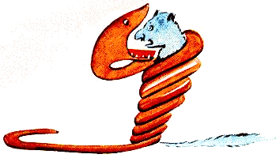

## Dedicatoria

A LÉON WERTH

Pido perdón a los niños por haber dedicado este libro a una persona mayor. Tengo una excusa seria: esta persona mayor es el mejor amigo que tengo en el mundo. Tengo otra excusa: esta persona mayor lo puede entender todo, hasta los libros para niños. Tengo una tercera excusa: esta persona mayor vive en Francia, donde pasa hambre y frío. Le hace mucha falta que la consuelen. Si todas estas excusas no bastan, quiero dedicar entonces este libro al niño que fue alguna vez esta persona mayor. Todas las personas mayores fueron primero niños. (Pero pocas lo recuerdan). Corrijo, pues, mi dedicatoria:

A LÉON WERTH

CUANDO ERA NIÑO

## I

Cuando yo tenía seis años vi una vez una imagen magnífica en un libro sobre la selva virgen que se llamaba *Historias vividas*. Mostraba una serpiente boa que se tragaba a una fiera. Esta es la copia del dibujo.

En el libro decía: «Las serpientes boas se tragan a su presa entera, sin masticarla. Después ya no pueden moverse y duermen durante los seis meses que dura su digestión».

Me puse entonces a pensar mucho en las aventuras de la jungla y, a mi vez, logré trazar con un lápiz de color mi primer dibujo. Mi dibujo número 1. Era así:

Les mostré mi obra maestra a las personas mayores y les pregunté si mi dibujo les daba miedo.

Me contestaron: «¿Por qué habría de dar miedo un sombrero?».

Mi dibujo no era un sombrero. Era una serpiente boa que digería un elefante. Dibujé entonces el interior de la serpiente boa, para que las personas mayores pudieran entender. Siempre necesitan explicaciones. Mi dibujo número 2 era así:

Las personas mayores me aconsejaron dejar a un lado los dibujos de serpientes boas abiertas o cerradas y ocuparme más bien de la geografía, la historia, el cálculo y la gramática. Así fue como abandoné, a los seis años, una magnífica carrera de pintor. Me había desanimado el fracaso de mi dibujo número 1 y de mi dibujo número 2. Las personas mayores nunca entienden nada por sí solas, y es cansador para los niños tener que darles explicaciones una y otra vez.

Tuve, pues, que elegir otro oficio y aprendí a pilotear aviones. He volado un poco por todo el mundo. Y es verdad que la geografía me ha servido mucho. Sabía distinguir de un vistazo la China de Arizona. Eso es muy útil si uno se pierde de noche.

A lo largo de mi vida he tenido así montones de contactos con montones de gente seria. He vivido mucho entre las personas mayores. Las he visto muy de cerca. Eso no mejoró demasiado mi opinión.

Cuando me encontraba con alguna que me parecía un poco lúcida, hacía la prueba con ella de mi dibujo número 1, que siempre he guardado. Quería saber si era de verdad comprensiva. Pero siempre me respondía: «Es un sombrero». Entonces yo no le hablaba ni de serpientes boas, ni de selvas vírgenes, ni de estrellas. Me ponía a su altura. Le hablaba de bridge, de golf, de política y de corbatas. Y la persona mayor quedaba muy contenta de conocer a un hombre tan razonable.
