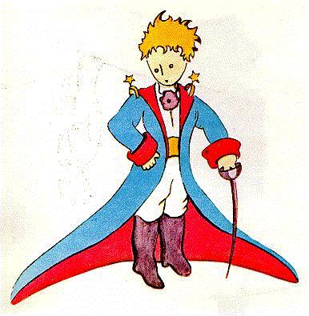
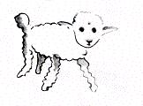
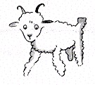
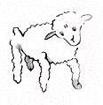
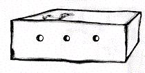

## II

Viví así, solo, sin nadie con quien hablar de verdad, hasta que tuve una avería en el desierto del Sahara, hace seis años. Algo se había roto en mi motor. Y como no llevaba conmigo ni mecánico ni pasajeros, me dispuse a intentar, yo solo, una reparación difícil. Para mí era cuestión de vida o muerte. Apenas tenía agua para beber durante ocho días.

La primera noche me dormí, pues, sobre la arena, a mil millas de cualquier tierra habitada. Estaba mucho más aislado que un náufrago en una balsa en medio del océano. Imaginen entonces mi sorpresa cuando, al amanecer, me despertó una vocecita extraña. Decía:

«Por favor... ¡dibújame un cordero!».

«¿Eh?».

«Dibújame un cordero...».

Me puse de pie de un salto, como si me hubiera caído un rayo. Me froté bien los ojos. Miré bien. Y vi a un hombrecito del todo extraordinario que me observaba con seriedad. Este es el mejor retrato que, más tarde, logré hacer de él. Pero mi dibujo, claro está, es mucho menos encantador que el modelo. No es culpa mía. Las personas mayores me habían desanimado de mi carrera de pintor a los seis años, y no había aprendido a dibujar nada, salvo boas cerradas y boas abiertas.

Miré, pues, aquella aparición con los ojos redondos de asombro. No olviden que me encontraba a mil millas de cualquier región habitada. Y sin embargo mi hombrecito no parecía ni perdido, ni muerto de cansancio, ni muerto de hambre, ni muerto de sed, ni muerto de miedo. No tenía en absoluto el aspecto de un niño perdido en medio del desierto, a mil millas de cualquier región habitada. Cuando por fin logré hablar, le dije:

«Pero ¿qué haces aquí?».

Y él me repitió entonces, muy despacio, como si se tratara de algo muy serio:

«Por favor... dibújame un cordero...».

Cuando el misterio impresiona demasiado, uno no se atreve a desobedecer. Por absurdo que me pareciera, a mil millas de todo lugar habitado y en peligro de muerte, saqué del bolsillo una hoja de papel y una pluma estilográfica. Pero recordé entonces que yo había estudiado sobre todo geografía, historia, cálculo y gramática, y le dije al hombrecito (con un poco de mal humor) que no sabía dibujar. Me respondió:

«No importa. Dibújame un cordero».

Como nunca había dibujado un cordero, rehíce para él uno de los dos únicos dibujos que sabía hacer. El de la boa cerrada. Y me quedé atónito al oír que el hombrecito me respondía:

«¡No! ¡No! No quiero un elefante dentro de una boa. Una boa es muy peligrosa, y un elefante ocupa mucho espacio. Donde yo vivo todo es muy pequeño. Necesito un cordero. Dibújame un cordero».

Entonces dibujé.

Miró con atención, y luego:

«¡No! Este ya está muy enfermo. Hazme otro».

Dibujé:

Mi amigo sonrió con amabilidad, con indulgencia:

«¿Ves?... Esto no es un cordero, es un carnero. Tiene cuernos...».

Rehíce, pues, una vez más mi dibujo, pero lo rechazó, como los anteriores:

«Este es demasiado viejo. Quiero un cordero que viva mucho tiempo».

Entonces, sin paciencia ya, porque tenía prisa por empezar a desmontar el motor, garabateé este dibujo.

Y le solté:

«Esta es la caja. El cordero que quieres está adentro».

Pero me sorprendió mucho ver cómo se iluminaba la cara de mi joven juez:

«¡Es justo como lo quería! ¿Crees que este cordero necesitará mucho pasto?».

«¿Por qué?».

«Porque donde yo vivo todo es muy pequeño...».

«Seguro que alcanzará. Te di un cordero muy pequeñito».

Inclinó la cabeza hacia el dibujo:

«No tan pequeño... ¡Mira! Se quedó dormido...».

Y así fue como conocí al principito.
