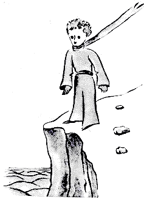

## III

Me costó mucho tiempo entender de dónde venía. El principito, que me hacía muchas preguntas, nunca parecía oír las mías. Fueron palabras dichas por casualidad las que, poco a poco, me lo revelaron todo. Así, cuando vio por primera vez mi avión (no voy a dibujar mi avión, es un dibujo demasiado complicado para mí), me preguntó:

«¿Qué es esa cosa?».

«No es una cosa. Vuela. Es un avión. Es mi avión».

Y yo estaba orgulloso de contarle que volaba. Entonces exclamó:

«¡Cómo! ¡Te caíste del cielo!».

«Sí», le dije con modestia.

«¡Ah! ¡Qué divertido!...».

Y el principito soltó una risa muy linda que me irritó mucho. Quiero que mis desgracias se tomen en serio. Después agregó:

«Entonces, ¡tú también vienes del cielo! ¿De qué planeta eres?».

Vislumbré de inmediato una luz en el misterio de su presencia, y le pregunté de golpe:

«¿Así que tú vienes de otro planeta?».

Pero no me contestó. Movía la cabeza suavemente sin dejar de mirar mi avión:

«Es verdad que, en eso, no puedes venir de muy lejos...».

Y se hundió en un ensueño que duró mucho rato. Luego, sacando mi cordero del bolsillo, se sumergió en la contemplación de su tesoro.

Imaginen cuánto me había intrigado esa media confidencia sobre «los otros planetas». Traté, pues, de saber algo más:

«¿De dónde vienes, hombrecito? ¿Dónde queda eso que llamas “donde yo vivo”? ¿Adónde quieres llevarte mi cordero?».

Me respondió después de un silencio pensativo:

«Lo bueno de la caja que me diste es que, de noche, le servirá de casa».

«Claro. Y si te portas bien, te daré también una cuerda para amarrarlo durante el día. Y una estaca».

La propuesta pareció escandalizar al principito:

«¿Amarrarlo? ¡Qué idea más rara!».

«Pero si no lo amarras, se irá a cualquier parte y se perderá...».

Y mi amigo soltó otra carcajada:

«Pero ¿adónde quieres que vaya?».

«A cualquier parte. Derecho hacia adelante...».

Entonces el principito observó con seriedad:

«No importa, ¡es tan pequeño donde yo vivo!».

Y, con un poco de melancolía, quizá, agregó:

«Derecho hacia adelante no se puede llegar muy lejos...».
