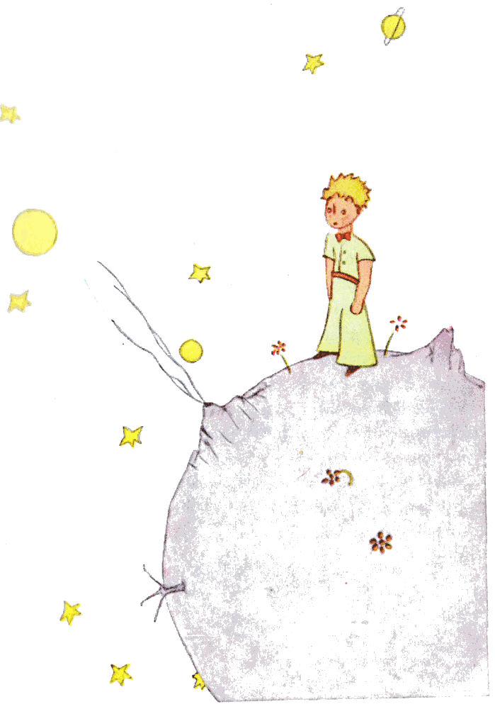
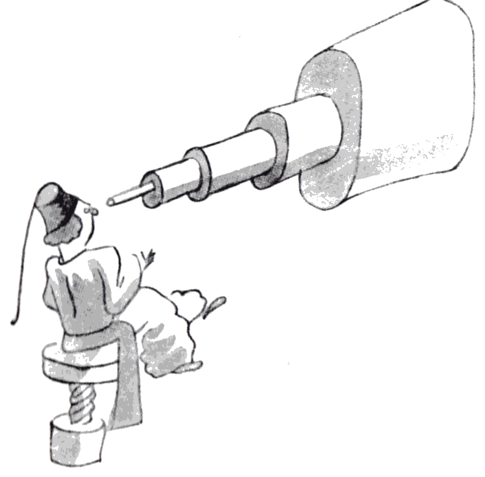
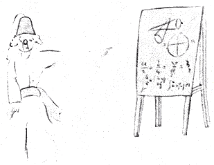
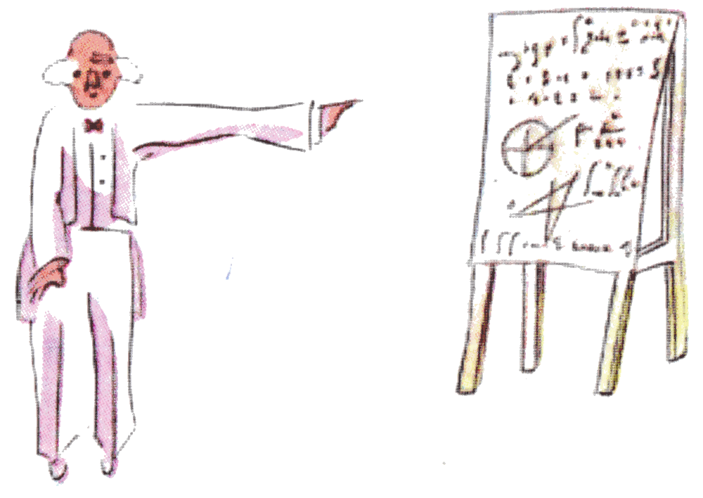

## IV

Así supe una segunda cosa muy importante: ¡su planeta de origen era apenas más grande que una casa!

Eso no podía asombrarme mucho. Sabía bien que, aparte de los planetas grandes como la Tierra, Júpiter, Marte o Venus, a los que se les ha dado nombre, hay cientos de otros que a veces son tan pequeños que cuesta mucho divisarlos con el telescopio. Cuando un astrónomo descubre uno de ellos, le pone por nombre un número. Lo llama, por ejemplo: «el asteroide 3251».

Tengo serias razones para creer que el planeta del que venía el principito es el asteroide B 612.

{width=100%}

Este asteroide solo ha sido divisado una vez con el telescopio, en 1909, por un astrónomo turco.

{width=75%}

El astrónomo hizo entonces una gran demostración de su descubrimiento en un Congreso Internacional de Astronomía.

Pero nadie le creyó por culpa de su traje. Así son las personas mayores.

{width=67%}

Por suerte para la reputación del asteroide B 612, un dictador turco obligó a su pueblo, bajo pena de muerte, a vestirse a la europea. El astrónomo repitió su demostración en 1920, con un traje muy elegante. Y esta vez todo el mundo le dio la razón.

{width=73%}

Si les he contado estos detalles sobre el asteroide B 612 y si les he confiado su número, es por las personas mayores. A las personas mayores les gustan las cifras. Cuando ustedes les hablan de un nuevo amigo, nunca les preguntan por lo esencial. Nunca les dicen: «¿Cómo es su voz? ¿Cuáles son sus juegos preferidos? ¿Colecciona mariposas?». Les preguntan: «¿Cuántos años tiene? ¿Cuántos hermanos tiene? ¿Cuánto pesa? ¿Cuánto gana su padre?». Solo entonces creen conocerlo. Si ustedes les dicen a las personas mayores: «He visto una casa preciosa de ladrillos rosados, con geranios en las ventanas y palomas en el techo...», no logran imaginarse esa casa. Hay que decirles: «He visto una casa de cien mil francos». Entonces exclaman: «¡Qué bonita es!».

Así, si ustedes les dicen: «La prueba de que el principito existió es que era encantador, que se reía y que quería un cordero. Cuando uno quiere un cordero, es la prueba de que existe», se encogerán de hombros y los tratarán a ustedes como a niños. Pero si les dicen: «El planeta del que venía es el asteroide B 612», entonces quedarán convencidas y los dejarán tranquilos con sus preguntas. Así son. No hay que guardarles rencor. Los niños deben ser muy indulgentes con las personas mayores.

Pero, claro, a nosotros, que entendemos la vida, ¡los números nos tienen sin cuidado! Me habría gustado empezar esta historia como los cuentos de hadas. Me habría gustado decir:

«Había una vez un principito que vivía en un planeta apenas más grande que él y que necesitaba un amigo...». Para los que entienden la vida, eso habría parecido mucho más verdadero.

Porque no me gusta que lean mi libro a la ligera. Siento tanta pena al contar estos recuerdos. Hace ya seis años que mi amigo se fue con su cordero. Si intento describirlo aquí, es para no olvidarlo. Es triste olvidar a un amigo. No todo el mundo ha tenido un amigo. Y yo puedo volverme como las personas mayores, que ya solo se interesan por las cifras. Por eso también me compré una caja de pinturas y unos lápices. ¡Es difícil volver a dibujar a mi edad, cuando uno nunca ha hecho otros intentos que el de una boa cerrada y el de una boa abierta, a los seis años! Trataré, por supuesto, de hacer los retratos lo más parecidos posible. Pero no estoy del todo seguro de lograrlo. Un dibujo resulta, y el otro ya no se parece. También me equivoco un poco en el tamaño. Aquí el principito es demasiado grande. Allá es demasiado pequeño. Dudo también sobre el color de su traje. Entonces tanteo por aquí y por allá, como mejor puedo. Por último, me equivocaré en algunos detalles más importantes. Pero eso tendrán que perdonármelo. Mi amigo nunca daba explicaciones. Quizá me creía parecido a él. Pero yo, por desgracia, no sé ver los corderos a través de las cajas. Quizá soy un poco como las personas mayores. Debo de haber envejecido.
