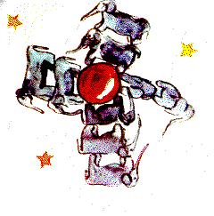
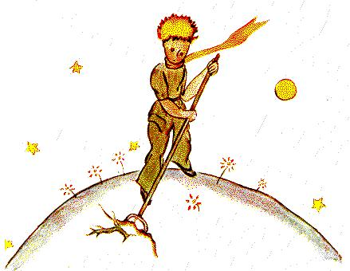
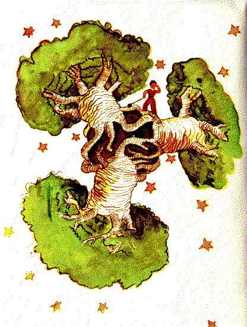

## V

Cada día aprendía algo sobre el planeta, sobre la partida, sobre el viaje. Iba saliendo muy despacio, al azar de lo que pensaba. Así fue como, al tercer día, supe del drama de los baobabs.

También esta vez fue gracias al cordero, porque de pronto el principito me preguntó, como asaltado por una duda grave:

«Es verdad, ¿no es cierto?, que los corderos se comen los arbustos».

«Sí. Es verdad».

«¡Ah! ¡Qué contento estoy!».

No entendí por qué era tan importante que los corderos se comieran los arbustos. Pero el principito agregó:

«Entonces, ¿también se comen los baobabs?».

Le hice notar al principito que los baobabs no son arbustos, sino árboles grandes como iglesias, y que, aunque se llevara consigo toda una manada de elefantes, esa manada no daría cuenta de un solo baobab.

La idea de la manada de elefantes hizo reír al principito:

«Habría que ponerlos unos encima de otros...».

Pero observó con sabiduría:

«Los baobabs, antes de crecer, empiezan siendo pequeños».

«¡Es cierto! Pero ¿por qué quieres que tus corderos se coman los baobabs pequeños?».

Me respondió: «¡Pero claro! ¡Si es obvio!», como si se tratara de una evidencia. Y tuve que hacer un gran esfuerzo de inteligencia para entender yo solo el problema.

Y, en efecto, en el planeta del principito había, como en todos los planetas, hierbas buenas y hierbas malas. Por lo tanto, semillas buenas de hierbas buenas y semillas malas de hierbas malas. Pero las semillas son invisibles. Duermen en el secreto de la tierra hasta que a una de ellas se le antoja despertar. Entonces se estira y empuja primero tímidamente hacia el sol un brotecito encantador e inofensivo. Si se trata de un brote de rábano o de rosal, se lo puede dejar crecer como quiera. Pero si se trata de una planta mala, hay que arrancarla enseguida, en cuanto se la reconoce. Ahora bien, en el planeta del principito había semillas terribles... eran las semillas de baobab. El suelo del planeta estaba infestado de ellas. Y un baobab, si uno se ocupa de él demasiado tarde, ya no hay manera de librarse de él. Invade todo el planeta. Lo perfora con sus raíces. Y si el planeta es demasiado pequeño y los baobabs son demasiado numerosos, lo hacen reventar.

«Es una cuestión de disciplina», me decía más tarde el principito. «Cuando uno ha terminado de arreglarse por la mañana, hay que arreglar con cuidado el planeta. Hay que obligarse a arrancar con regularidad los baobabs apenas se los distingue de los rosales, a los que se parecen mucho cuando son muy jóvenes. Es un trabajo muy aburrido, pero muy fácil».

Y un día me aconsejó que me esmerara en hacer un buen dibujo, para que esto les entrara bien en la cabeza a los niños de mi tierra. «Si algún día viajan», me decía, «les podrá servir. A veces no hay ningún inconveniente en dejar el trabajo para más tarde. Pero, si se trata de los baobabs, es siempre una catástrofe. Conocí un planeta habitado por un perezoso. Había descuidado tres arbustos...».

Y, siguiendo las indicaciones del principito, dibujé ese planeta. No me gusta mucho adoptar el tono de un moralista. Pero el peligro de los baobabs es tan poco conocido, y los riesgos que correría quien se extraviara en un asteroide son tan grandes, que, por una vez, hago una excepción a mi reserva. Digo: «¡Niños! ¡Cuidado con los baobabs!». Si trabajé tanto en ese dibujo, fue para advertir a mis amigos de un peligro que rozaban desde hacía mucho tiempo, igual que yo, sin conocerlo. La lección que daba valía la pena. Quizá se pregunten ustedes: ¿por qué no hay en este libro otros dibujos tan grandiosos como el dibujo de los baobabs? La respuesta es muy simple: lo intenté, pero no lo logré. Cuando dibujé los baobabs, me impulsaba el sentimiento de la urgencia.

