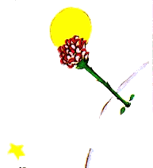

## VII

El quinto día, otra vez gracias al cordero, se me reveló este secreto de la vida del principito. Me preguntó de golpe, sin preámbulo, como fruto de un problema largamente meditado en silencio:

«Un cordero, si se come los arbustos, ¿se come también las flores?».

«Un cordero se come todo lo que encuentra».

«¿Hasta las flores que tienen espinas?».

«Sí. Hasta las flores que tienen espinas».

«Entonces, las espinas, ¿para qué sirven?».

Yo no lo sabía. Estaba muy ocupado tratando de desatornillar un perno demasiado apretado de mi motor. Estaba muy preocupado, porque la avería empezaba a parecerme muy grave, y el agua para beber, que se acababa, me hacía temer lo peor.

«Las espinas, ¿para qué sirven?».

El principito nunca renunciaba a una pregunta una vez que la había hecho. Yo estaba irritado con mi perno y respondí cualquier cosa:

«Las espinas no sirven para nada, ¡son pura maldad de las flores!».

«¡Oh!».

Pero después de un silencio me lanzó, con una especie de rencor:

«¡No te creo! Las flores son débiles. Son ingenuas. Se dan seguridad como pueden. Se creen terribles con sus espinas...».

No respondí nada. En ese momento me decía: «Si este perno sigue resistiendo, lo haré saltar de un martillazo». El principito volvió a interrumpir mis pensamientos:

«Y tú crees que las flores...».

«¡Que no! ¡Que no! ¡No creo nada! Respondí cualquier cosa. ¡Yo me ocupo de cosas serias!».

Me miró estupefacto.

«¡De cosas serias!».

Me veía con el martillo en la mano y los dedos negros de grasa, inclinado sobre un objeto que le parecía muy feo.

«¡Hablas como las personas mayores!».

Eso me dio un poco de vergüenza. Pero él, implacable, agregó:

«Lo confundes todo... ¡lo mezclas todo!».

Estaba de verdad muy irritado. Sacudía al viento sus cabellos dorados:

«Conozco un planeta donde hay un señor carmesí. Nunca ha olido una flor. Nunca ha mirado una estrella. Nunca ha querido a nadie. Nunca ha hecho otra cosa que sumas. Y todo el día repite como tú: “¡Soy un hombre serio! ¡Soy un hombre serio!”, y eso lo hincha de orgullo. Pero eso no es un hombre, ¡es un hongo!».

«¿Un qué?».

«¡Un hongo!».

El principito estaba ahora pálido de rabia.

«Hace millones de años que las flores fabrican espinas. Hace millones de años que los corderos se comen igual las flores. ¿Y no es serio tratar de entender por qué se toman tanto trabajo en fabricarse espinas que nunca sirven para nada? ¿No es importante la guerra entre los corderos y las flores? ¿No es más serio y más importante que las sumas de un señor gordo y colorado? ¡Y si yo conozco una flor única en el mundo, que no existe en ninguna parte salvo en mi planeta, y que un corderito puede destruir de un solo golpe, así, una mañana, sin darse cuenta de lo que hace, eso no es importante!».

Se puso colorado y luego continuó:

«Si alguien quiere a una flor de la que no existe más que un ejemplar entre los millones y millones de estrellas, eso basta para que sea feliz cuando las mira. Se dice: “Mi flor está allá, en alguna parte...”. Pero si el cordero se come la flor, ¡para él es como si de repente todas las estrellas se apagaran! ¡Y eso no es importante!».

No pudo decir nada más. De pronto estalló en sollozos. Había caído la noche. Yo había soltado mis herramientas. Qué me importaban el martillo, el perno, la sed y la muerte. ¡Había, en una estrella, en un planeta, el mío, la Tierra, un principito a quien consolar! Lo tomé en brazos. Lo mecí. Le decía: «La flor que quieres no está en peligro... Le dibujaré un bozal a tu cordero... Te dibujaré una armadura para tu flor... Yo...». No sabía muy bien qué decir. Me sentía muy torpe. No sabía cómo llegar hasta él, dónde alcanzarlo... ¡Es tan misterioso el país de las lágrimas!
