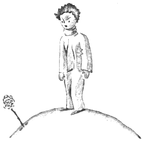
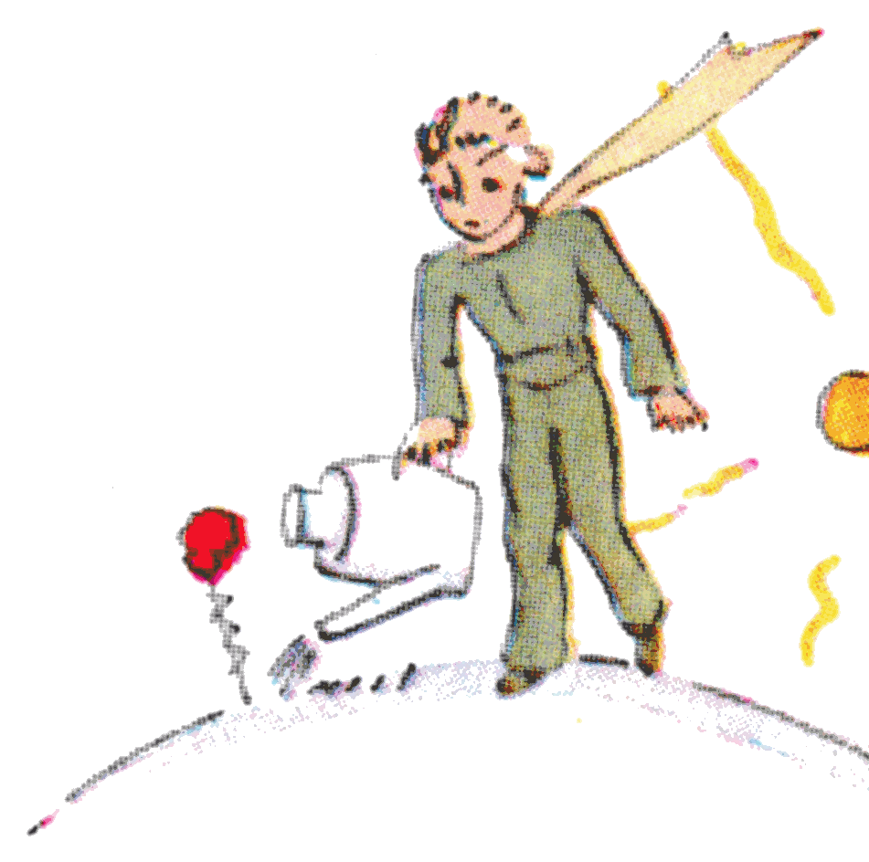
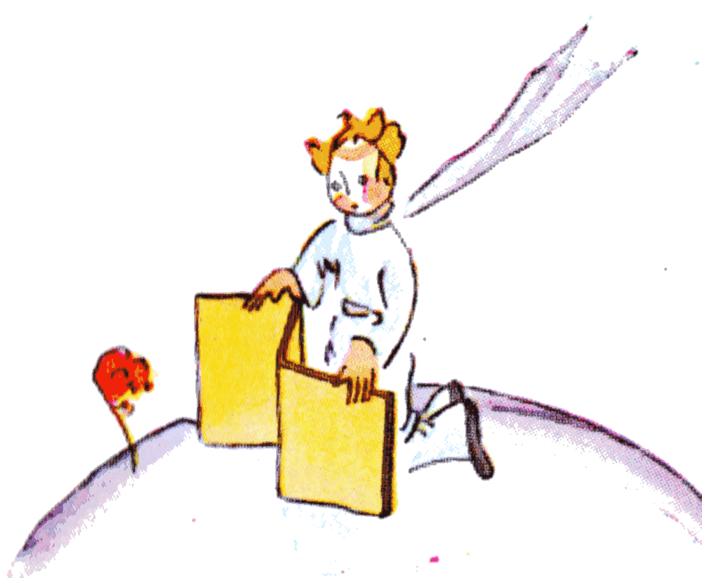
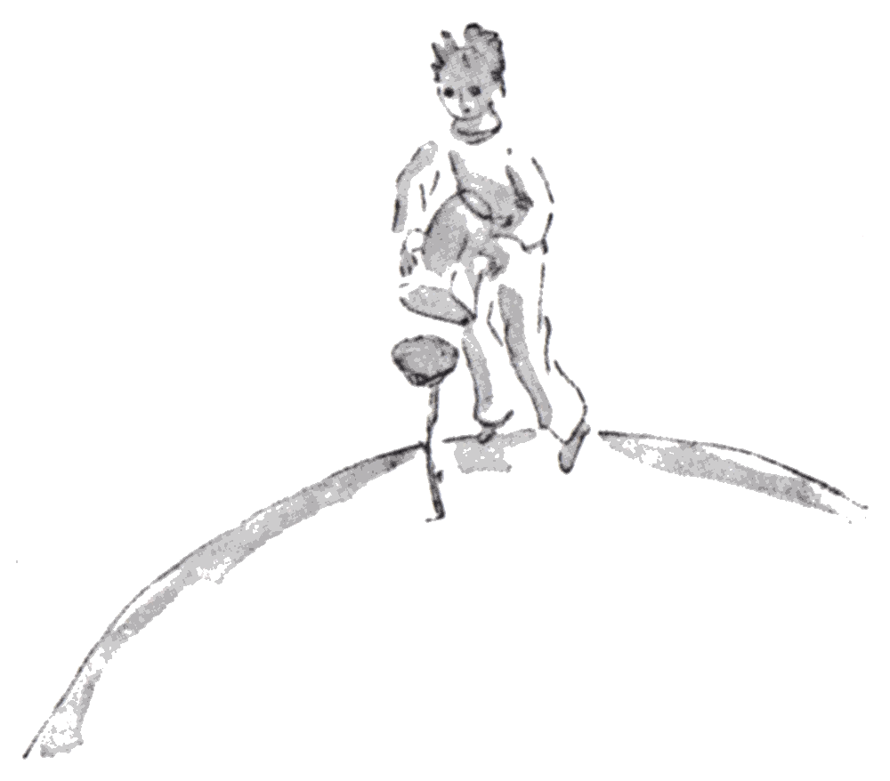

## VIII

Muy pronto aprendí a conocer mejor esa flor. En el planeta del principito siempre había habido flores muy sencillas, adornadas con una sola hilera de pétalos, que no ocupaban lugar y no molestaban a nadie. Aparecían una mañana entre la hierba y se apagaban por la tarde. Pero esta había germado un día de una semilla traída de quién sabe dónde, y el principito había vigilado muy de cerca ese brote que no se parecía a los demás brotes. Podía ser una nueva especie de baobab. Pero el arbusto pronto dejó de crecer y empezó a preparar una flor. El principito, que asistía a la aparición de un capullo enorme, presentía que de él saldría algo milagroso, pero la flor no terminaba nunca de prepararse para ser hermosa, al abrigo de su habitación verde. Elegía con cuidado sus colores. Se vestía despacio, se acomodaba los pétalos uno a uno. No quería salir toda arrugada como las amapolas. Solo quería aparecer en el pleno esplendor de su belleza. ¡Pues sí! ¡Era muy coqueta! Su misterioso arreglo había durado, pues, días y días. Y he aquí que una mañana, justo a la hora en que salía el sol, se había mostrado.

{width=42%}

Y ella, que había trabajado con tanta precisión, dijo bostezando:

«¡Ah! Apenas me despierto... Le pido perdón... Todavía estoy toda despeinada...».

El principito, entonces, no pudo contener su admiración:

«¡Qué hermosa es usted!».

«¿Verdad que sí?», respondió suavemente la flor. «Y nací al mismo tiempo que el sol...».

El principito adivinó que no era demasiado modesta, ¡pero era tan conmovedora!

«Creo que es la hora del desayuno», había agregado al poco rato. «¿Tendría usted la bondad de acordarse de mí?...».

Y el principito, muy confundido, fue a buscar una regadera con agua fresca y le sirvió a la flor.

{width=50%}

Así, muy pronto lo había atormentado con su vanidad un poco quisquillosa. Un día, por ejemplo, hablando de sus cuatro espinas, le había dicho al principito:

«¡Que vengan los tigres con sus garras!».

{width=47%}

«No hay tigres en mi planeta», había objetado el principito, «y además los tigres no comen hierba».

«Yo no soy una hierba», había respondido suavemente la flor.

«Perdóneme...».

«No les temo a los tigres, pero las corrientes de aire me horrorizan. ¿No tendría usted un biombo?».

{width=66%}

«Las corrientes de aire la horrorizan... mala suerte para una planta», había observado el principito. «Esta flor es bien complicada...».

«Por la noche me pondrá bajo un globo de cristal. Hace mucho frío aquí donde usted vive. Está mal acondicionado. Allá de donde vengo...».

{width=61%}

Pero se había interrumpido. Había llegado en forma de semilla. No había podido conocer nada de los otros mundos. Humillada por haberse dejado sorprender preparando una mentira tan ingenua, había tosido dos o tres veces para dejar al principito como el culpable:

«¿Y el biombo?...».

«¡Iba a buscarlo, pero usted me estaba hablando!».

Entonces ella había forzado la tos para que él sintiera remordimiento de todos modos.

Así, el principito, a pesar de la buena voluntad de su amor, pronto había empezado a dudar de ella. Se había tomado en serio palabras sin importancia y se había vuelto muy desdichado.

«No debí escucharla», me confió un día. «Nunca hay que escuchar a las flores. Hay que mirarlas y olerlas. La mía perfumaba mi planeta, pero yo no sabía alegrarme con eso. Esa historia de las garras, que tanto me había molestado, debió enternecerme...».

Y me confió también:

«¡No supe entender nada entonces! Debí juzgarla por sus actos y no por sus palabras. Me perfumaba y me iluminaba. ¡Nunca debí huir! Debí adivinar su ternura detrás de sus pobres astucias. ¡Las flores son tan contradictorias! Pero yo era demasiado joven para saber quererla».
