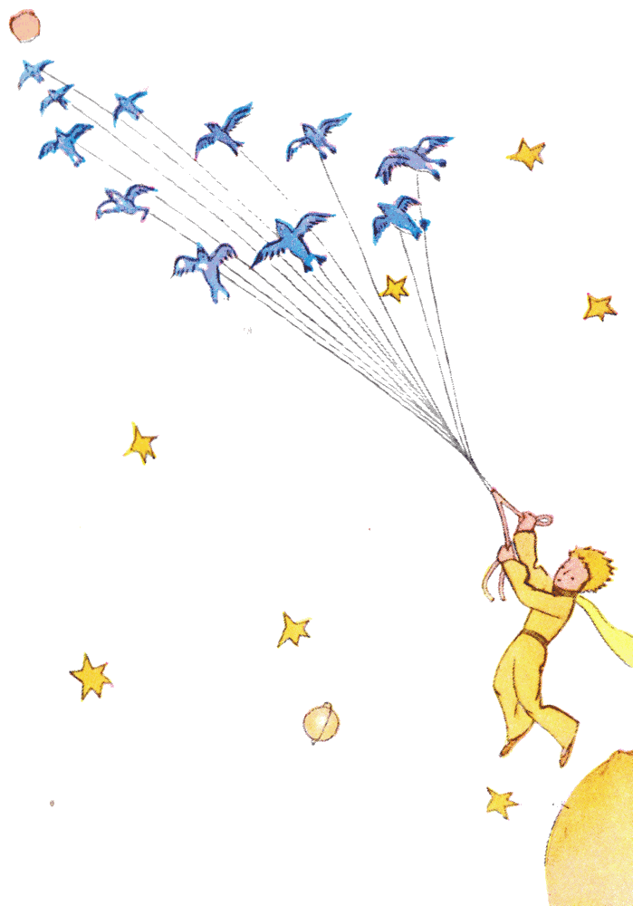
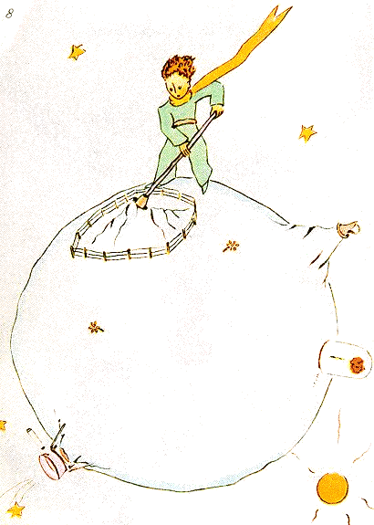

## IX

{width=100%}

Creo que, para escaparse, aprovechó una migración de pájaros silvestres. La mañana de la partida dejó su planeta bien ordenado. Deshollinó con cuidado sus volcanes en actividad. Tenía dos volcanes en actividad. Y eran muy prácticos para calentar el desayuno por la mañana. Tenía también un volcán apagado. Pero, como él decía: «¡Nunca se sabe!». Así que deshollinó también el volcán apagado. Si están bien deshollinados, los volcanes arden despacio y con regularidad, sin erupciones. Las erupciones volcánicas son como los incendios de chimenea. Es evidente que en nuestra tierra somos demasiado pequeños para deshollinar nuestros volcanes. Por eso nos causan montones de problemas.

El principito arrancó también, con un poco de melancolía, los últimos brotes de baobab. Creía que no iba a volver nunca. Pero todas esas tareas de siempre le parecieron, aquella mañana, extremadamente dulces. Y cuando regó por última vez la flor y se dispuso a ponerla al abrigo bajo su globo, descubrió que tenía ganas de llorar.

{width=100%}

«Adiós», le dijo a la flor.

Pero ella no le respondió.

«Adiós», repitió él.

La flor tosió. Pero no era por su resfrío.

«He sido tonta», le dijo por fin. «Te pido perdón. Trata de ser feliz».

Lo sorprendió que no hubiera reproches. Se quedó ahí, desconcertado, con el globo en el aire. No entendía esa dulzura tranquila.

«Pues sí, te quiero», le dijo la flor. «No te enteraste de nada, por culpa mía. Eso no tiene ninguna importancia. Pero tú fuiste tan tonto como yo. Trata de ser feliz... Deja ese globo. Ya no lo quiero».

«Pero el viento...».

«No estoy tan resfriada... El aire fresco de la noche me hará bien. Soy una flor».

«Pero los animales...».

«Tengo que aguantar dos o tres orugas si quiero conocer a las mariposas. Dicen que son tan hermosas. Si no, ¿quién vendrá a visitarme? Tú vas a estar lejos. En cuanto a los animales grandes, no les temo. Tengo mis garras».

Y mostraba ingenuamente sus cuatro espinas. Después agregó:

«No te demores así, que es irritante. Decidiste irte. Vete».

Porque no quería que él la viera llorar. Era una flor tan orgullosa...
