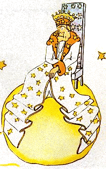

## X

Se encontraba en la región de los asteroides 325, 326, 327, 328, 329 y 330. Empezó, pues, por visitarlos, para buscar allí una ocupación y para instruirse.

El primero estaba habitado por un rey. El rey, vestido de púrpura y armiño, estaba sentado en un trono muy sencillo y, sin embargo, majestuoso.

{width=100%}

«¡Ah! He aquí un súbdito», exclamó el rey cuando vio al principito.

Y el principito se preguntó:

«¿Cómo puede reconocerme, si nunca me ha visto?».

No sabía que, para los reyes, el mundo es muy simple. Todos los hombres son súbditos.

«Acércate, para que te vea mejor», le dijo el rey, muy orgulloso de ser por fin rey de alguien.

El principito buscó con los ojos dónde sentarse, pero todo el planeta estaba ocupado por el magnífico manto de armiño. Se quedó, pues, de pie, y, como estaba cansado, bostezó.

«Es contrario a la etiqueta bostezar en presencia de un rey», le dijo el monarca. «Te lo prohíbo».

«No puedo evitarlo», respondió el principito, muy confundido. «He hecho un largo viaje y no he dormido...».

«Entonces», le dijo el rey, «te ordeno bostezar. Hace años que no veo bostezar a nadie. Los bostezos son para mí una curiosidad. ¡Vamos! Bosteza otra vez. Es una orden».

«Eso me intimida... ya no puedo...», dijo el principito, todo colorado.

«¡Ejem! ¡Ejem!», respondió el rey. «Entonces yo... yo te ordeno que a ratos bosteces y a ratos...».

Balbuceaba un poco y parecía molesto.

Porque el rey quería ante todo que se respetara su autoridad. No toleraba la desobediencia. Era un monarca absoluto. Pero, como era muy bueno, daba órdenes razonables.

«Si yo ordenara», decía a menudo, «si yo le ordenara a un general convertirse en ave marina, y el general no obedeciera, no sería culpa del general. Sería culpa mía».

«¿Puedo sentarme?», preguntó tímidamente el principito.

«Te ordeno sentarte», le respondió el rey, que recogió majestuosamente un faldón de su manto de armiño.

Pero el principito estaba asombrado. El planeta era diminuto. ¿Sobre qué podía reinar el rey?

«Majestad», le dijo, «le pido perdón por preguntarle...».

«Te ordeno preguntarme», se apresuró a decir el rey.

«Majestad... ¿sobre qué reina usted?».

«Sobre todo», respondió el rey con gran sencillez.

«¿Sobre todo?».

El rey, con un gesto discreto, señaló su planeta, los otros planetas y las estrellas.

«¿Sobre todo eso?», dijo el principito.

«Sobre todo eso...», respondió el rey.

Porque no solo era un monarca absoluto, sino también un monarca universal.

«¿Y las estrellas le obedecen?».

«Por supuesto», le dijo el rey. «Obedecen al instante. No tolero la indisciplina».

Semejante poder maravilló al principito. ¡Si lo hubiera tenido él mismo, habría podido presenciar no cuarenta y cuatro, sino setenta y dos, o incluso cien, o incluso doscientas puestas de sol en un mismo día, sin tener que correr nunca su silla! Y como se sentía un poco triste al recordar su pequeño planeta abandonado, se atrevió a pedirle una gracia al rey:

«Quisiera ver una puesta de sol... Hágame ese gusto... Ordénele al sol que se ponga...».

«Si yo le ordenara a un general volar de flor en flor como una mariposa, o escribir una tragedia, o convertirse en ave marina, y el general no cumpliera la orden recibida, ¿quién estaría en falta, él o yo?».

«Usted», dijo con firmeza el principito.

«Exacto. Hay que exigir a cada uno lo que cada uno puede dar», continuó el rey. «La autoridad descansa ante todo en la razón. Si le ordenas a tu pueblo que vaya a tirarse al mar, hará la revolución. Yo tengo derecho a exigir obediencia porque mis órdenes son razonables».

«¿Y mi puesta de sol?», le recordó el principito, que nunca olvidaba una pregunta una vez que la había hecho.

«Tu puesta de sol la tendrás. La exigiré. Pero, según mi ciencia de gobierno, esperaré a que las condiciones sean favorables».

«¿Y cuándo será eso?», quiso saber el principito.

«¡Ejem! ¡Ejem!», le respondió el rey, que primero consultó un grueso calendario. «¡Ejem! ¡Ejem! Será hacia... hacia... ¡será esta tarde, hacia las siete y cuarenta! Y verás qué bien me obedecen».

El principito bostezó. Echaba de menos su puesta de sol perdida. Y además ya empezaba a aburrirse un poco:

«Ya no tengo nada que hacer aquí», le dijo al rey. «¡Me voy otra vez!».

«No te vayas», respondió el rey, que estaba tan orgulloso de tener un súbdito. «No te vayas, ¡te nombro ministro!».

«¿Ministro de qué?».

«¡De... de justicia!».

«¡Pero si no hay nadie a quien juzgar!».

«Nunca se sabe», le dijo el rey. «Todavía no he recorrido mi reino. Soy muy viejo, no tengo espacio para una carroza y caminar me cansa».

«¡Oh! Pero yo ya miré», dijo el principito, que se inclinó para echar otro vistazo al otro lado del planeta. «Allá tampoco hay nadie...».

«Entonces te juzgarás a ti mismo», le respondió el rey. «Es lo más difícil. Es mucho más difícil juzgarse a sí mismo que juzgar a los demás. Si logras juzgarte bien, es que eres un verdadero sabio».

«Yo», dijo el principito, «puedo juzgarme a mí mismo en cualquier parte. No necesito vivir aquí».

«¡Ejem! ¡Ejem!», dijo el rey. «Creo que en alguna parte de mi planeta hay una rata vieja. La oigo por la noche. Podrás juzgar a esa rata vieja. La condenarás a muerte de vez en cuando. Así su vida dependerá de tu justicia. Pero la indultarás cada vez, para ahorrarla. No hay más que una».

«A mí», respondió el principito, «no me gusta condenar a muerte, y creo que me voy».

«No», dijo el rey.

Pero el principito, que ya había terminado sus preparativos, no quiso apenar al viejo monarca:

«Si Su Majestad deseara ser obedecido puntualmente, podría darme una orden razonable. Podría ordenarme, por ejemplo, partir antes de un minuto. Me parece que las condiciones son favorables...».

Como el rey no respondió nada, el principito dudó al principio y luego, con un suspiro, emprendió la partida.

«¡Te nombro mi embajador!», se apresuró entonces a gritar el rey.

Tenía un gran aire de autoridad.

Las personas mayores son muy extrañas, se dijo el principito para sus adentros durante el viaje.
