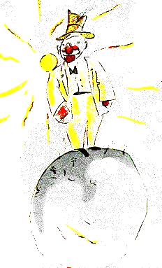

## XI

El segundo planeta estaba habitado por un vanidoso:

«¡Ah! ¡Ah! ¡Aquí viene a visitarme un admirador!», exclamó de lejos el vanidoso apenas vio al principito.

Porque, para los vanidosos, los demás hombres son admiradores.

«Buenos días», dijo el principito. «Usted tiene un sombrero muy raro».

«Es para saludar», le respondió el vanidoso. «Es para saludar cuando me aclaman. Por desgracia, nunca pasa nadie por aquí».

«¿Ah, sí?», dijo el principito, que no entendió.

«Golpea una mano contra la otra», le aconsejó entonces el vanidoso.

El principito golpeó una mano contra la otra. El vanidoso saludó con modestia, levantando el sombrero.

«Esto es más divertido que la visita al rey», se dijo para sus adentros el principito. Y volvió a golpear una mano contra la otra. El vanidoso volvió a saludar levantando el sombrero.

Después de cinco minutos de ejercicio, el principito se cansó de la monotonía del juego:

«Y para que se caiga el sombrero», preguntó, «¿qué hay que hacer?».

Pero el vanidoso no lo oyó. Los vanidosos nunca oyen otra cosa que las alabanzas.

«¿De verdad me admiras mucho?», le preguntó al principito.

«¿Qué quiere decir admirar?».

«Admirar quiere decir reconocer que soy el hombre más hermoso, el mejor vestido, el más rico y el más inteligente del planeta».

«¡Pero si estás solo en tu planeta!».

«Hazme ese gusto. ¡Admírame de todos modos!».

«Te admiro», dijo el principito, encogiéndose un poco de hombros, «pero ¿qué puede importarte eso?».

Y el principito se marchó.

Las personas mayores son decididamente muy raras, se dijo simplemente para sus adentros durante el viaje.
