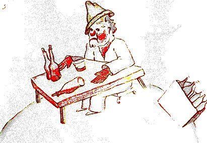

## XII

El planeta siguiente estaba habitado por un bebedor. Esta visita fue muy corta, pero sumió al principito en una gran melancolía:

«¿Qué haces ahí?», le dijo al bebedor, al que encontró sentado en silencio frente a una colección de botellas vacías y una colección de botellas llenas.

«Bebo», respondió el bebedor con aire lúgubre.

«¿Por qué bebes?», le preguntó el principito.

«Para olvidar», respondió el bebedor.

«¿Para olvidar qué?», quiso saber el principito, que ya lo compadecía.

«Para olvidar que me da vergüenza», confesó el bebedor bajando la cabeza.

«¿Vergüenza de qué?», preguntó el principito, que quería ayudarlo.

«¡Vergüenza de beber!», concluyó el bebedor, y se encerró para siempre en el silencio.

Y el principito se marchó, perplejo.

Las personas mayores son decididamente muy, muy raras, se decía para sus adentros durante el viaje.
