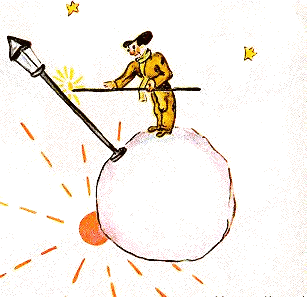

## XIV

El quinto planeta era muy curioso. Era el más pequeño de todos. Tenía el espacio justo para un farol y un farolero. El principito no lograba explicarse para qué podían servir, en alguna parte del cielo, en un planeta sin casas ni habitantes, un farol y un farolero. Sin embargo, se dijo para sus adentros:

«Puede que este hombre sea absurdo. Sin embargo, es menos absurdo que el rey, que el vanidoso, que el hombre de negocios y que el bebedor. Al menos su trabajo tiene sentido. Cuando enciende su farol, es como si hiciera nacer una estrella más, o una flor. Cuando apaga su farol, hace dormir a la flor o a la estrella. Es una ocupación muy linda. Es verdaderamente útil, puesto que es linda».

{width=100%}

Cuando llegó al planeta, saludó con respeto al farolero:

«Buenos días. ¿Por qué acabas de apagar tu farol?».

«Es la consigna», respondió el farolero. «Buenos días».

«¿Qué es la consigna?».

«Apagar mi farol. Buenas noches».

Y lo volvió a encender.

«Pero ¿por qué acabas de volver a encenderlo?».

«Es la consigna», respondió el farolero.

«No entiendo», dijo el principito.

«No hay nada que entender», dijo el farolero. «La consigna es la consigna. Buenos días».

Y apagó su farol.

Después se secó la frente con un pañuelo a cuadros rojos.

«Tengo aquí un oficio terrible. Antes era razonable. Apagaba por la mañana y encendía por la tarde. Tenía el resto del día para descansar y el resto de la noche para dormir...».

«¿Y desde entonces la consigna ha cambiado?».

«La consigna no ha cambiado», dijo el farolero. «¡Ese es justamente el drama! El planeta, año tras año, ha girado cada vez más rápido, ¡y la consigna no ha cambiado!».

«¿Y entonces?», dijo el principito.

«Entonces, ahora que da una vuelta por minuto, ya no tengo ni un segundo de descanso. ¡Enciendo y apago una vez por minuto!».

«¡Qué divertido! ¡En tu planeta los días duran un minuto!».

«No tiene nada de divertido», dijo el farolero. «Ya hace un mes que estamos conversando».

«¿Un mes?».

«Sí. Treinta minutos. ¡Treinta días! Buenas noches».

Y volvió a encender su farol.

El principito lo miró y le tomó cariño a este farolero tan fiel a la consigna. Se acordó de las puestas de sol que él mismo iba a buscar antes, corriendo su silla. Quiso ayudar a su amigo:

«¿Sabes?... conozco una manera de que descanses cuando quieras...».

«Yo quiero siempre», dijo el farolero.

Porque se puede ser, a la vez, fiel y perezoso.

El principito continuó:

«Tu planeta es tan pequeño que le das la vuelta en tres zancadas. No tienes más que caminar lo bastante despacio para quedarte siempre al sol. Cuando quieras descansar, caminarás... y el día durará todo lo que tú quieras».

«Eso no me sirve de mucho», dijo el farolero. «Lo que me gusta en la vida es dormir».

«Qué mala suerte», dijo el principito.

«Qué mala suerte», dijo el farolero. «Buenos días».

Y apagó su farol.

Este, se dijo el principito mientras seguía su viaje más lejos, este sería despreciado por todos los demás, por el rey, por el vanidoso, por el bebedor, por el hombre de negocios. Sin embargo, es el único que no me parece ridículo. Quizá porque se ocupa de algo que no es él mismo.

Suspiró con pesar y se dijo también:

«Este es el único del que yo habría podido hacerme amigo. Pero su planeta es de veras demasiado pequeño. No hay lugar para dos...».

Lo que el principito no se atrevía a confesarse era que echaba de menos ese planeta bendito sobre todo por ¡las mil cuatrocientas cuarenta puestas de sol cada veinticuatro horas!
