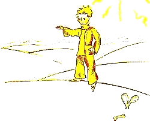
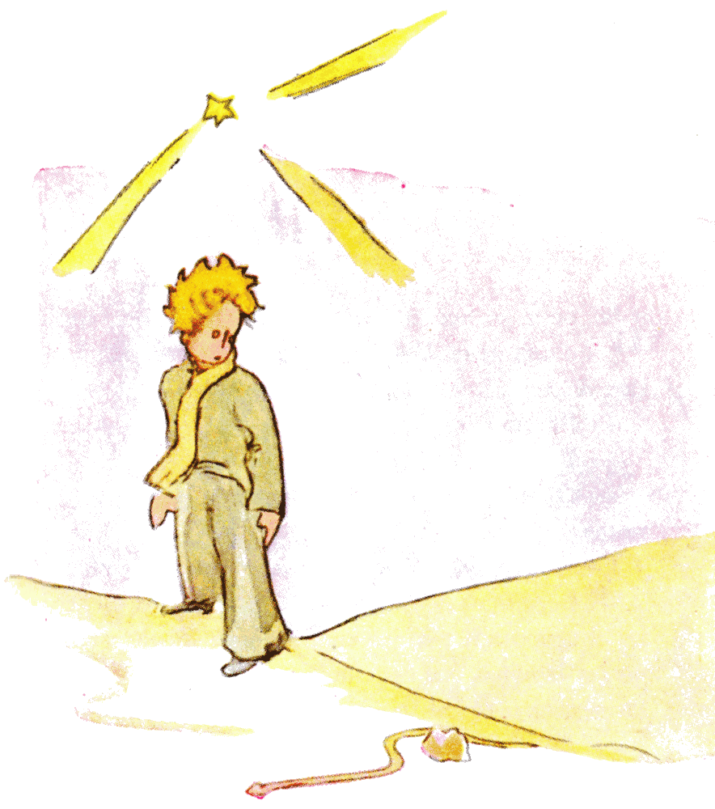

## XVII

Cuando uno quiere hacerse el ingenioso, a veces le pasa que miente un poco. No he sido muy honesto al hablarles de los faroleros. Corro el riesgo de dar una idea falsa de nuestro planeta a quienes no lo conocen. Los hombres ocupan muy poco lugar en la Tierra. Si los dos mil millones de habitantes que pueblan la Tierra se pusieran de pie y un poco apretados, como para un mitin, cabrían sin dificultad en una plaza pública de veinte millas de largo por veinte millas de ancho. Se podría amontonar a la humanidad en el más pequeño islote del Pacífico.

Las personas mayores, por supuesto, no les creerán. Se imaginan que ocupan mucho lugar. Se ven tan importantes como los baobabs. Aconséjenles, entonces, que hagan el cálculo. Adoran las cifras: eso les gustará. Pero no pierdan su tiempo en esa tarea. Es inútil. Ustedes confían en mí.

{width=100%}

El principito, una vez en la Tierra, se sorprendió mucho de no ver a nadie. Ya tenía miedo de haberse equivocado de planeta, cuando un anillo color de luna se movió en la arena.

«Buenas noches», dijo el principito, por si acaso.

«Buenas noches», dijo la serpiente.

«¿En qué planeta he caído?», preguntó el principito.

«En la Tierra, en África», respondió la serpiente.

«¡Ah!... ¿Entonces no hay nadie en la Tierra?».

«Aquí es el desierto. No hay nadie en los desiertos. La Tierra es grande», dijo la serpiente.

El principito se sentó en una piedra y levantó los ojos hacia el cielo:

«Me pregunto», dijo, «si las estrellas están encendidas para que cada uno pueda algún día encontrar la suya. Mira mi planeta. Está justo encima de nosotros... ¡Pero qué lejos está!».

«Es hermoso», dijo la serpiente. «¿Qué vienes a hacer aquí?».

«Tengo problemas con una flor», dijo el principito.

«¡Ah!», dijo la serpiente.

Y se quedaron callados.

«¿Dónde están los hombres?», volvió a decir por fin el principito. «Uno está un poco solo en el desierto...».

«También se está solo entre los hombres», dijo la serpiente.

El principito la miró largo rato:

{width=100%}

«Eres un animal raro», le dijo por fin, «delgado como un dedo...».

«Pero soy más poderosa que el dedo de un rey», dijo la serpiente.

El principito sonrió:

«No eres muy poderosa... ni siquiera tienes patas... ni siquiera puedes viajar...».

«Puedo llevarte más lejos que un barco», dijo la serpiente.

Se enroscó alrededor del tobillo del principito, como un brazalete de oro:

«Al que toco, lo devuelvo a la tierra de la que salió», dijo todavía. «Pero tú eres puro y vienes de una estrella...».

El principito no respondió nada.

«Me das lástima, tú, tan débil, en esta Tierra de granito. Puedo ayudarte algún día si echas demasiado de menos tu planeta. Puedo...».

«¡Oh! Entendí muy bien», dijo el principito, «pero ¿por qué hablas siempre con enigmas?».

«Yo los resuelvo todos», dijo la serpiente.

Y se quedaron callados.
