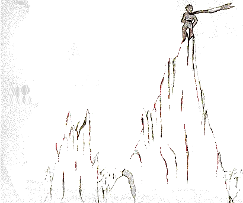

## XIX

El principito subió a una montaña alta. Las únicas montañas que había conocido en su vida eran los tres volcanes, que le llegaban a la rodilla. Y el volcán apagado le servía de taburete. «Desde una montaña tan alta como esta», se dijo entonces, «veré de una vez todo el planeta y a todos los hombres...». Pero no divisó más que agujas de roca muy afiladas.

«Buenos días», dijo por si acaso.

«Buenos días... buenos días... buenos días...», respondió el eco.

«¿Quiénes son ustedes?», dijo el principito.

«Quiénes son ustedes... quiénes son ustedes... quiénes son ustedes...», respondió el eco.

«Sean mis amigos, estoy solo», dijo.

«Estoy solo... estoy solo... estoy solo...», respondió el eco.

«¡Qué planeta tan raro!», pensó entonces. «Es todo seco, todo puntiagudo y todo salado.

Y a los hombres les falta imaginación. Repiten lo que se les dice... En mi casa tenía una flor: siempre hablaba primero...».
