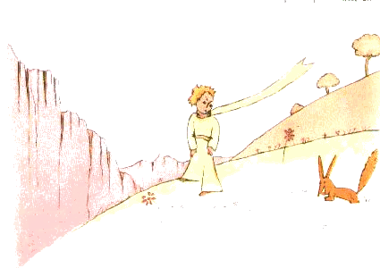
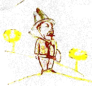
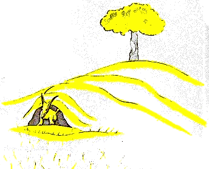

## XXI

Fue entonces cuando apareció el zorro.

«Buenos días», dijo el zorro.

«Buenos días», respondió cortésmente el principito, que se dio vuelta pero no vio nada.

«Estoy aquí», dijo la voz, «debajo del manzano».

«¿Quién eres?», dijo el principito. «Eres muy bonito...».

«Soy un zorro», dijo el zorro.

«Ven a jugar conmigo», le propuso el principito. «Estoy tan triste...».

«No puedo jugar contigo», dijo el zorro. «No estoy domesticado».

«¡Ah! Perdón», dijo el principito.

Pero, después de pensarlo, agregó:

«¿Qué significa “domesticar”?».

«Tú no eres de aquí», dijo el zorro. «¿Qué buscas?».

«Busco a los hombres», dijo el principito. «¿Qué significa “domesticar”?».

«Los hombres», dijo el zorro, «tienen escopetas y cazan. ¡Es muy molesto! También crían gallinas. Es lo único que tienen de interesante. ¿Buscas gallinas?».

«No», dijo el principito. «Busco amigos. ¿Qué significa “domesticar”?».

«Es una cosa demasiado olvidada», dijo el zorro. «Significa “crear lazos...”».

«¿Crear lazos?».

«Claro», dijo el zorro. «Para mí, tú no eres todavía más que un niño igual a cien mil niños. Y no te necesito. Y tú tampoco me necesitas. Para ti, yo no soy más que un zorro igual a cien mil zorros. Pero, si me domesticas, nos necesitaremos el uno al otro. Tú serás para mí único en el mundo. Yo seré para ti único en el mundo...».

«Empiezo a entender», dijo el principito. «Hay una flor... creo que me ha domesticado...».

«Es posible», dijo el zorro. «En la Tierra se ven toda clase de cosas...».

«¡Oh! No es en la Tierra», dijo el principito.

El zorro pareció muy intrigado:

«¿En otro planeta?».

«Sí».

«¿Hay cazadores en ese planeta?».

«No».

«¡Eso sí que es interesante! ¿Y gallinas?».

«No».

«Nada es perfecto», suspiró el zorro.

Pero el zorro volvió a su idea:

«Mi vida es monótona. Yo cazo gallinas, los hombres me cazan a mí. Todas las gallinas se parecen y todos los hombres se parecen. Así que me aburro un poco. Pero si me domesticas, mi vida se llenará de sol. Conoceré un ruido de pasos que será distinto de todos los demás. Los otros pasos me hacen esconderme bajo tierra. Los tuyos me llamarán fuera de la madriguera, como una música. ¡Y además, mira! ¿Ves allá los campos de trigo? Yo no como pan. El trigo para mí no sirve de nada. Los campos de trigo no me recuerdan nada. ¡Y eso es triste! Pero tú tienes el pelo color de oro. ¡Entonces será maravilloso cuando me hayas domesticado! El trigo, que es dorado, me hará acordarme de ti. Y me gustará el ruido del viento en el trigo...».

El zorro se calló y miró largo rato al principito:

«Por favor... ¡domestícame!», dijo.

«Me encantaría», respondió el principito, «pero no tengo mucho tiempo. Tengo amigos que descubrir y muchas cosas que conocer».

«Solo se conocen las cosas que se domestican», dijo el zorro. «Los hombres ya no tienen tiempo de conocer nada. Compran cosas ya hechas en las tiendas. Pero como no existen tiendas de amigos, los hombres ya no tienen amigos. Si quieres un amigo, ¡domestícame!».

«¿Qué hay que hacer?», dijo el principito.

«Hay que tener mucha paciencia», respondió el zorro. «Primero te sentarás un poco lejos de mí, así, en la hierba. Yo te miraré de reojo y tú no dirás nada. El lenguaje es fuente de malentendidos. Pero cada día podrás sentarte un poco más cerca...».

Al día siguiente el principito volvió.

«Habría sido mejor que volvieras a la misma hora», dijo el zorro. «Si vienes, por ejemplo, a las cuatro de la tarde, desde las tres empezaré a ser feliz. Mientras más avance la hora, más feliz me sentiré. A las cuatro ya estaré agitado e inquieto; ¡descubriré el precio de la felicidad! Pero si vienes a cualquier hora, nunca sabré a qué hora preparar el corazón... Hacen falta ritos».

«¿Qué es un rito?», dijo el principito.

«Es también algo demasiado olvidado», dijo el zorro. «Es lo que hace que un día sea distinto de los otros días, y una hora, de las otras horas. Mis cazadores, por ejemplo, tienen un rito. Los jueves bailan con las muchachas del pueblo. ¡Entonces el jueves es un día maravilloso! Me voy a pasear hasta la viña. Si los cazadores bailaran en cualquier momento, todos los días serían iguales y yo no tendría nunca vacaciones».

Así el principito domesticó al zorro. Y cuando estuvo cerca la hora de partir:

«¡Ah!», dijo el zorro... «Voy a llorar».

«Es culpa tuya», dijo el principito. «Yo no te deseaba ningún mal, pero tú quisiste que te domesticara...».

«Claro», dijo el zorro.

«¡Pero vas a llorar!», dijo el principito.

«Claro», dijo el zorro.

«¡Entonces no ganas nada!».

«Gano algo», dijo el zorro, «por el color del trigo».

Luego agregó:

«Ve a ver otra vez las rosas. Entenderás que la tuya es única en el mundo. Volverás a despedirte de mí y te regalaré un secreto».

El principito se fue a ver otra vez las rosas.

«Ustedes no se parecen en nada a mi rosa, ustedes no son nada todavía», les dijo. «Nadie las ha domesticado y ustedes no han domesticado a nadie. Son como era mi zorro. No era más que un zorro igual a otros cien mil. Pero lo hice mi amigo, y ahora es único en el mundo».

Y las rosas se sentían incómodas.

«Son hermosas, pero están vacías», les dijo todavía. «No se puede morir por ustedes. Claro que, en cuanto a mi rosa, un transeúnte cualquiera creería que se parece a ustedes. Pero ella sola es más importante que todas ustedes juntas, porque es a ella a quien regué. Porque es a ella a quien puse bajo un globo de cristal. Porque es a ella a quien protegí con el biombo. Porque es a ella a quien le maté las orugas (salvo las dos o tres que dejé para las mariposas). Porque es a ella a quien escuché quejarse, o alabarse, o incluso, algunas veces, quedarse callada. Porque es mi rosa».

Y volvió adonde estaba el zorro:

«Adiós», dijo...

«Adiós», dijo el zorro. «Este es mi secreto. Es muy simple: solo se ve bien con el corazón. Lo esencial es invisible a los ojos».

«Lo esencial es invisible a los ojos», repitió el principito, para acordarse.

«Es el tiempo que perdiste por tu rosa lo que hace a tu rosa tan importante».

«Es el tiempo que perdí por mi rosa...», dijo el principito, para acordarse.

«Los hombres han olvidado esta verdad», dijo el zorro. «Pero tú no debes olvidarla. Te vuelves responsable para siempre de lo que has domesticado. Eres responsable de tu rosa...».

«Soy responsable de mi rosa...», repitió el principito, para acordarse.
