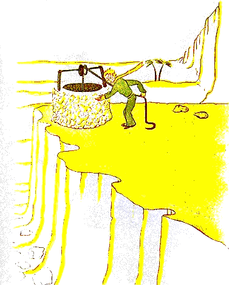

## XXV

«Los hombres», dijo el principito, «se meten en los rápidos, pero ya no saben lo que buscan. Entonces se agitan y dan vueltas en redondo...».

Y agregó:

«No vale la pena...».

El pozo al que habíamos llegado no se parecía a los otros pozos del Sahara. Los pozos del Sahara son simples agujeros cavados en la arena. Este se parecía a un pozo de pueblo. Pero allí no había ningún pueblo, y yo creía estar soñando.

«Es extraño», le dije al principito, «todo está listo: la polea, el balde y la cuerda...».

Se rio, tocó la cuerda, hizo andar la polea. Y la polea gimió como una vieja veleta cuando el viento ha dormido mucho tiempo.

{width=100%}

«¿Oyes?», dijo el principito. «Despertamos este pozo y canta...».

Yo no quería que hiciera ningún esfuerzo:

«Déjame a mí», le dije, «es demasiado pesado para ti».

Lentamente subí el balde hasta el brocal. Lo dejé ahí bien asentado. En mis oídos seguía el canto de la polea y, en el agua que todavía temblaba, veía temblar el sol.

«Tengo sed de esa agua», dijo el principito, «dame de beber...».

¡Y comprendí lo que había buscado!

Levanté el balde hasta sus labios. Bebió con los ojos cerrados. Era dulce como una fiesta. Esa agua era mucho más que un alimento. Había nacido de la caminata bajo las estrellas, del canto de la polea, del esfuerzo de mis brazos. Era buena para el corazón, como un regalo. Cuando yo era niño, la luz del árbol de Navidad, la música de la misa de medianoche, la dulzura de las sonrisas hacían así todo el brillo del regalo de Navidad que recibía.

«Los hombres de tu tierra», dijo el principito, «cultivan cinco mil rosas en un mismo jardín... y no encuentran en él lo que buscan...».

«No lo encuentran», respondí...

«Y, sin embargo, lo que buscan podría encontrarse en una sola rosa o en un poco de agua...».

«Claro», respondí.

Y el principito agregó:

«Pero los ojos son ciegos. Hay que buscar con el corazón».

Yo había bebido. Respiraba bien. La arena, al amanecer, es color de miel. Ese color de miel también me hacía feliz. ¿Por qué tenía que sentir pena...?

«Tienes que cumplir tu promesa», me dijo suavemente el principito, que de nuevo se había sentado a mi lado.

«¿Qué promesa?».

«Ya sabes... un bozal para mi cordero... ¡soy responsable de esa flor!».

Saqué del bolsillo mis bosquejos de dibujo. El principito los vio y dijo riendo:

«Tus baobabs se parecen un poco a repollos...».

«¡Oh!».

¡Y yo que estaba tan orgulloso de los baobabs!

«Tu zorro... sus orejas... se parecen un poco a cuernos... ¡y son demasiado largas!».

Y se rio otra vez.

«Eres injusto, hombrecito, yo no sabía dibujar nada más que boas cerradas y boas abiertas».

«¡Oh! Está bien así», dijo, «los niños saben».

Dibujé, pues, un bozal con el lápiz. Y se me apretó el corazón al dárselo:

«Tienes planes que yo no conozco...».

Pero no me respondió. Me dijo:

«¿Sabes? Mi caída en la Tierra... mañana se cumple un año...».

Luego, después de un silencio, dijo todavía:

«Había caído muy cerca de aquí...».

Y se sonrojó.

Y de nuevo, sin entender por qué, sentí una pena extraña. Sin embargo, me vino una pregunta:

«Entonces no es por casualidad que, la mañana en que te conocí, hace ocho días, andabas paseando así, solo, a mil millas de cualquier región habitada. ¿Volvías al lugar de tu caída?».

El principito se sonrojó otra vez.

Y agregué, dudando:

«¿Tal vez por el aniversario?...».

El principito se sonrojó de nuevo. Nunca respondía a las preguntas, pero, cuando uno se sonroja, eso significa «sí», ¿no es cierto?

«¡Ah!», le dije, «tengo miedo...».

Pero él me respondió:

«Ahora tienes que trabajar. Tienes que volver a tu máquina. Te espero aquí. Vuelve mañana en la tarde...».

Pero yo no estaba tranquilo. Me acordaba del zorro. Uno corre el riesgo de llorar un poco si se ha dejado domesticar...
