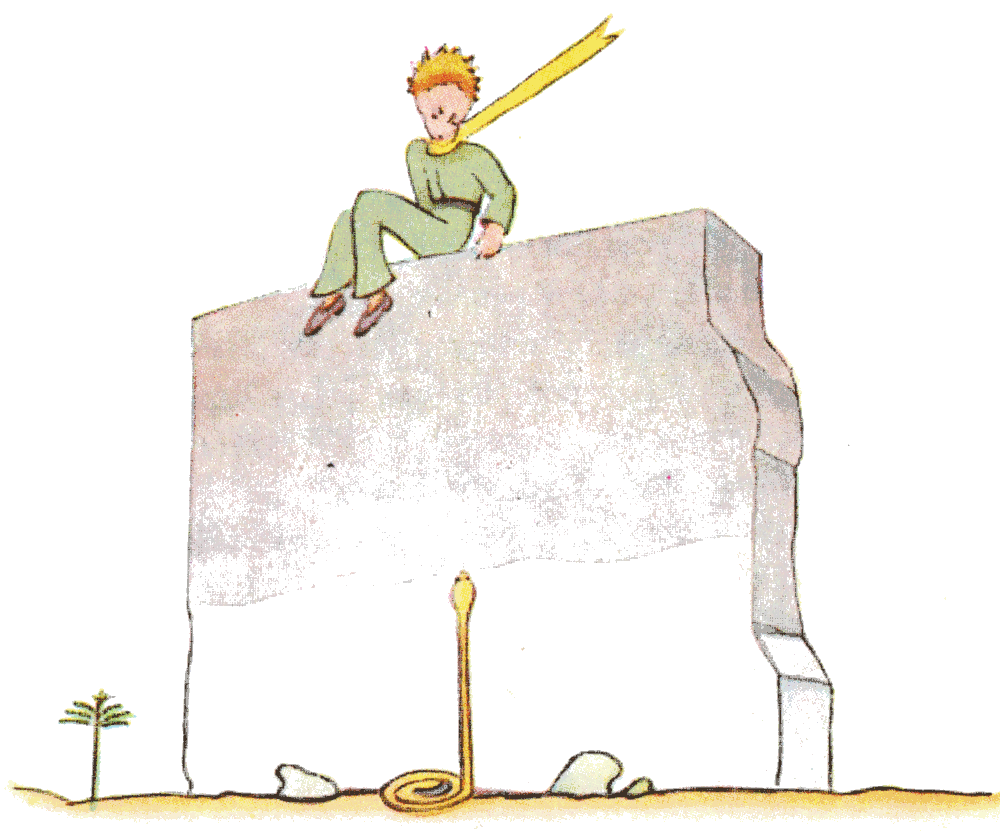
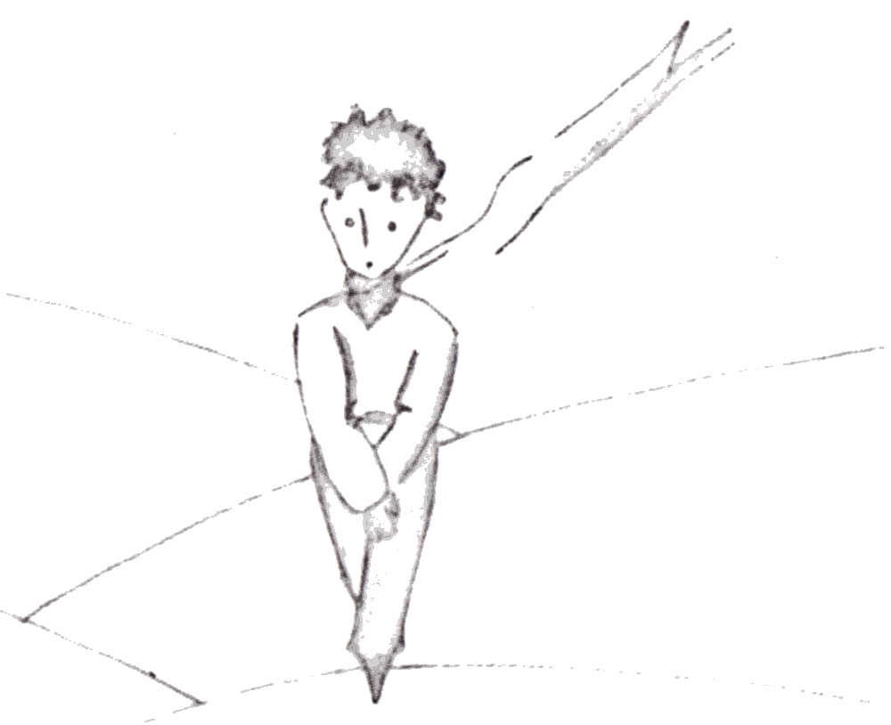
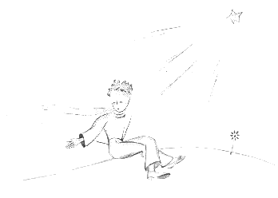

## XXVI

Junto al pozo había las ruinas de un viejo muro de piedra. Cuando volví de mi trabajo, al día siguiente en la tarde, divisé de lejos a mi principito sentado allá arriba, con las piernas colgando. Y lo oí hablar:

«¿Entonces no te acuerdas?», decía. «¡No es exactamente aquí!».

Otra voz le respondió, sin duda, puesto que él replicó:

«¡Sí! ¡Sí! Es el día, pero no es aquí el lugar...».

Seguí caminando hacia el muro. Seguía sin ver ni oír a nadie. Sin embargo, el principito replicó de nuevo:

«... Claro. Verás dónde empieza mi huella en la arena. No tienes más que esperarme allí. Estaré allí esta noche...».

Yo estaba a veinte metros del muro y seguía sin ver nada.

El principito dijo todavía, después de un silencio:

«¿Tienes buen veneno? ¿Estás seguro de que no me harás sufrir mucho tiempo?».

Me detuve, con el corazón apretado, pero seguía sin entender.

«Ahora vete», dijo... «¡Quiero bajar!».

{width=100%}

Entonces yo mismo bajé los ojos hacia el pie del muro, ¡y di un salto! Allí estaba, erguida hacia el principito, una de esas serpientes amarillas que lo despachan a uno en treinta segundos. Mientras buscaba en el bolsillo para sacar mi revólver, eché a correr, pero, al ruido que hice, la serpiente se dejó deslizar suavemente en la arena, como un chorro de agua que muere, y, sin apurarse demasiado, se escurrió entre las piedras con un leve ruido de metal.

Llegué al muro justo a tiempo para recibir en mis brazos a mi pequeño príncipe, pálido como la nieve.

«¡¿Qué historia es esta?! ¡Ahora hablas con las serpientes!».

Le había quitado su eterna bufanda dorada. Le había mojado las sienes y le había dado de beber. Y ahora ya no me atrevía a preguntarle nada. Me miró con seriedad y me rodeó el cuello con sus brazos. Sentía latir su corazón como el de un pájaro que muere, cuando le han disparado con una carabina. Me dijo:

«Me alegra que hayas encontrado lo que le faltaba a tu máquina. Vas a poder volver a tu casa...».

«¿Cómo lo sabes?».

¡Yo venía justamente a contarle que, contra toda esperanza, había logrado terminar mi trabajo!

No respondió nada a mi pregunta, pero agregó:

«Yo también vuelvo hoy a mi casa...».

Luego, melancólico:

«Es mucho más lejos... es mucho más difícil...».

Yo sentía bien que estaba pasando algo extraordinario. Lo apretaba en mis brazos como a un niño pequeño y, sin embargo, me parecía que se hundía en línea recta en un abismo sin que yo pudiera hacer nada para retenerlo...

Tenía la mirada seria, perdida muy lejos:

«Tengo tu cordero. Y tengo la caja para el cordero. Y tengo el bozal...».

Y sonrió con melancolía.

Esperé largo rato. Sentía que poco a poco recobraba el calor:

«Hombrecito, tuviste miedo...».

¡Claro que había tenido miedo! Pero se rio suavemente:

«Tendré mucho más miedo esta noche...».

De nuevo me sentí helado por la sensación de lo irreparable. Y comprendí que no soportaba la idea de no volver a oír nunca más esa risa. Era para mí como una fuente en el desierto.

«Hombrecito, quiero oírte reír otra vez...».

Pero él me dijo:

«Esta noche se cumple un año. Mi estrella estará justo encima del lugar donde caí el año pasado...».

«Hombrecito, ¿verdad que es un mal sueño esta historia de la serpiente, de la cita y de la estrella...?».

Pero no respondió a mi pregunta. Me dijo:

«Lo importante no se ve...».

«Claro...».

«Es como con la flor. Si quieres a una flor que está en una estrella, es dulce mirar el cielo de noche. Todas las estrellas están florecidas».

«Claro...».

«Es como con el agua. La que me diste de beber era como una música, por la polea y la cuerda... ¿te acuerdas?... era buena».

«Claro...».

«De noche mirarás las estrellas. Mi casa es demasiado pequeña para mostrarte dónde está la mía. Es mejor así. Mi estrella será para ti una de las estrellas. Entonces te gustará mirar todas las estrellas... Todas serán tus amigas. Y además te voy a hacer un regalo...».

Se rio otra vez.

«¡Ah, hombrecito, hombrecito, cómo me gusta oír esa risa!».

«Justamente ese será mi regalo... será como con el agua...».

«¿Qué quieres decir?».

«La gente tiene estrellas que no son las mismas. Para unos, los que viajan, las estrellas son guías. Para otros no son más que lucecitas. Para otros, que son sabios, son problemas. Para mi hombre de negocios eran oro. Pero todas esas estrellas se callan. Tú tendrás estrellas como nadie las tiene...».

«¿Qué quieres decir?».

«Cuando mires el cielo, de noche, como yo viviré en una de ellas, como yo me reiré en una de ellas, entonces para ti será como si se rieran todas las estrellas. ¡Tú tendrás estrellas que saben reír!».

Y se rio otra vez.

«Y cuando te hayas consolado (uno siempre se consuela), te alegrarás de haberme conocido. Siempre serás mi amigo. Tendrás ganas de reírte conmigo. Y a veces abrirás tu ventana, así, por el gusto de hacerlo... Y tus amigos se quedarán muy sorprendidos de verte reír mirando el cielo. Entonces les dirás: “¡Sí, las estrellas siempre me hacen reír!”. Y te creerán loco. Te habré hecho una broma muy fea...».

Y se rio otra vez.

«Será como si te hubiera dado, en vez de estrellas, montones de cascabelitos que saben reír...».

Y se rio otra vez. Luego volvió a ponerse serio:

«Esta noche... ¿sabes?... no vengas».

«No te dejaré».

«Parecerá que me duele... parecerá un poco que me muero. Es así. No vengas a ver eso, no vale la pena...».

«No te dejaré».

Pero estaba preocupado.

«Te lo digo... también por la serpiente. No tiene que morderte... Las serpientes son malas. Pueden morder por gusto...».

«No te dejaré».

Pero algo lo tranquilizó:

«Es cierto que no tienen veneno para la segunda mordedura...».

Esa noche no lo vi ponerse en camino. Se había escapado sin ruido. Cuando logré alcanzarlo, caminaba decidido, con paso rápido. Solo me dijo:

«¡Ah! Estás aquí...».

Y me tomó de la mano. Pero todavía se atormentó:

«Hiciste mal. Vas a sufrir. Parecerá que estoy muerto y no será verdad...».

Yo me callaba.

«Entiendes. Es demasiado lejos. No puedo llevarme este cuerpo. Pesa demasiado».

Yo me callaba.

«Pero será como una vieja corteza abandonada. No son tristes las cortezas viejas...».

Yo me callaba.

Se desanimó un poco. Pero hizo todavía un esfuerzo:

«Será lindo, ¿sabes? Yo también miraré las estrellas. Todas las estrellas serán pozos con una polea oxidada. Todas las estrellas me darán de beber...».

Yo me callaba.

«¡Será tan divertido! Tú tendrás quinientos millones de cascabeles, yo tendré quinientos millones de fuentes...».

Y él también se calló, porque estaba llorando...

«Es aquí. Déjame dar un paso solo».

{width=68%}

Y se sentó porque tenía miedo.

{width=100%}

Dijo todavía:

«¿Sabes?... mi flor... ¡soy responsable de ella! ¡Y es tan débil! Y es tan ingenua. Tiene cuatro espinas de nada para protegerse del mundo...».

Yo me senté porque ya no podía tenerme en pie. Él dijo:

«Eso es... Eso es todo...».

Vaciló todavía un poco y luego se levantó. Dio un paso. Yo no podía moverme.

No hubo más que un destello amarillo cerca de su tobillo. Se quedó inmóvil un instante. No gritó. Cayó suavemente, como cae un árbol. Ni siquiera hizo ruido, por la arena.
