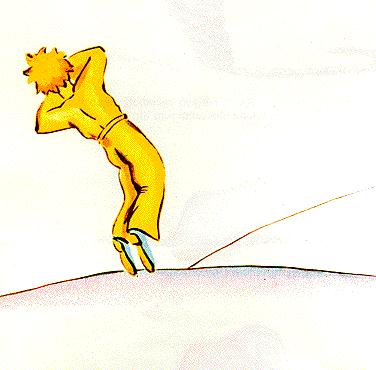
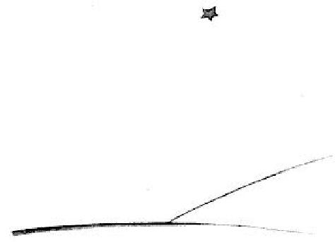

## XXVII

Y ahora, claro, ya han pasado seis años... Nunca he contado todavía esta historia. Los compañeros que volvieron a verme se alegraron mucho de verme vivo. Yo estaba triste, pero les decía: «Es el cansancio...».

Ahora me he consolado un poco. Es decir... no del todo. Pero sé bien que volvió a su planeta, porque al amanecer no encontré su cuerpo. No era un cuerpo tan pesado... Y de noche me gusta escuchar las estrellas. Es como quinientos millones de cascabeles...

Pero sucede algo extraordinario. ¡Al bozal que dibujé para el principito se me olvidó agregarle la correa de cuero! Nunca habrá podido ponérselo al cordero. Entonces me pregunto: «¿Qué habrá pasado en su planeta? A lo mejor el cordero se comió la flor...».

A veces me digo: «¡Seguro que no! El principito encierra su flor todas las noches bajo su globo de cristal, y vigila bien a su cordero...». Entonces soy feliz. Y todas las estrellas se ríen suavemente.

Otras veces me digo: «Uno se distrae alguna vez, ¡y eso basta! Una noche se olvidó del globo de cristal, o el cordero salió sin ruido durante la noche...». ¡Entonces los cascabeles se convierten todos en lágrimas!...

Ese es un misterio muy grande. Para ustedes, que también quieren al principito, igual que para mí, nada del universo es lo mismo si en alguna parte, quién sabe dónde, un cordero que no conocemos se ha comido, sí o no, una rosa...

Miren el cielo. Pregúntense: ¿el cordero se comió o no se comió la flor? Y verán cómo todo cambia...

¡Y ninguna persona mayor comprenderá jamás que eso tenga tanta importancia!

Este es, para mí, el paisaje más hermoso y más triste del mundo. Es el mismo paisaje de la página anterior, pero lo dibujé una vez más para mostrárselo bien. Es aquí donde el principito apareció en la Tierra y después desapareció.

Miren con atención este paisaje para estar seguros de reconocerlo, si algún día viajan a África, por el desierto. Y, si les toca pasar por ahí, se lo suplico, no se apuren, ¡esperen un poco justo debajo de la estrella! Si entonces un niño se les acerca, si se ríe, si tiene el pelo de oro, si no responde cuando le preguntan, adivinarán bien quién es. ¡Entonces sean buenos! No me dejen tan triste: escríbanme pronto que ha vuelto...
