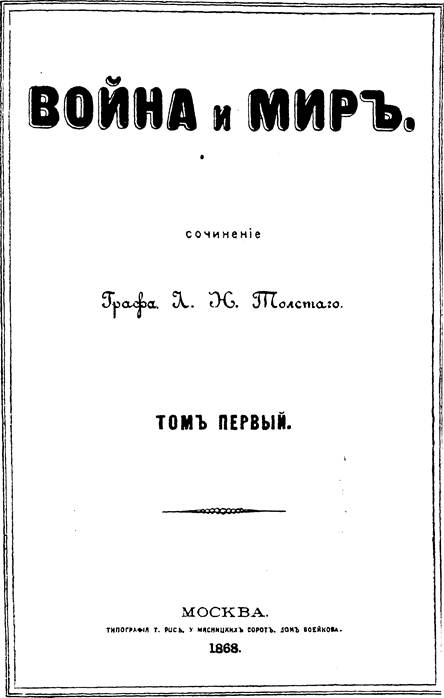

## Tomo II, parte II, capítulo I

Después de explicarse con su mujer, Pierre partió hacia Petersburgo. En la posta de Torzhok no había caballos, o el encargado no quería dárselos. Pierre tuvo que esperar. Sin desvestirse, se tendió en el sofá de cuero que había frente a la mesa redonda, puso sobre la mesa sus grandes piernas, calzadas con botas de abrigo, y se quedó pensativo.

«¿Manda usted que traiga las maletas? ¿Que prepare la cama? ¿Manda que le sirva té?», preguntaba el ayuda de cámara.

Pierre no respondía, porque no oía ni veía nada. Ya en la posta anterior se había quedado absorto y seguía pensando en lo mismo, en algo tan importante que no prestaba atención alguna a lo que ocurría a su alrededor. No solo le daba igual llegar más tarde o más temprano a Petersburgo y tener o no un lugar donde descansar en aquella posta, sino que, comparado con los pensamientos que ahora lo ocupaban, le daba lo mismo pasar en aquella posta unas horas o la vida entera.

El encargado de la posta, su mujer, el ayuda de cámara y una campesina con bordados de Torzhok entraban en la habitación a ofrecerle sus servicios. Pierre, sin mover las piernas que tenía en alto, los miraba a través de los anteojos y no comprendía qué podían necesitar ni cómo podían vivir todos ellos sin haber resuelto las preguntas que lo ocupaban. Y a él lo ocupaban siempre las mismas preguntas desde el día en que volvió de Sokólniki después del duelo y pasó la primera noche de tormento y desvelo. Solo que ahora, en la soledad del viaje, se habían apoderado de él con especial fuerza. Se pusiera a pensar en lo que se pusiera, volvía siempre a las mismas preguntas, que no podía resolver ni podía dejar de hacerse. Era como si en su cabeza *se hubiera pasado de rosca* el tornillo principal que sostenía toda su vida. El tornillo no entraba más ni salía, sino que giraba sin agarrar, siempre en el mismo surco, y era imposible dejar de darle vueltas.

Cubierta de la primera edición de la novela «Guerra y paz» (1868–1869).

Entró el encargado de la posta y, con aire servil, se puso a rogarle a Su Excelencia que esperara apenas dos horitas, al cabo de las cuales le daría a Su Excelencia (pasara lo que pasara) los caballos reservados a los correos. Era evidente que el encargado mentía y que solo quería sacarle al viajero un poco más de dinero. «¿Estaba eso mal o bien?», se preguntaba Pierre. «Para mí, bien, para otro viajero, mal, y para él mismo, inevitable, porque no tiene qué comer. Dijo que un oficial le había pegado por eso. Y el oficial le pegó porque tenía que seguir viaje cuanto antes. Y yo le disparé a Dólojov porque me consideré ofendido. Y a Luis XVI lo ejecutaron porque lo consideraban un criminal, y un año después mataron a quienes lo habían ejecutado, también por algo. ¿Qué está mal? ¿Qué está bien? ¿Qué hay que amar, qué hay que odiar? ¿Para qué vivir y qué soy yo? ¿Qué es la vida, qué es la muerte? ¿Qué fuerza lo gobierna todo?», se preguntaba. Y no había respuesta a ninguna de esas preguntas, salvo una, una respuesta al margen de la lógica que en realidad no respondía a ninguna de ellas. La respuesta era «Te morirás y todo se acabará. Te morirás y lo sabrás todo, o dejarás de preguntar». Pero morirse también daba miedo.

La vendedora de Torzhok ofrecía con voz chillona su mercancía, en especial unas zapatillas de piel de cabra. «Tengo cientos de rublos que no sé en qué gastar, y ahí está ella, con su abrigo de piel desgarrado, mirándome con timidez —pensaba Pierre—. ¿Y para qué sirve ese dinero? ¿Acaso pueden darle un pelo más de felicidad, de sosiego, esos rublos? ¿Hay algo en el mundo que pueda hacernos, a ella y a mí, menos vulnerables al mal y a la muerte? La muerte, que acabará con todo y que ha de llegar hoy o mañana: da igual, dentro de un instante, comparado con la eternidad». Y volvió a apretar el tornillo que no agarraba, y el tornillo siguió girando como antes, en el mismo sitio.

Su criado le alcanzó un ejemplar de la novela en cartas de *m-me Suza*.[^418] Solo se habían cortado los pliegos hasta la mitad del volumen. Se puso a leer sobre los sufrimientos y la lucha virtuosa de cierta *Amélie de Mansfeld*.[^419] «¿Y para qué luchaba contra su seductor —pensaba—, si lo amaba? Dios no pudo haber puesto en su alma un anhelo contrario a su voluntad. Mi exmujer no luchó y quizá tenía razón. No se ha descubierto nada —se decía otra vez Pierre—, no se ha ideado nada. Solo podemos saber que no sabemos nada. Y ese es el grado más alto de la sabiduría humana».

Todo, en él mismo y a su alrededor, le parecía enmarañado, absurdo y repugnante. Pero en esa misma repugnancia por cuanto lo rodeaba Pierre encontraba una especie de placer irritante.

«Me atrevo a pedirle a Su Ilustrísima que se haga un poquito a un lado, para dejarle sitio aquí a este señor», dijo el encargado de la posta al entrar en la habitación, haciendo pasar tras de sí a otro viajero al que la falta de caballos había obligado a detenerse. El viajero era un viejo achaparrado, de huesos anchos, amarillento y arrugado, con cejas canosas que le caían sobre los ojos brillantes, de un gris indefinido.

Pierre retiró los pies de la mesa, se levantó y fue a tenderse en la cama que le habían preparado, mirando de vez en cuando al recién llegado, que, con aire sombrío y cansado, se quitaba con esfuerzo la ropa con ayuda de su criado, sin mirar a Pierre. Una vez que quedó en una gastada pelliza corta forrada de nanquín por fuera y con unas botas de fieltro en las piernas flacas y huesudas, el viajero se sentó en el sofá, apoyó en el respaldo su enorme cabeza, ancha en las sienes y con el pelo cortado al ras, y miró a Bezújov. La expresión severa, inteligente y penetrante de aquella mirada impresionó a Pierre. Le dieron ganas de hablar con el viajero, pero, cuando se dispuso a preguntarle por el camino, este ya había cerrado los ojos y seguía sentado, inmóvil, con las manos viejas y arrugadas juntas y un gran anillo de hierro fundido en uno de los dedos, con la imagen de la cabeza de Adán. O bien descansaba, o bien meditaba sobre algo con hondura y calma, según le pareció a Pierre. El criado del viajero era un viejecito todo arrugado, también amarillento, sin bigote ni barba, que, por lo visto, nunca había tenido que afeitarse, pues jamás le habían crecido. El ágil viejecito iba sacando las cosas del cofrecillo de viaje y preparando la mesa para el té, y trajo el samovar hirviendo. Cuando todo estuvo listo, el viajero abrió los ojos, se arrimó a la mesa y, después de servirse un vaso de té, sirvió otro para el viejecito imberbe y se lo tendió. Pierre empezaba a sentir inquietud y la necesidad, y hasta la inevitabilidad, de entablar conversación con aquel viajero.

El criado trajo de vuelta su vaso vacío, boca abajo, con un trocito de azúcar a medio morder, y preguntó si hacía falta algo.

«Nada. Dame el libro», dijo el viajero. El criado le alcanzó un libro que a Pierre le pareció de devoción, y el viajero se enfrascó en la lectura. Pierre lo miraba. De pronto, el viajero cerró el libro después de marcar la página y lo dejó a un lado. Volvió a cerrar los ojos y, apoyándose en el respaldo, se sentó como antes. Pierre lo miraba y no alcanzó a apartar la vista cuando el viejo abrió los ojos y le clavó en pleno rostro su mirada firme y severa.

Pierre se sentía turbado y quiso sustraerse a aquella mirada, pero aquellos ojos brillantes de viejo lo atraían irresistiblemente.

[^418]: De la señora Suza.

[^419]: De Amalia Mansfeld.
