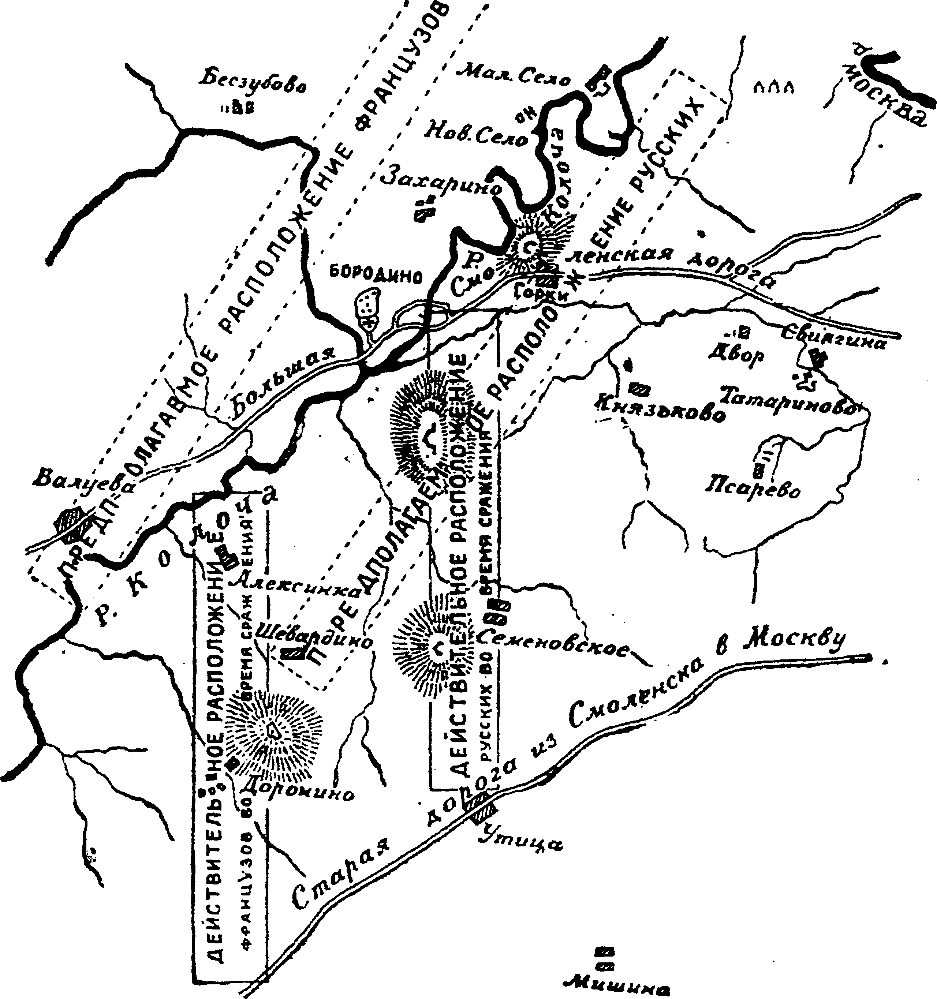

## Tomo III, parte II, capítulo XIX

El 24 se libró la batalla junto al reducto de Shevardinó, el 25 no se disparó un solo tiro ni de un lado ni del otro, y el 26 tuvo lugar la batalla de Borodinó.

¿Para qué y cómo se dieron y se aceptaron las batallas de Shevardinó y de Borodinó? ¿Para qué se dio la batalla de Borodinó? Ni para los franceses ni para los rusos tenía el menor sentido. El resultado inmediato fue, y tenía que ser, que, para los rusos, nos acercamos a la ruina de Moscú (lo que más temíamos en el mundo) y que, para los franceses, se acercaron a la ruina de todo su ejército (lo que también ellos más temían en el mundo). Ese resultado era ya entonces del todo evidente, y sin embargo Napoleón dio la batalla y Kutúzov la aceptó.

Si los jefes militares se rigieran por razones sensatas, ¡qué claro, al parecer, debía resultarle a Napoleón que, tras haberse adentrado más de dos mil verstas, al aceptar batalla con la probabilidad de perder una cuarta parte de su ejército, iba derecho a la ruina! Y con igual claridad debía parecerle a Kutúzov que, al aceptar batalla y arriesgarse también a perder una cuarta parte de su ejército, perdería sin duda Moscú. Para Kutúzov eso era matemáticamente claro, tan claro como que, si en las damas tengo una ficha menos y me pongo a cambiar fichas, perderé con toda seguridad, y por eso no debo cambiarlas.

Cuando mi adversario tiene dieciséis fichas y yo catorce, solo soy una octava parte más débil que él, pero cuando haya cambiado trece fichas con él, será tres veces más fuerte que yo.

Antes de la batalla de Borodinó, nuestras fuerzas estaban con respecto a las francesas aproximadamente como cinco a seis, y después de la batalla, como uno a dos, es decir, antes de la batalla, cien mil contra ciento veinte mil, y después de la batalla, cincuenta mil contra cien mil. Y sin embargo el inteligente y experimentado Kutúzov aceptó la batalla. Napoleón, por su parte, el genial jefe militar, como lo llaman, dio la batalla, perdiendo una cuarta parte de su ejército y extendiendo aún más su línea. Si se dice que pensaba poner fin a la campaña con la ocupación de Moscú, como con la de Viena, hay muchas pruebas en contra. Los propios historiadores de Napoleón cuentan que ya desde Smolensk quería detenerse, que sabía lo precario de su situación con la línea tan extendida y que sabía que la ocupación de Moscú no pondría fin a la campaña, porque desde Smolensk veía en qué estado le dejaban las ciudades rusas y no recibía una sola respuesta a sus reiteradas declaraciones de que deseaba negociar.

Al dar y aceptar la batalla de Borodinó, Kutúzov y Napoleón obraron involuntariamente y sin sentido. Solo después los historiadores urdieron complicadas pruebas para atribuir los hechos consumados a la previsión y al genio de los jefes militares, que, entre todos los instrumentos involuntarios de los acontecimientos del mundo, fueron los agentes más serviles e involuntarios.

Los antiguos nos dejaron modelos de poemas heroicos en los que todo el interés de la historia reside en los héroes, y todavía no logramos acostumbrarnos a que, en esta época humana nuestra, una historia de esa índole carezca de sentido.

En cuanto a la otra pregunta («¿Cómo se dieron la batalla de Borodinó y la de Shevardinó, que la precedió?»), existe también una versión muy precisa, conocida por todos y completamente falsa. Todos los historiadores describen los hechos del siguiente modo:

*En su retirada desde Smolensk, el ejército ruso buscaba, según se dice, la mejor posición para dar una batalla general, y tal posición se encontró, según se dice, cerca de Borodinó.*

*Los rusos, según se dice, fortificaron de antemano esa posición a la izquierda del camino (de Moscú a Smolensk), casi en ángulo recto con él, desde Borodinó hasta Utitsa, en el mismo lugar donde se libró la batalla.*

*Delante de esa posición, según se dice, se instaló un puesto avanzado fortificado en la colina de Shevardinó para observar al enemigo. El 24, según se dice, Napoleón atacó el puesto avanzado y lo tomó, y el 26 atacó a todo el ejército ruso, que ocupaba la posición en el campo de Borodinó.*

Así lo cuentan los libros de historia, y todo esto es completamente falso, como podrá comprobar fácilmente cualquiera que quiera examinar a fondo el asunto.

Los rusos no buscaban la mejor posición. Al contrario, en su retirada pasaron por muchas posiciones mejores que la de Borodinó. No se detuvieron en ninguna de ellas porque Kutúzov no quería aceptar una posición que no hubiera elegido él, y porque la exigencia de una batalla de todo el pueblo aún no se había expresado con suficiente fuerza, y porque Milorádovich aún no había llegado con la milicia, y por otras razones, que son incontables. El hecho es que las posiciones anteriores eran más fuertes y que la posición de Borodinó (aquella en la que se dio la batalla) no solo no era fuerte, sino que en ningún sentido era más posición que cualquier otro lugar del Imperio ruso que uno señalara a ciegas con un alfiler en el mapa.

Los rusos no solo no fortificaron la posición en el campo de Borodinó, a la izquierda del camino y en ángulo recto con él (es decir, el lugar donde se libró la batalla), sino que antes del 25 de agosto de 1812 jamás pensaron que la batalla pudiera librarse en ese lugar. La primera prueba es que no solo el día 25 no había fortificaciones en ese lugar, sino que las que se empezaron el 25 seguían sin terminar el 26. La segunda prueba es la ubicación del reducto de Shevardinó. El reducto de Shevardinó, por delante de la posición en la que se aceptó la batalla, no tiene ningún sentido. ¿Para qué se fortificó ese reducto más que ningún otro punto? ¿Y para qué, al defenderlo el día 24 hasta bien entrada la noche, se extremaron los esfuerzos y se perdieron seis mil hombres? Para vigilar al enemigo bastaba una patrulla de cosacos. La tercera prueba de que la posición donde se libró la batalla no se había previsto y de que el reducto de Shevardinó no era un punto avanzado de esa posición es que Barclay de Tolly y Bagratión estuvieron convencidos hasta el día 25 de que el reducto de Shevardinó era el flanco *izquierdo* de la posición, y que el propio Kutúzov, en el parte que escribió en caliente después de la batalla, llama al reducto de Shevardinó flanco *izquierdo* de la posición. Solo mucho después, cuando se redactaban con toda calma los partes sobre la batalla de Borodinó, se inventó (probablemente para justificar los errores del comandante en jefe, que debía ser infalible) aquella afirmación falsa y extraña según la cual el reducto de Shevardinó había servido de puesto *avanzado* (cuando solo era un punto fortificado del flanco izquierdo) y nosotros habíamos aceptado la batalla de Borodinó en una posición fortificada y elegida de antemano, cuando en realidad se libró en un lugar del todo imprevisto y casi sin fortificar.

Lo que ocurrió, evidentemente, fue esto. Se escogió una posición a lo largo del río Kolocha, que cruza el camino principal en ángulo agudo y no recto, de modo que el flanco izquierdo quedaba en Shevardinó, el derecho cerca de la aldea de Nóvoye y el centro en Borodinó, en la confluencia del Kolocha y el Voina. Cualquiera que mire el campo de Borodinó y se olvide de cómo se libró la batalla verá que esa posición, al amparo del río Kolocha, era la opción evidente para un ejército que se proponía detener al enemigo que avanzaba hacia Moscú por el camino de Smolensk.

Napoleón, al salir el día 24 hacia Valúyevo, no vio (como dicen los libros de historia) la posición de los rusos desde Utitsa hasta Borodinó (no podía ver esa posición porque no existía), ni vio un puesto avanzado del ejército ruso, sino que, al perseguir a la retaguardia rusa, se topó con el flanco izquierdo de la posición de los rusos, con el reducto de Shevardinó, e hizo pasar a sus tropas al otro lado del Kolocha, tomando por sorpresa a los rusos. Y los rusos, sin haber tenido tiempo de entablar una batalla general, retiraron su ala izquierda de la posición que se proponían ocupar y ocuparon una nueva posición, que no se había previsto ni fortificado. Al pasar a la orilla izquierda del Kolocha, a la izquierda del camino, Napoleón desplazó toda la batalla que iba a librarse de derecha a izquierda (desde el lado ruso) y la trasladó al campo entre Utitsa, Semiónovskoye y Borodinó (a ese campo que no ofrecía, para establecer una posición, más ventajas que cualquier otro campo de Rusia), y en ese campo se libró toda la batalla del día 26. A grandes rasgos, el esquema de la batalla prevista y de la que se libró es el siguiente:

Si Napoleón no hubiera llegado al Kolocha al atardecer del día 24 y no hubiera ordenado atacar el reducto de inmediato, esa misma tarde, sino que hubiera iniciado el ataque a la mañana siguiente, nadie habría dudado de que el reducto de Shevardinó era el flanco izquierdo de nuestra posición y la batalla se habría librado tal como la esperábamos. En ese caso, probablemente habríamos defendido con mayor tenacidad aún el reducto de Shevardinó, nuestro flanco izquierdo, habríamos atacado a Napoleón en el centro o por la derecha, y el día 24 se habría librado la batalla general en la posición que se había fortificado y previsto. Pero como el ataque a nuestro flanco izquierdo se produjo al atardecer, tras la retirada de nuestra retaguardia, es decir, inmediatamente después del combate de Gridneva, y como los jefes militares rusos no quisieron o no tuvieron tiempo de entablar la batalla general esa misma tarde del 24, el primer acto y el principal de la batalla de Borodinó se perdió ya el día 24, y era evidente que eso llevaba a perder también la batalla que se libró el día 26.

Tras la pérdida del reducto de Shevardinó, al amanecer del día 25 nos encontramos sin posición en el flanco izquierdo y nos vimos obligados a doblar hacia atrás nuestra ala izquierda y a fortificarla a toda prisa en cualquier parte.

Pero el 26 de agosto las tropas rusas solo estaban al amparo de unas fortificaciones débiles e inconclusas, y la desventaja de esa posición se agravó aún más porque los jefes militares rusos, sin reconocer del todo el hecho consumado (la pérdida de la posición en el flanco izquierdo y el desplazamiento de todo el futuro campo de batalla de derecha a izquierda), se mantuvieron en su extensa posición, que iba desde la aldea de Nóvoye hasta Utitsa, y por eso tuvieron que trasladar sus tropas de derecha a izquierda en plena batalla. Así, durante toda la batalla, los rusos se enfrentaron con la mitad de las fuerzas a todo el ejército francés, dirigido contra nuestra ala izquierda. (Las acciones de Poniatowski contra Utitsa y las de Uvárov en el flanco derecho de los franceses fueron acciones al margen del curso de la batalla.)

Así pues, la batalla de Borodinó se libró de un modo muy distinto de como (tratando de ocultar los errores de nuestros jefes militares y menguando con ello la gloria del ejército y del pueblo rusos) la describen. La batalla de Borodinó no se libró en una posición escogida y fortificada, con fuerzas apenas inferiores del lado ruso, sino que, a raíz de la pérdida del reducto de Shevardinó, los rusos aceptaron la batalla de Borodinó en campo abierto, casi sin fortificar, con la mitad de las fuerzas de los franceses, es decir, en condiciones en las que no solo era inconcebible combatir diez horas y dejar indecisa la batalla, sino que era inconcebible siquiera impedir durante tres horas que el ejército sufriera una derrota total y se diera a la fuga.
