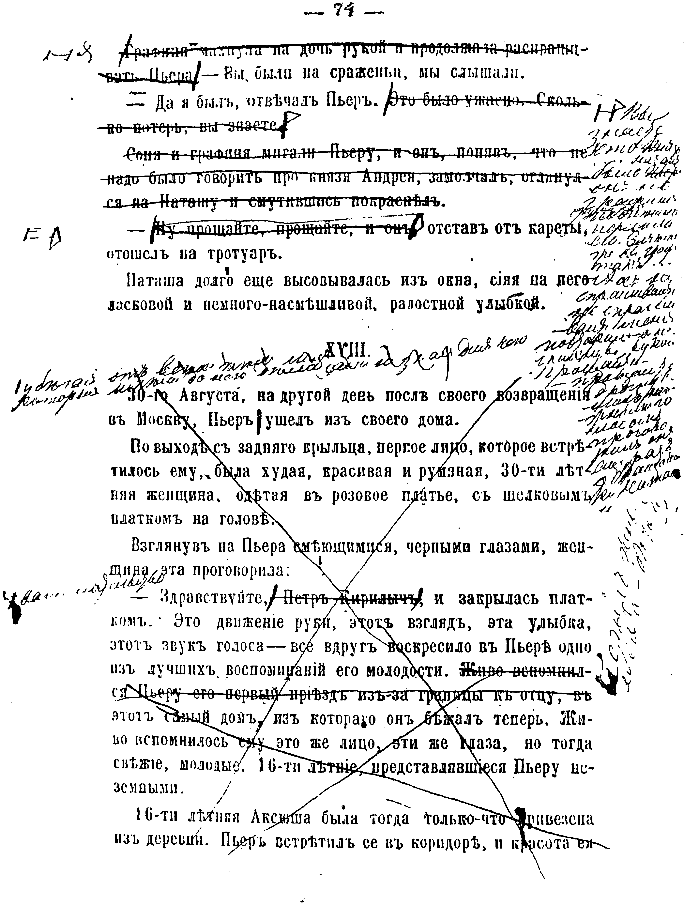
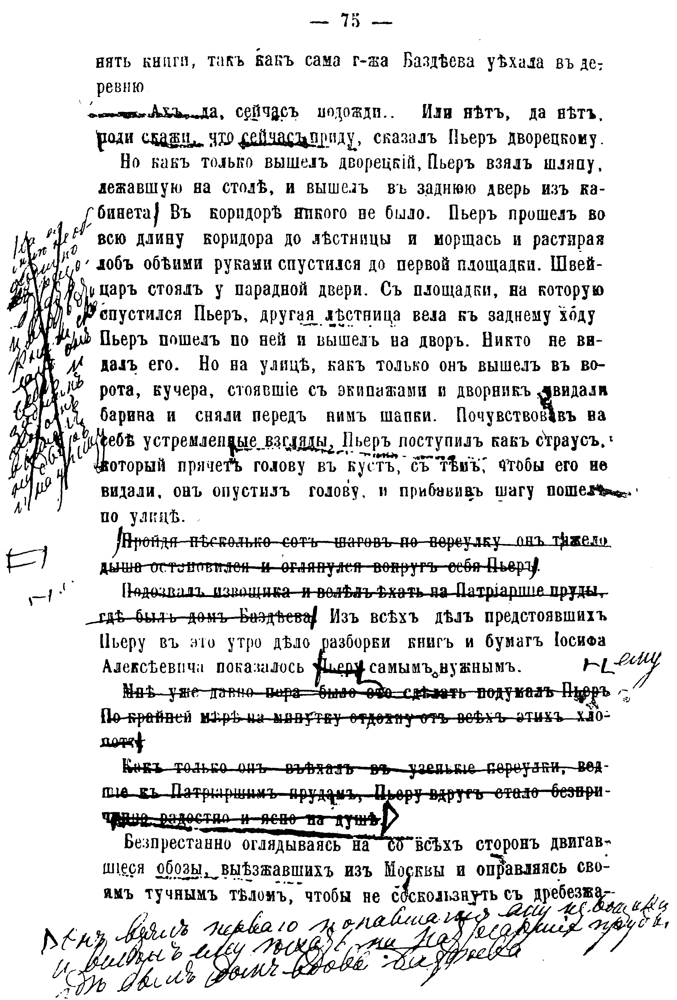

## Tomo III, parte III, capítulo XVII

Pasada la una, los cuatro carruajes de los Rostov, con los caballos enganchados y el equipaje cargado, estaban a la entrada. Las carretas con los heridos iban saliendo del patio una tras otra.

Al pasar frente a la escalinata, la calesa en que llevaban al príncipe Andréi llamó la atención de Sonia, que, junto con una criada, preparaba el asiento de la condesa en su enorme y alto coche, detenido a la entrada.

«¿Y de quién es esa calesa?», preguntó Sonia, asomándose por la ventanilla del coche.

«¿Pues no lo sabía, señorita?», respondió la doncella. «Es el príncipe herido. Pasó la noche aquí y también viene con nosotros».

«Pero ¿quién es? ¿Cómo se apellida?».

«¡El mismísimo que era nuestro novio! ¡El príncipe Bolkonski!», respondió la doncella con un suspiro. «Dicen que se está muriendo».

Sonia saltó del coche y corrió en busca de la condesa. La condesa, ya vestida para el viaje, con chal y sombrero, iba y venía, cansada, por la sala, a la espera de que llegaran los de la casa para sentarse juntos a puerta cerrada y rezar antes de partir. Natasha no estaba en la sala.

«*Maman*», dijo Sonia, «el príncipe Andréi está aquí. Está herido y se está muriendo. Viaja con nosotros».

La condesa abrió mucho los ojos, asustada, agarró a Sonia de la mano y miró a su alrededor.

«¿Natasha?», alcanzó a decir.

Tanto para Sonia como para la condesa, la noticia solo tuvo un significado en el primer momento. Conocían a su Natasha, y el horror de pensar qué le pasaría al enterarse ahogaba en ambas toda compasión por el hombre al que las dos querían.

«Natasha todavía no lo sabe, pero él viaja con nosotros», dijo Sonia.

«¿Dices que se está muriendo?».

Sonia asintió con la cabeza.

La condesa abrazó a Sonia y se echó a llorar.

«¡Los caminos del Señor son inescrutables!», pensó, sintiendo que en todo cuanto sucedía empezaba a manifestarse la Mano Todopoderosa, hasta entonces oculta a los ojos de los hombres.

Prueba de imprenta de la página 74 del quinto tomo de la primera edición de «Guerra y paz» (1868–1869).

(El texto difiere considerablemente del actual.)

*Tamaño del original.*

Última prueba de imprenta de la página 75 del quinto tomo de la primera edición de «Guerra y paz» (1868–1869).

(El texto ya se ha sustituido por una versión cercana a la impresa).

*Tamaño del original*

«Bueno, mamá, ya está todo listo. ¿De qué hablan…?», preguntó Natasha con el rostro animado al entrar corriendo en la sala.

«De nada», dijo la condesa. «Si ya está todo listo, vámonos». Y se inclinó sobre su bolsito para ocultar su semblante turbado. Sonia abrazó a Natasha y la besó.

Natasha la miró con aire interrogante.

«¿Qué te pasa? ¿Qué ha pasado?».

«Nada… no…».

«¿Algo muy malo para mí…? ¿Qué es?», insistía Natasha, tan perceptiva.

Sonia suspiró y no respondió nada. El conde, Petia, *m-me Schoss*, Mavra Kuzmínishna y Vasílich entraron en la sala y, tras cerrar las puertas, todos se sentaron y se quedaron así unos segundos, en silencio, sin mirarse unos a otros.

El conde fue el primero en levantarse y, tras suspirar sonoramente, empezó a santiguarse ante el icono. Todos hicieron lo mismo. Luego el conde se puso a abrazar a Mavra Kuzmínishna y a Vasílich, que se quedaban en Moscú, y, mientras ellos le tomaban la mano y le besaban el hombro, les daba suaves palmadas en la espalda y les decía entre dientes algo cariñoso para tranquilizarlos. La condesa se fue al oratorio, y allí la encontró Sonia, de rodillas ante los iconos que quedaban dispersos por la pared. (Los iconos más preciados por la tradición familiar se los llevaban consigo.)

En la escalinata y en el patio, los que se iban, con los puñales y sables con que los había armado Petia, los pantalones metidos en las botas y los cinturones y las fajas bien ajustados, se despedían de los que se quedaban.

Como siempre al partir de viaje, se habían olvidado muchas cosas y otras se habían acomodado mal, y durante un buen rato dos lacayos aguardaron, uno a cada lado de la portezuela abierta y de los escalones del coche, listos para ayudar a subir a la condesa, mientras las criadas corrían con almohadones y atadillos de la casa a los coches, a la calesa y al birlocho, y de vuelta a la casa.

«¡Se pasarán la vida olvidándose de todo!», decía la condesa. «Bien sabes que así no puedo ir sentada». Y Duniasha, apretando los dientes y sin contestar, con expresión de reproche, se precipitó dentro del coche para arreglar de nuevo el asiento.

«¡Ay, esta gente!», decía el conde, meneando la cabeza.

El viejo cochero Yefim, el único con quien la condesa se atrevía a viajar, sentado en lo alto del pescante, ni siquiera volvía la cabeza para ver qué ocurría a sus espaldas. Por treinta años de experiencia sabía que aún tardarían en decirle «¡Con Dios!», y que, cuando se lo dijeran, todavía lo harían parar dos veces y mandarían a buscar las cosas olvidadas, y que solo después de eso lo harían parar una vez más, y la propia condesa se asomaría por la ventanilla y le pediría, por Cristo nuestro Señor, que fuera con más cuidado en las bajadas. Lo sabía y por eso esperaba lo que había de suceder con más paciencia que sus caballos (sobre todo que Halcón, el alazán de la izquierda, que pateaba el suelo y movía el bocado entre los dientes, masticándolo). Por fin se sentaron todos. Se plegaron los escalones y se alzaron dentro del coche, la portezuela se cerró de golpe, mandaron a buscar el cofrecito y la condesa se asomó y dijo lo que tenía que decir. Entonces Yefim se quitó despacio el sombrero y empezó a santiguarse. El postillón y todos los criados hicieron lo mismo.

«¡Con Dios!», dijo Yefim, poniéndose el sombrero. «¡Adelante!». El postillón puso en marcha el tiro. El caballo de la derecha de la lanza se echó contra la collera, crujieron las altas ballestas y se balanceó la caja del coche. El lacayo saltó al pescante con el coche en marcha. Al salir del patio al empedrado desigual, el coche dio una sacudida, los demás carruajes dieron otra igual y la caravana se puso en marcha calle arriba. En los coches, en la calesa y en el birlocho, todos se santiguaban de cara a la iglesia que quedaba enfrente. Los que se quedaban en Moscú iban a pie a ambos lados de los carruajes para despedir a los que partían.

Rara vez había sentido Natasha una alegría como la que sentía ahora, sentada en el coche junto a la condesa, mirando los muros de la Moscú inquieta que iban dejando atrás y que pasaban lentamente ante ella. De vez en cuando se asomaba por la ventanilla del coche y miraba hacia atrás y hacia adelante, a lo largo de la caravana de heridos que los precedía. Casi a la cabeza de todos alcanzaba a ver la capota cerrada de la calesa del príncipe Andréi. No sabía quién iba en ella, y cada vez que calculaba hasta dónde se extendía su caravana, buscaba con los ojos aquella calesa. Sabía que iba delante de todos.

En Kudrin confluyeron, desde Nikítskaya, desde Presnia y desde Podnovínskoie, varias caravanas como la de los Rostov, y por la Sadóvaya ya avanzaban en dos filas los carruajes y las carretas.

Al rodear la torre Sújarev, Natasha, que observaba con curiosidad y rapidez a la gente que iba en carruaje y a pie, lanzó de pronto un grito de alegría y asombro:

«¡Dios mío! ¡Mamá, Sonia, miren, es él!».

«¿Quién? ¿Quién?».

«¡Miren, por Dios que es Bezújov!», decía Natasha, asomándose por la ventanilla del coche y mirando a un hombre alto y gordo, vestido con un caftán de cochero. Por el paso y el porte se veía que era un señor disfrazado. Llegó al arco de la torre Sújarev al lado de un viejecito amarillento y sin barba, con un capote de frisa.

«¡Por Dios que es Bezújov, con un caftán y con una especie de muchachito viejo! ¡Por Dios!», decía Natasha. «¡Miren, miren!».

«Pero no, no es él. ¡Cómo se te ocurren esas tonterías!».

«¡Mamá!», gritaba Natasha. «Me juego la cabeza a que es él. Se lo aseguro. ¡Para, para!», le gritaba al cochero. Pero el cochero no podía detenerse, porque de la calle Meshchánskaya salían más carretas y carruajes, y les gritaban a los Rostov que avanzaran y no retrasaran a los demás.

En efecto, aunque ya estaba mucho más lejos que antes, todos los Rostov vieron a Pierre, o a un hombre extraordinariamente parecido a Pierre, con un caftán de cochero, que iba por la calle con la cabeza gacha y el semblante serio, al lado de un viejecito menudo y sin barba que tenía aspecto de lacayo. El viejecito advirtió que alguien se asomaba del coche para mirarlo y, tocándole respetuosamente el codo a Pierre, le dijo algo mientras le señalaba el coche. Pierre tardó mucho en entender lo que le decía. Tan absorto estaba, a todas luces, en sus pensamientos. Cuando por fin lo entendió, miró hacia donde le señalaba y, al reconocer a Natasha, se encaminó al instante y a toda prisa hacia el coche, dejándose llevar por la primera impresión. Pero, después de dar unos diez pasos, pareció acordarse de algo y se detuvo.

El rostro de Natasha, asomado por la ventanilla del coche, resplandecía con una ternura burlona.

«¡Piotr Kirílich, venga! ¡Si ya lo reconocimos! ¡Qué cosa tan rara!», gritaba ella, tendiéndole la mano. «¿Cómo es eso? ¿Por qué anda así?».

Pierre tomó la mano que le tendía y, sin dejar de caminar (pues el coche seguía avanzando), se la besó con torpeza.

«¿Qué le pasa, conde?», preguntó la condesa con voz sorprendida y compasiva.

«¿Qué? ¿Qué? ¿Para qué? No me pregunte», dijo Pierre, y se volvió hacia Natasha, cuya mirada radiante de alegría (él lo sentía sin mirarla) lo envolvía con su encanto.

«¿Y usted? ¿Acaso se queda en Moscú?». Pierre guardó silencio un momento.

«¿En Moscú?», dijo en tono interrogativo. «Sí, en Moscú. Adiós».

«¡Ah, cómo quisiera ser hombre! Me quedaría con usted sin falta. ¡Ah, qué lindo sería!», dijo Natasha. «Mamá, déjeme quedarme». Pierre miró distraídamente a Natasha y quiso decir algo, pero la condesa lo interrumpió.

«Estuvo usted en la batalla, según oímos, ¿verdad?».

«Sí, estuve», respondió Pierre. «Mañana habrá otra batalla…», empezó a decir, pero Natasha lo interrumpió:

«Pero ¿qué le pasa, conde? Usted no parece el mismo…».

«Ah, no pregunte, no me pregunte, yo mismo no sé nada. Mañana… ¡Pero no! Adiós, adiós», dijo. «¡Qué tiempos tan terribles!». Y, rezagándose del coche, se apartó hacia la acera.

Natasha siguió largo rato asomada a la ventanilla, radiante, con una sonrisa cariñosa, un poco burlona y llena de alegría, vuelta hacia él.
